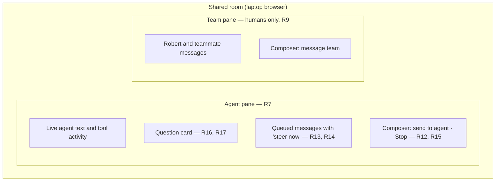
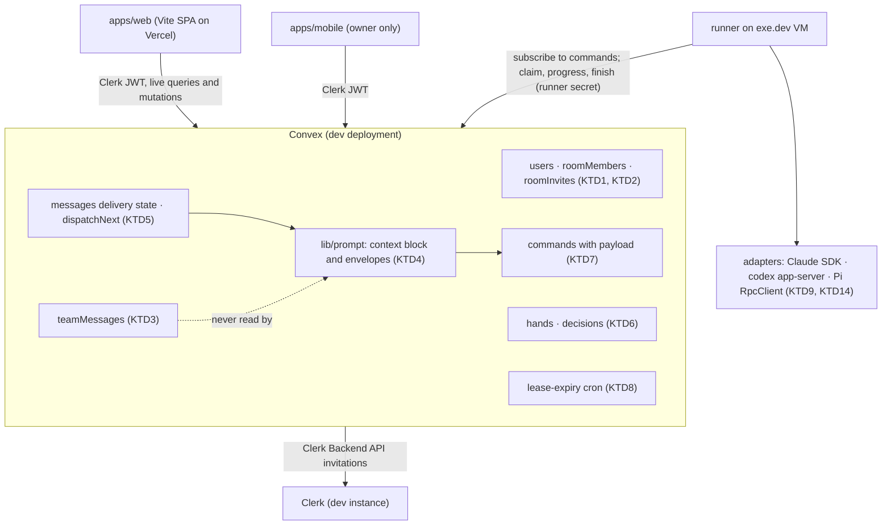
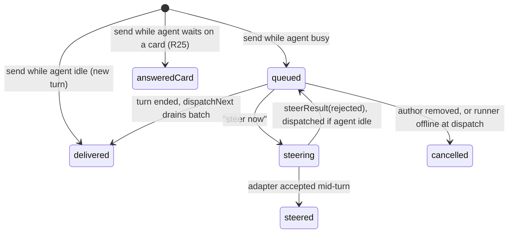
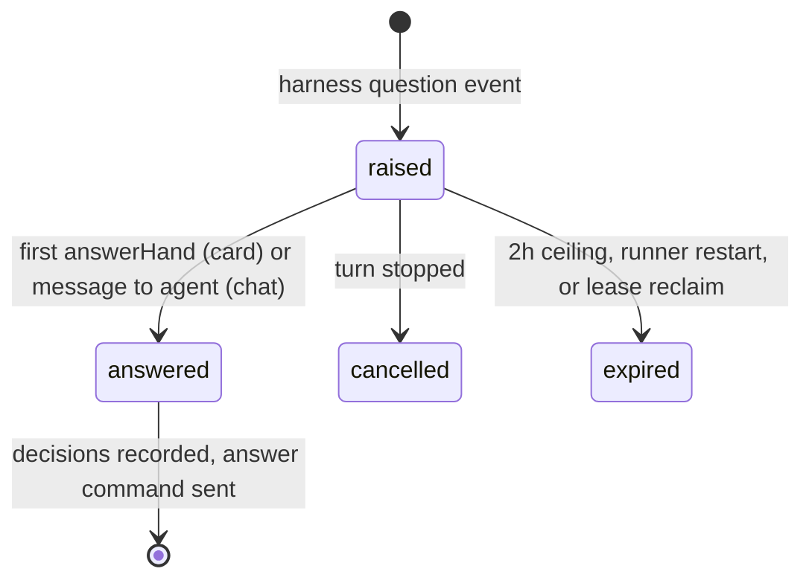
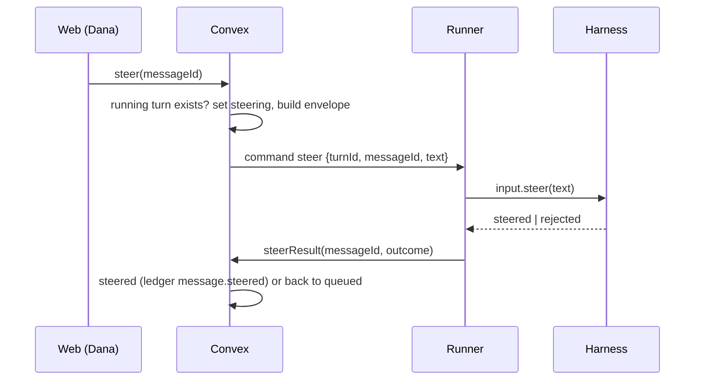

# Shared Rooms - Plan

## Goal Capsule

- **Objective:** Robert and a teammate from another department, at a scheduled session on their laptops, can work through a skill-driven brainstorm or plan with an agent in one Atelier room. They talk to each other by text where the agent cannot hear, and either of them can prompt, steer and answer the same agent.
- **Means:** Convex owns membership, the per-agent message queue, question cards and their decisions (KTD1–KTD6). The runner gains a live input channel into running turns (KTD7). A new `apps/web` is built on t3code's UI layer (KTD10).
- **Product authority:** The Product Contract wins on behavior, the Planning Contract on mechanism, and units override neither. Ambient listening, a Slack bridge and per-action approval cards are not active scope. See How This Work Fits Together.
- **Stop conditions:** Stop and ask Robert if U1 shows Claude cannot take a steered message without stopping its turn (R14), or if any session-settled decision proves unworkable. Do not silently degrade steering to stop-and-resend.
- **Execution profile:** One PR. Start from a commit that contains the uncommitted independent-review (step 4) work now in the working tree. Live harness probes in U1 and the acceptance pass need Robert's VM, where his Claude, Codex and Pi logins live.
- **Who finishes:** `ce-work` implements and verifies locally. Robert runs the two-browser acceptance pass with a real teammate account before merging.
- **Open blockers:** None.

---

## Product Contract

Product Contract preservation: changed R1 (the notice now states the agents' full reach, by Robert's choice of full reach over a restricted tool profile) and R16 and R21 (clarified per harness). Added R25–R30, the behaviors confirmed in the planning synthesis. The old Outstanding Questions are resolved into KTDs. No other scope change.

### Summary

Shared rooms in a web app. Robert invites a teammate to a specific room. The room shows the agent's live work in one pane and a humans-only team chat in the other. Either person can prompt or steer the agent and answer its questions. Each answer is recorded as a decision linked to the team discussion behind it. A per-room switch lets the agent edit files, so skills can write their plans. The work ships as one PR: membership, queue and cards in Convex, a live input channel in the runner's adapters, and a new t3code-style web app on the existing dev backend.

### Problem Frame

Robert regularly works with people in other departments, and the work suits an agent session: running one of his brainstorming or planning skills together, the way two people pair-program. Today the only shared path is a call with Robert's screen shared. Robert types, the other person talks, and Robert relays every answer. Neither of them wants to be on a call.

The awkward moment is the agent's question. A skill stops and asks something, the two people need to talk it over, and only then should one agreed answer reach the agent. In a single chat with the agent, that side discussion would leak into the agent's context. A plain human chat app, meanwhile, can't show what the agent is saying and doing.

Atelier can't support this today. It has exactly one human (an owner email allowlist checked by every user-facing function), rooms have no members, it is iPhone-only, and ordinary turns can't edit files, so a planning skill can't save its plan. The v0 spec lists multiple users and a web or Mac client as non-goals. This work lifts both.

### Actors

- A1. Robert: room owner. Runs the runner on his VM, under his own Claude, Codex and Pi logins.
- A2. Teammate: a person from another department, invited to specific rooms. Signs in with their own account.
- A3. Agents: the room's harness participants (Claude Code, Codex, Pi), running on Robert's runner in the room's folder.

### Key Decisions

- **Two panes side by side; the team pane is invisible to agents.** (session-settled: user-directed — chosen over a single timeline with a team/Claude toggle and over per-question huddles with a shared draft answer: it keeps the agent's work and the human discussion visibly separate.) Governs R6, R9.
- **Text only, scheduled sessions, both people present.** (session-settled: user-directed — chosen over a call or screen share and over drop-in, asynchronous use: sessions are dedicated time slots, so no notifications or presence are needed.) No governed requirement. It bounds scope.
- **Web first; a desktop app wraps it later.** (session-settled: user-directed — chosen over building a desktop app first: web is faster to ship, a teammate opens a link with nothing to install, and a wrapper reuses the same app.) Governs R5, R22.
- **The web app is separate from the Expo app.** (session-settled: user-directed — chosen over Expo web from the same codebase and over making web the primary client: a dense two-pane desktop chat is where react-native-web is weakest, and the v0 spec already reserved `apps/web`.) It shares the Convex backend, Clerk sign-in and runner; the iPhone app is unchanged. Governs R5.
- **Build the web app on t3code's UI layer, not its runtime.** (session-settled: user-directed — chosen over also adopting t3code's Effect-based client runtime and over a stack chosen from scratch: Robert rates t3code's UI highly, and its runtime duplicates what Convex live queries already provide.) Governs R22, R24. The mechanism is KTD10.
- **Served from a static host.** (session-settled: user-directed — chosen over serving from the exe.dev VM publicly or by private share: it stays up when the VM is down, and teammates need only a Clerk login.) Governs R23.
- **Equal driving in the conversation; room setup stays with Robert.** (session-settled: user-approved — chosen over equal rights on everything and over tighter agent permissions for teammates' prompts.) Governs R1, R2, R3.
- **Agents keep their full reach in shared rooms, and the join notice says so.** (session-settled: user-directed — chosen over a restricted shared-room tool profile with no user MCP servers, connectors or extensions, and over excluding Codex: Robert accepts that a teammate can reach anything his agents can.) Governs R1.
- **Queue by default, steer on request.** (session-settled: user-directed — chosen over always injecting, always queuing, and stop-then-redirect: people can talk before they interrupt the agent, and a fast path exists when it heads the wrong way.) Governs R13, R14.
- **A room-level edit switch instead of approval cards.** (session-settled: user-approved — chosen over per-action approval cards, both together, and staying read-only: it is the smallest change that lets skills write their plans.) Governs R21.
- **Answers to agent questions become decisions linked to their discussion.** (session-settled: user-directed — chosen over the recommended web room without linking and over Slack as the team pane: it records why each answer was given, which is the reason the Atelier ledger exists.) Governs R18, R19.

### Requirements

**Membership and access**

- R1. Robert invites a teammate to a specific room. The teammate signs in with their own account and sees only the rooms they belong to. Before entering, they are told three things: team chat and agent activity are recorded permanently, the agents run on Robert's machine, and their prompts can reach anything Robert's agents can, including files outside the room's folder and Robert's connected tools.
- R2. In a room they belong to, a teammate can do everything Robert can do in the conversation: post team chat, prompt any agent in the room, steer, answer agent questions, and stop a turn.
- R3. Only Robert creates rooms, invites and removes members, chooses the room's agents, edits the handbook, sets the edit switch (R21), and starts independent reviews.
- R4. Removing a member ends their access at once. Their earlier messages stay in the room and the ledger.
- R28. An invite is for one room and one email address, and lasts 7 days. Only someone signed in with that email can accept it. Robert can revoke a pending invite.

**Client and delivery**

- R5. Both people can fully use a shared room from a laptop web browser.
- R22. The web app can later be wrapped as a desktop app without a rewrite.
- R23. Teammates reach the web app at a stable public HTTPS address and need only their Atelier sign-in, with no exe.dev account.
- R24. Code borrowed from t3code keeps its MIT copyright and license notice.

**Room layout**

- R6. The room shows an agent pane and a team pane side by side.
- R7. The agent pane shows each agent's work live and identically for both people: streaming text, tool activity, questions, turn status and queued messages.
- R8. Every message in either pane shows who wrote it.
- R27. When Robert's machine is offline, both people see it in the room, and messages to agents are refused instead of being held.
- R29. An agent's streamed text and tool activity stay visible after its turn ends, alongside the final answer.

**Team chat stays human**

- R9. No team-pane message ever reaches an agent: not in a prompt, the room context block, an Atelier MCP tool result, or a resumed session.
- R10. Team-pane messages are stored permanently and written to the ledger like other messages. They cannot be edited or deleted.

**Talking to the agent**

- R11. Each message delivered to an agent carries its author's name, so the agent knows which person said what.
- R12. A message sent to an idle agent starts a turn, as rooms do today.
- R13. A message sent to an agent that is working waits in a queue visible to both people, and goes in, in send order, when the current turn ends.
- R14. Either person can choose "steer now" for a queued or new message. The message then goes into the running turn without stopping it. This works for Claude Code, Codex and Pi.
- R15. Either person can stop an agent's running turn.
- R30. Each turn tells the agent who is in the room and their roles, whether file edits are on, and the room's recent decisions. It also says that a private team channel exists that the agent cannot see.

**Agent questions**

- R16. When a skill running in an agent asks the user a question through the harness's own question prompt, the question appears as a card in the agent pane with its options and a free-text answer. The skill needs no changes. An agent whose harness has no usable question prompt asks in plain text instead, and the room says that this agent can't raise cards.
- R17. Either person can answer a card. The first answer is applied, the card shows who answered and what, and the agent continues with that answer.
- R25. A message sent to an agent that is waiting on its own question card answers that card ("answered in chat") instead of queuing behind it.
- R26. A card left unanswered for 2 hours, or open when Robert's runner restarts, closes with no decision. A late answer can still be sent to the agent as a message.

**Decisions from discussion**

- R18. Each answered question card is recorded in the ledger as a decision: the question, the answer and who answered.
- R19. That decision links to the team-pane messages posted between the question appearing and its answer.

**Agent permissions**

- R21. Each room has an "agents may edit files in this folder" switch. It is off by default, only Robert sets it, and both people can see its state. When it is on, Claude Code, Codex and Pi can edit files in the room's folder without prompting. Commands stay limited to what each harness already allows unprompted: Robert's Claude allow rules, Codex's own safe-command set, and no shell at all for Pi.

### Key Flows

- F1. Teammate joins
  - **Trigger:** Robert invites a teammate to a room before a scheduled session.
  - **Actors:** A1, A2
  - **Steps:** Robert sends the invite. The teammate opens it in a laptop browser, signs in, reads the recording, machine and reach notice, and enters the room. They see that room only.
  - **Covered by:** R1, R3, R5, R28
- F2. Working through a skill together
  - **Trigger:** In a session, Robert asks Claude to run one of his brainstorm or plan skills on a topic.
  - **Actors:** A1, A2, A3
  - **Steps:** Both people watch Claude's output and tool activity in the agent pane. Claude asks a question, which appears as a card. Robert and the teammate discuss it in the team pane. The teammate picks an answer on the card. The answer is recorded as a decision linked to that discussion, and Claude continues. With the edit switch on, the skill writes its plan file in the room's folder.
  - **Covered by:** R7, R9, R16, R17, R18, R19, R21
- F3. Steering mid-turn
  - **Trigger:** Claude is mid-turn and heading somewhere the two people don't want.
  - **Actors:** A1, A2, A3
  - **Steps:** Robert sends a correction to Claude, and it appears as queued. After a quick exchange in the team pane, the teammate chooses "steer now" on Robert's queued message. Claude receives it inside the running turn, attributed to Robert, and adjusts without restarting.
  - **Covered by:** R11, R13, R14

### Acceptance Examples

- AE1. **Covers R13, R11.** Given Claude is running a turn, when the teammate sends Claude a message, then both people see it queued. When the turn ends, it goes in as the next prompt, attributed to the teammate.
- AE2. **Covers R14.** Given a queued message, when Robert chooses "steer now", then the running turn receives it without being stopped or restarted, and it leaves the queue.
- AE3. **Covers R17.** Given an open question card, when Robert and the teammate pick different options moments apart, then only the first answer is applied, and the other person sees the card already answered, with who answered it.
- AE4. **Covers R9.** Given the teammate writes "between us, I think this plan is too big" in the team pane, then that text never appears in any agent's prompt, context block, tool result or later resumed session.
- AE5. **Covers R19.** Given a question appears at 14:10, team messages are posted at 14:11 and 14:13, the answer comes at 14:15, and another team message follows at 14:16, then the decision links the 14:11 and 14:13 messages and not the 14:16 one.
- AE6. **Covers R21.** Given the edit switch is off, when a skill tries to write its plan file, then the write is denied as it is today. With the switch on, the write succeeds. A command outside what the harness already allows unprompted is denied in both cases.
- AE7. **Covers R2, R3.** Given the teammate is in a room, they can stop Claude's turn, and it stops for both people. They have no way to invite anyone, change the agents, edit the handbook, flip the edit switch, or start an independent review.
- AE8. **Covers R4.** Given Robert removes the teammate mid-session, then the teammate loses access to the room at once, and their earlier messages and linked decisions remain.
- AE9. **Covers R25.** Given Claude is waiting on a card, when the teammate sends Claude "go with option B but keep it short", then the card shows "answered in chat by" the teammate, and Claude continues with that text as the answer.
- AE10. **Covers R28.** Given an invite for dana@example.com, when someone signed in as another address opens the link, then they see which address the invite was for (partly masked) and cannot join.
- AE11. **Covers R27.** Given Robert's runner stopped sending heartbeats, then both people see that his machine is offline, and a message sent to Claude is refused with that reason.

### Success Criteria

- Robert and one teammate from another department run a complete brainstorm-skill session from two laptops with no call. Every agent question is discussed in the team pane and answered by one of them, the skill writes its plan into the room's folder, and neither person has to relay messages for the other.
- After that session, the ledger lets a later reader see each answer the agents received alongside the human discussion that produced it.

<!-- ce-section: work-relationships -->
### How This Work Fits Together

This plan covers shared rooms: membership, the two-pane web room, queued and steered messages, question cards, linked decisions and the edit switch. The breakdown below is the current understanding, not a committed roadmap.

- Ambient listening: an agent reads team chat and decides on its own when to change course.
  - Depends on this plan's team pane and steering (R9, R14). It would deliberately relax R9.
  - Still to decide: whether it is wanted at all, given that this plan keeps team chat private by design.
- Slack bridge: team chat mirrored to or from a Slack channel.
  - Depends on the team pane (R10). Can proceed independently of steering.
- Per-action approval cards for edits and commands.
  - Shares the question-card surface (R16). Would extend or replace the edit switch (R21).
- Atelier MCP `raise_hand` (v0 build-order step 5).
  - Shares the question card (R16, R17). Agent-initiated hands could use the same card.

### Scope Boundaries

- Ambient listening, a Slack bridge, and per-action approval cards. See How This Work Fits Together.
- Notifications, presence and typing indicators. Sessions are scheduled with both people present.
- Teammates managing rooms, inviting others, or starting independent reviews. Independent reviews keep their current behavior and stay visible to Robert only, including review follow-ups.
- A team pane on the iPhone app. Robert's phone app keeps working for his rooms and gets only the fixes needed to attribute teammates correctly (U14).
- Forwarding or summarizing team chat into an agent's context.
- The desktop app itself. It comes after the web app and wraps it (R22).
- Considered and not built: a restricted shared-room tool profile. Robert chose full reach (R1). A teammate prompt that misuses a connector would change the call.
- Considered and not built: editing or withdrawing a queued message. Stop and resend covers it in a synchronous session. Repeated mistaken sends in real sessions would change the call.
- Considered and not built: a rich-text (Tiptap) composer. A plain textarea is enough for chat and slash commands. Long structured prompts becoming common would change the call.

#### Deferred to Follow-Up Work

- Moving both apps to a production Convex deployment and a Clerk production instance on a domain Robert owns, with a one-time data migration.
- The Atelier MCP server (`raise_hand`, `read_handbook`, `recent_decisions`), which can reuse the card table and the agent-facing projection from this plan.
- Question cards for Pi through a runner-shipped extension that registers an ask-user tool.
- The Electron desktop wrapper.

### Dependencies / Assumptions

- Teammates are trusted with everything Robert's agents can reach on his machine and through his pre-approved tools and connectors, because Robert chose full reach. Their prompts use Robert's Claude, Codex and Pi subscriptions.
- Both apps stay on the current dev Convex deployment and Clerk dev instance (KTD11). Clerk's dev instance shows a development badge and has user limits, which is acceptable for a few invited teammates.
- The independent-review (step 4) work is uncommitted in the working tree. This plan builds on it.
- Ordinary turns are read-only today: Claude runs in `dontAsk` mode, Codex uses a read-only sandbox with `approvalPolicy: 'never'`, and Pi runs with `--tools read,grep,find,ls`.

### Sources / Research

- `docs/v0-spec.md`: non-goals (multiple users, web or Mac client, peer mode), the room context block, the `hands` and `commands` tables, and build-order step 5.
- `docs/independent-review.md` and `LEARNINGS.md`: blind-until-reveal and per-harness restriction details. These must keep holding for reviews in shared rooms.
- `packages/backend/convex/lib/auth.ts`: the single-owner allowlist (`requireOwner`).
- `packages/backend/convex/messages.ts`: `send` picks the single human participant and always inserts a `run_turn` command, with no in-flight check. `timeline` filters only on `visibility`, so revealed review answers would reach members.
- `packages/backend/convex/runner.ts`: `claim` rejects non-queued turns; `finish` overwrites `harnessSessionId`; `LEASE_MS` is 5 minutes and nothing reclaims expired leases.
- `runner/src/index.ts`: a 30-minute hard deadline per turn, `tool_call` events dropped, and every pending command started at once.
- `runner/src/adapters/claude.ts`, `codex.ts`, `pi.ts`: current ordinary-turn permissions and the single-prompt turn shape.
- Claude Agent SDK 0.3.318 (`runner/node_modules/@anthropic-ai/claude-agent-sdk/sdk.d.ts`): `prompt` accepts `AsyncIterable<SDKUserMessage>`, `SDKUserMessage.priority` is `'now' | 'next' | 'later'` (undocumented), and in `dontAsk` mode `AskUserQuestion` is denied without reaching `canUseTool` (https://code.claude.com/docs/en/agent-sdk/permissions, https://code.claude.com/docs/en/agent-sdk/user-input).
- Codex app-server 0.166.0 (`codex app-server generate-ts`): `turn/steer {threadId, input, expectedTurnId}` fails on a turn-id mismatch. `item/tool/requestUserInput` is experimental, needs `capabilities.experimentalApi`, and is probably limited to Plan collaboration mode.
- Pi 1.4.0 (`runner/node_modules/@earendil-works/pi-coding-agent/dist/modes/rpc/rpc-client.d.ts`): `steer` is delivered after current tool calls and before the next model call. There is no built-in question tool. `edit` and `write` accept absolute paths.
- Clerk: Restricted sign-up mode and Backend API invitations with `redirectUrl` and a `__clerk_ticket` (https://clerk.com/docs/guides/secure/restricting-access, https://clerk.com/docs/guides/users/inviting). Convex: key users on `tokenIdentifier` (https://docs.convex.dev/auth/database-auth).
- https://github.com/pingdotgg/t3code at commit 6577c6b (MIT, © 2026 T3 Tools Inc.): the UI reference. Copyable as-is: `apps/web/src/components/ui/*` (except `sidebar.tsx` and `toast.tsx`, which use `effect/Schema`), `apps/web/src/markdown-incremental.ts`, `apps/web/src/components/chat/markdownStreamBlocks.ts`, `packages/client-runtime/src/state/pendingUserInput.ts`, `apps/web/src/components/RightPanelSheet.tsx` and the `apps/web/src/index.css` tokens. Reference only: `ChatView`, `MessagesTimeline` with its Legend List usage, `timelineViewport.ts`, `useTimelineFollow.ts`, `ComposerPendingUserInputPanel.tsx`, `QueuedRunsControl.tsx`, `TimelineToolActivityIcon.tsx`, and `apps/desktop`. Never copy branding, `Icons.tsx`, `JetBrainsIcons.tsx`, notification sounds or KaTeX fonts.

---

## Planning Contract

### Key Technical Decisions

- KTD1. **Identity is a `users` table keyed on Clerk `tokenIdentifier`, and membership is a separate `roomMembers` row.** A member row holds role (`owner` or `member`), the human participant it maps to, the accepted notice version, and `removedAt`. Participants gain an optional user link. The owner stays defined by `ATELIER_OWNER_EMAILS`. A one-time backfill links each existing room's human participant to Robert's user and creates his owner row. A `requireMember(ctx, roomId)` helper beside `requireOwner` returns the user, member row, participant and owner flag. Keying on email would break when a Clerk email changes, and folding membership into `participants` would make removal (R4) delete authorship. Governs R1–R4.
- KTD2. **Invites are Convex `roomInvites` rows, with Clerk invitations used only to admit new accounts.** An owner-only action creates the row (room, email, hashed token, 7-day expiry, status) and calls Clerk's Backend API `createInvitation` with a `redirectUrl` of `<web>/invite/<token>` when the email has no Clerk account yet. This needs `CLERK_SECRET_KEY` and `ATELIER_WEB_URL` as Convex env vars. Accepting the invite requires a matching token and an email on the signed-in identity that equals the invite's email. Clerk sign-up is set to Restricted mode, so strangers cannot create accounts. A Convex row per room handles second-room invites and revocation, which a Clerk invitation (one per email for the whole app) cannot. Governs R1, R28.
- KTD3. **Team chat lives in its own `teamMessages` table, with its own ledger type `team_message.posted`.** A separate table makes R9 structural: nothing that reads agent messages, builds prompts or serves MCP can touch it by accident. Governs R9, R10.
- KTD4. **Agent-facing text is built only in Convex, through one module (`packages/backend/convex/lib/prompt.ts`).** The module produces two things:
  1. the room context block (R30), with recent decisions projected to `{question, choice, answeredBy, at}`. It never includes `rationale` or team links, and never includes decisions linked to an independent review, which stay Robert-only;
  2. an attribution envelope for each human message: author, role, send time, and whether it was queued or steered. Envelope-looking text in a body is escaped.

  The module lives in the backend, not `packages/shared`, because the backend does not depend on `@atelier/shared` and the runner never sees Clerk identity. Governs R9, R11, R30.
- KTD5. **The queue is enforced in Convex: one active ordinary turn per agent, and queued messages drain together as one prompt.** Messages sent to an agent are stored as `messages` rows with a delivery state (`queued`, `steering`, `steered`, `delivered`, `answeredCard`, `cancelled`) and the turn that delivered them. `answeredCard` is the terminal state of a message that answered an open card (R25).
  - A `dispatchNext(participant)` helper runs inside `send` (when the agent is idle), inside every terminal transition (`finish`, `fail`, `cancel`, lease reclaim), and inside `steerResult(rejected)`.
  - It creates one turn whose prompt is the context block plus every queued message, each in its envelope, in send order. A `steering` message whose target turn is already terminal counts as queued.
  - It applies the same offline rule as `send` (KTD8). When the room's runner is offline, it creates no turn, and it marks the queued messages `cancelled` with the reason "runner offline". That reason is recorded in the ledger and shown in the agent pane.
  - Every steer failure reports `steerResult(rejected)`: the adapter rejecting it, or the runner finding the turn no longer running locally. That returns the message to `queued` and dispatches it if the agent is idle.
  - Review turns stay outside the queue. In rooms with a member, a review or decision follow-up is never batched with other messages (KTD13).

  Draining one message per turn would let the agent act on a message before it sees the correction queued behind it. Governs R12, R13, R27.
- KTD6. **Question cards reuse and extend the `hands` table.** A card holds the harness request id, 1–4 questions (header, text, options, multi-select, free-text allowed), status (`raised`, `answered`, `cancelled`, `expired`), the answers, who answered, when, and how (`card` or `chat`). The turn records `waitingOnHandId`, and its status stays `running`, so the phone and existing status checks keep working. A card is answered as a whole in one first-wins mutation. Each question on it records its own decision, and the `decision.recorded` payload carries the ids of the team messages in the card's window, never their text. Governs R16–R19, R25, R26.
- KTD7. **The runner receives steer, answer, settings and interrupt as `commands` with a payload, routed to the running turn's input channel.** The runner already subscribes to its pending commands. Control commands (every type except `run_turn`) take their own `claim` branch:
  - The branch requires the target turn to be `running` rather than `queued`.
  - It returns the payload without a lease.
  - The runner hands the command to a per-turn handle held next to the existing abort controller, then marks it `done` through a new `commandHandled` mutation, or `failed` if the turn is not running locally.

  The KTD8 lease cron reclaims only `run_turn` commands. An `interrupt` aborts the turn's existing abort signal. `Harness.runTurn` gains an input object with:
  - `steer(text)`, which resolves `steered` or `rejected`;
  - `onQuestion(card)`, which returns the answer;
  - `setEditsEnabled(on)`.

  `HarnessEvent` gains `question` events and id-correlated `tool_call` and `tool_result` events. A per-turn subscription would duplicate the existing claim and lease path. Governs R14–R17, R21.
- KTD8. **Turn lifetime and liveness:**
  - The 30-minute turn deadline pauses while a card is open.
  - A separate 2-hour card ceiling closes the card as `expired` and tells the agent no decision was made (R26).
  - The harness session id is saved when the `session` event arrives, not only at `finish`, so a first turn interrupted mid-question can be resumed.
  - The `run_turn` lease is renewed by the existing progress loop for as long as the turn is running, including while it waits on a card.
  - A Convex cron scans for claimed `run_turn` commands whose lease has expired, meaning renewal has stopped. It fails their turns as interrupted, expires their cards, and runs `dispatchNext`.
  - Members can read the runner's `lastHeartbeatAt`. The web app treats more than 45 s without a heartbeat as offline, and `send` refuses with the same rule.

  Governs R26, R27.
- KTD9. **What the edit switch does in each harness:**
  - **Claude.** `permissionMode: 'default'` in both states. Not `acceptEdits`, which would auto-approve `rm`, `mv`, `cp` and `sed` in the folder without Robert's allow rules (R21). A runner-owned `canUseTool`:
    - turns `AskUserQuestion` into a card;
    - allows Edit/Write/NotebookEdit inside `cwd` only while the switch is on;
    - denies everything else that reaches it.

    Every unapproved edit reaches the callback, which reads the switch live through `setEditsEnabled`, so switching off applies immediately with no mode change.
  - **Codex.** Switch off: today's read-only sandbox with `approvalPolicy: 'never'`. Switch on: `workspaceWrite` with `writableRoots: [cwd]`, network off, and `approvalPolicy: 'untrusted'`. The runner declines command approvals and accepts file-change approvals under `cwd`.
  - **Pi.** Switch on adds `edit,write` to `--tools`, plus a runner-shipped extension that blocks edits outside `cwd`.
  - **Protected paths, all three harnesses.** Even inside `cwd`, edits are denied to harness and repository control files: `.claude/`, `.mcp.json`, `.codex/`, `.pi/`, `.agents/` and `.git/`. Paths are checked after resolving symlinks. Otherwise an agent could write an allow rule, hook or extension and run commands next turn, which breaks R21's command limit. For Codex, U1 confirms that `workspaceWrite` keeps these read-only or routes them through file-change approval. If neither holds, stop and ask Robert before enabling Codex edits.
  - **Turning the switch off.** It interrupts running Codex and Pi turns, which fix their permissions when a turn starts. Claude picks up the change live.
  - Each turn snapshots the switch state for audit.

  `dontAsk` cannot stay, because it denies `AskUserQuestion` before the callback runs. Governs R16, R21.
- KTD10. **The web app copies t3code's UI layer onto Convex.**
  - **Stack.** A Vite + React 19 + TypeScript SPA with file-based TanStack Router and Tailwind v4. shadcn `base-mira` on Base UI (`components.json` with the `@coss` registry), lucide icons, `react-markdown` + `remark-gfm` with t3code's incremental streaming split, and stock `@legendapp/list` for the agent timeline. A plain textarea composer.
  - **Data.** Convex hooks through `ConvexProviderWithClerk`.
  - **Copied files.** They keep the MIT notice in a header and in `apps/web/THIRD_PARTY_NOTICES.md`.
  - **Wrappable later.** Clerk sits behind one shell module, the build is fully static, config comes from `VITE_*` env, and there are no popups or host-specific URLs, as t3code does for its Electron shell.

  Stock Vite is used rather than t3code's `vite-plus` to match the repo's existing toolchain. Governs R5, R6, R22, R24.
- KTD11. **Both apps stay on the current dev Convex deployment and Clerk dev instance, and the web app deploys to Vercel.** (session-settled: user-directed — chosen over moving both apps to production with a domain and data migration now: it works for a few invited teammates with no migration, and keeps the phone and web on one database.) t3code also deploys its web app to Vercel. A `vercel.json` SPA rewrite and a turbo `build` task are added. Governs R23.
- KTD12. **Persist streamed text and tool activity after a turn ends.** `partialText` is kept on finish instead of being replaced, and tool activity is stored as small `turnItems` rows (name, one-line summary, ok, sequence). Raw tool output stays on the runner's disk, as the spec's data split requires. Governs R7, R29.
- KTD13. **Owner-only isolation is enforced in queries, using the role from `requireMember`.** For members, the agent-pane query excludes ritual-linked messages and turns, revealed review answers, and turns whose prompt came from a review follow-up. It never returns `turns.prompt`. All `rituals.*`, `push.*` and `runners.list` stay `requireOwner`. The single-human `.find(p => p.kind === 'human')` calls resolve the caller's own participant instead.

  Hiding follow-ups in queries isn't enough, because the agent remembers them. In rooms with a member, a review or decision follow-up runs alone, on a separate harness session stored on its ritual and never written back to the participant's ordinary session id. Solo rooms keep today's behavior. (session-settled: user-approved — chosen over letting follow-ups continue the ordinary session with the join notice warning that review content can surface: keeps reviews Robert-only, at the cost of follow-up context not carrying into the agent's ordinary conversation in shared rooms.) Governs R3, R9.
- KTD14. **Harness capability gaps are decided by a spike (U1), with fixed rules for what follows:**
  - **Claude steering.** If a message pushed with `priority: 'now'` mid-turn is folded in without ending the turn, steering uses it. Otherwise stop and ask Robert, per the Goal Capsule.
  - **Codex question cards.** If `requestUserInput` only fires in Plan collaboration mode, Codex is not switched into Plan mode. It asks in plain text, and the room marks it as unable to raise cards (R16).
  - **Pi.** Pi always asks in plain text. Its adapter answers any `extension_ui_request` with `cancelled`, by writing to the child's stdin, so an extension cannot hang a turn.

  Governs R14, R16.

### High-Level Technical Design

Component boundaries. Convex holds every rule, the runner moves bytes, and the web app and phone are views.

How a message to an agent moves through delivery states (KTD5):

Question card lifecycle (KTD6, KTD8):

Steer, sequence across the three processes (KTD7):

### Assumptions

- Convex functions can't read the clock reactively, so the offline rule (KTD8) runs on the client from `lastHeartbeatAt`, plus a matching check in `send`.
- Clerk's dev instance supports Restricted sign-up and invitations on a non-localhost Vercel domain. U12's execution note verifies this before U13 relies on it.

---

## Implementation Units

| U-ID | Title | Files touched (primary) | Depends on |
|---|---|---|---|
| U1 | Harness capability spike | `runner/scripts/spikes/*`, `LEARNINGS.md` | — |
| U2 | Identity, membership and invites | `convex/schema.ts`, `convex/lib/auth.ts`, `convex/members.ts`, `convex/invites.ts`, `convex/me.ts`, `convex/rooms.ts` | — |
| U3 | Owner-only isolation and multi-human fixes | `convex/messages.ts`, `convex/rituals.ts`, `convex/rooms.ts` | U2 |
| U4 | Team chat backend | `convex/team.ts`, `convex/schema.ts` | U2 |
| U5 | Agent queue, context block, liveness | `convex/agent.ts`, `convex/lib/prompt.ts`, `convex/lib/dispatch.ts`, `convex/runner.ts`, `convex/crons.ts` | U2, U3 |
| U6 | Question cards and decisions backend | `convex/hands.ts`, `convex/schema.ts`, `convex/runner.ts` | U5 |
| U7 | Edit switch backend | `convex/rooms.ts`, `convex/runner.ts` | U5 |
| U8 | Runner live channel and harness interface | `packages/shared/src/harness.ts`, `runner/src/turns.ts`, `runner/src/index.ts` | U5, U6, U7 |
| U9 | Claude adapter | `runner/src/adapters/claude.ts` | U1, U8 |
| U10 | Codex adapter | `runner/src/adapters/codex.ts` | U1, U8 |
| U11 | Pi adapter | `runner/src/adapters/pi.ts`, `runner/src/adapters/pi-guard-extension.*` | U1, U8 |
| U12 | Web app scaffold | `apps/web/*`, `turbo.json`, `pnpm-workspace.yaml` | U2 |
| U13 | Web room UI | `apps/web/src/routes/*`, `apps/web/src/components/*` | U4, U5, U6, U7, U12 |
| U14 | Phone compatibility fixes | `apps/mobile/src/app/room/[id].tsx`, `apps/mobile/src/app/index.tsx` | U2, U5, U6 |
| U15 | Docs and operational notes | `docs/v0-spec.md`, `docs/independent-review.md`, `LEARNINGS.md`, `docs/shared-rooms.md` | all |

### U1. Harness capability spike

**Goal:** Settle the three unverified harness behaviors before adapter work, and record the results.

**Requirements:** R14, R16, R21. Feeds KTD9 and KTD14.

**Dependencies:** None.

**Files:**
- Create: `runner/scripts/spikes/claude-steer.ts`, `runner/scripts/spikes/codex-input.ts`, `runner/scripts/spikes/pi-guard.ts`
- Modify: `LEARNINGS.md`

**Approach:**
1. **Claude.** Use a streaming-input `query()` in a scratch directory. While a long tool call runs, push an `SDKUserMessage` with `priority: 'now'`, and observe whether it folds in without a `result`. Separately, check that `AskUserQuestion` and an unapproved in-folder Write both reach `canUseTool` under `default` mode, and that a returned `updatedInput.answers` resumes the turn.
2. **Codex.** Initialize with `experimentalApi`. Check whether `item/tool/requestUserInput` fires in Default mode. Check `turn/steer` mid-turn and with a stale `expectedTurnId`. Check that `workspaceWrite` with `untrusted` produces command approval requests the runner can decline. Check that writes under `.git/` and `.codex/` are either read-only or arrive as file-change approvals (KTD9 protected paths).
3. **Pi.** Check `steer` mid-tool. Check that a `--extension` hook can block `edit` and `write` outside `cwd` while user extensions still load.
4. Record each outcome and its consequence for KTD14 in `LEARNINGS.md`. Stop per the Goal Capsule if the Claude steering check fails.

**Execution note:** This runs live against Robert's harness logins on the VM, in a throwaway directory. It is exploratory, so do not merge the spike scripts as product code.

**Patterns to follow:** The live probes recorded in `LEARNINGS.md` "Independent review (step 4)", and `runner/src/adapters/smoke.test.ts`.

**Test scenarios:** Test expectation: none -- exploratory spike. Its outputs are the recorded LEARNINGS entries that U9–U11 test against.

**Verification:** `LEARNINGS.md` has a dated entry per harness. Each entry states the observed behavior and which KTD14 branch applies.

### U2. Identity, membership and invites

**Goal:** Let invited teammates sign in and reach only their rooms, while Robert keeps owner powers.

**Requirements:** R1, R2, R3, R4, R28. KTD1, KTD2, KTD11.

**Dependencies:** None.

**Files:**
- Modify: `packages/backend/convex/schema.ts`, `packages/backend/convex/lib/auth.ts`, `packages/backend/convex/me.ts`, `packages/backend/convex/rooms.ts`
- Create: `packages/backend/convex/users.ts`, `packages/backend/convex/members.ts`, `packages/backend/convex/invites.ts`, `packages/backend/convex/migrations.ts`
- Test: `packages/backend/tests/membership.test.ts`

**Approach:**
1. Add the `users`, `roomMembers` (by room, by user, by room and user) and `roomInvites` (by room, by token hash) tables, an optional `userId` on `participants`, and a notice version constant.
2. `users.ensure` (called on sign-in) upserts by `tokenIdentifier`.
3. Add `requireMember` to `lib/auth.ts`. Keep `requireOwner` as it is.
4. `rooms.list` returns only the caller's rooms, through an index. It adds `role` and keeps the existing fields for the owner. `rooms.access(roomId)` returns `owner`, `member`, `removed` or `none`, so the web app can route without hitting errors.
5. Invite functions:
   - `invites.create` (owner-only action) inserts the row and calls Clerk `createInvitation` when no Clerk user exists for that email.
   - `invites.revoke` also revokes the pending Clerk invitation.
   - `invites.lookup(token)` returns the room name, the partly masked invited email, the status (`pending`, `expired`, `revoked` or `accepted`), and whether the caller's email matches. It reveals nothing without a valid token.
   - `invites.accept(token)` checks expiry, status and the email match, creates the member row and a human participant for the user, and records `member.joined` in the ledger.
   - `members.acceptNotice` stores the notice version on the member row.
6. `members.remove` (owner) sets `removedAt`, cancels the removed person's queued messages, and records `member.removed`.
7. A one-time internal migration backfills Robert's user, links his human participants, and creates his owner rows. It is safe to run twice.
8. `me.get` adds `userId` and keeps `isOwner`.

**Patterns to follow:** `lib/ledger.ts` `record` in the same transaction. The owner identity mocking in `packages/backend/tests/review.test.ts`.

**Test scenarios:**
- Covers AE7. A member identity can call `rooms.get` for its room but gets `access: none` for another room. It fails on `rooms.addParticipant`, `rituals.begin`, `invites.create` and the edit switch mutation.
- Covers AE10. `invites.accept` with a valid token but a different verified email is rejected. `invites.lookup` for that caller returns the masked invited email with `matches: false`.
- `invites.lookup` with an unknown token returns nothing about any room.
- An expired or revoked invite is rejected, and the invite row's status says why.
- A second-room invite for an existing user creates a second member row without a Clerk invitation call (the Clerk API is mocked).
- Covers AE8. After `members.remove`, the member's next `rooms.get` throws and `rooms.access` returns `removed`. Their earlier messages are still returned to the owner, and their queued messages are `cancelled`.
- The backfill run twice leaves exactly one owner member row per room.
- `rooms.list` for the owner returns the same fields mobile reads today.

**Verification:** Backend tests pass. A manual sign-in with a second Clerk dev account sees no rooms until it accepts an invite.

### U3. Owner-only isolation and multi-human fixes

**Goal:** Keep reviews and owner data hidden from members, and stop the code from assuming one human.

**Requirements:** R3, R8, R9. KTD13.

**Dependencies:** U2.

**Files:**
- Modify: `packages/backend/convex/messages.ts`, `packages/backend/convex/rituals.ts`, `packages/backend/convex/rooms.ts`
- Test: `packages/backend/tests/isolation.test.ts`, `packages/backend/tests/review.test.ts`

**Approach:**
1. Replace `requireOwner` in `messages.timeline`, `messages.send`, `messages.cancel` and `rooms.get` with `requireMember`. Cancelling a turn that has a `ritualId` stays owner-only.
2. For members, `timeline` and the new agent-pane query (U5) exclude messages and turns with a `ritualId`, plus messages and turns created by review or decision follow-ups. They never include `turns.prompt`. `decisionId` and `reviewTurnId` on `send` are owner-only arguments.
3. In rooms with a member, a follow-up `send` creates its own turn, which is not batched, with a session stored on the ritual. `claim` resumes that session, and `finish` saves to it instead of the participant's ordinary `harnessSessionId`.
4. Hide the `readyReviews` count from members in `rooms.list`.
5. Resolve the caller's own participant in `send`, `cancel`, and the owner paths in `rituals.ts`. Record `actorParticipantId` on `turn.interrupted` (who stopped it).

**Patterns to follow:** The `JSON.stringify(...).not.toContain('SECRET')` assertions in `packages/backend/tests/review.test.ts`.

**Test scenarios:**
- After a review is revealed, a member's `timeline` contains no review answer text, while the owner's still does.
- A review follow-up sent by the owner, and the agent's reply to it, are absent from the member's view.
- In a room with a member, a follow-up turn resumes and saves a session on the ritual. The participant's ordinary session id is unchanged, so the next member-prompted turn resumes a session that never saw the review answer.
- A follow-up queued behind a teammate's message drains as its own turn, not in the same batch.
- In a solo room, a follow-up still continues the ordinary session as today.
- A member cannot cancel a review turn.
- A message sent by the teammate is authored by the teammate's participant, not Robert's.
- The existing `review.test.ts` blind-until-reveal tests stay green unchanged.

**Verification:** Backend tests pass. Owner behavior on the phone is unchanged.

### U4. Team chat backend

**Goal:** A humans-only chat per room that nothing agent-facing can read.

**Requirements:** R8, R9, R10. KTD3.

**Dependencies:** U2.

**Files:**
- Modify: `packages/backend/convex/schema.ts`
- Create: `packages/backend/convex/team.ts`
- Test: `packages/backend/tests/team.test.ts`

**Approach:** Add a `teamMessages` table (room, author user, author participant, body, by room). `team.list(roomId)` and `team.post(roomId, body)` require membership. Posting records `team_message.posted`, and the ledger payload holds the message id, not the body. Nothing supports editing or deleting.

**Patterns to follow:** `messages.send`, and the ledger use in `rooms.create`.

**Test scenarios:**
- Both the owner and a member can post and list. A non-member and a removed member are rejected.
- An empty or whitespace-only body is rejected.
- No mutation exists to edit or delete a team message (an assertion on the API surface).

**Verification:** Backend tests pass.

### U5. Agent queue, context block and liveness

**Goal:** One active turn per agent, with queued messages drained together, attributed prompts, the room context, and recovery from a dead runner.

**Requirements:** R11, R12, R13, R15, R27, R30, R9. KTD4, KTD5, KTD8.

**Dependencies:** U2, U3.

**Files:**
- Create: `packages/backend/convex/lib/prompt.ts`, `packages/backend/convex/lib/dispatch.ts`, `packages/backend/convex/agent.ts`, `packages/backend/convex/crons.ts`
- Modify: `packages/backend/convex/schema.ts`, `packages/backend/convex/messages.ts`, `packages/backend/convex/runner.ts`
- Test: `packages/backend/tests/queue.test.ts`, `packages/backend/tests/prompt.test.ts`

**Approach:**
1. Add to `messages`: `toParticipantId`, `delivery`, `deliveredTurnId`. Add to `turns`: `requestedByParticipantIds`, `editsEnabled`, `waitingOnHandId`. Add `payload` on `commands`, with new command types `steer`, `answer` and `settings`. Add a `by_room_type` index on the ledger and use it instead of scanning the whole room's ledger.
2. `lib/prompt.ts` builds the context block and the envelopes per KTD4. Recent decisions are read through a single `agentDecisions` projection helper.
3. `send` routes through `dispatch.ts`:
   - If the runner is offline (KTD8), refuse.
   - If the agent is waiting on a card, answer the card (handled in U6).
   - If the agent is idle, create the turn now.
   - Otherwise store the message as `queued`.
4. `dispatchNext(participantId)` is called from `finish`, `fail`, `failTurn`, `cancel`, lease reclaim and `steerResult(rejected)`, and follows KTD5's rules (offline cancellation, stale `steering` rows). It takes all queued messages for the agent, creates one turn with them, marks them `delivered`, and inserts one `run_turn` command.
5. `agent.steer(messageId)` and the runner-facing `steerResult` follow the state diagram.
6. In `runner.ts`:
   - Add the KTD7 control-command branch to `claim` and the `commandHandled` mutation.
   - Restrict the lease cron to `run_turn` commands.
7. `agent.pane(roomId)` returns, for members, the agent messages with delivery state, the turns with `partialText`, `turnItems` and status, the open cards, per-agent status, the edit switch, and `lastHeartbeatAt`, with the U3 exclusions applied.
8. `crons.ts` runs the lease-expiry scan every minute.
9. `finish` keeps `partialText` (KTD12). A new `sessionStarted` runner mutation saves the harness session id as soon as the runner sees it. Today it is only saved at finish.

**Technical design:** Directional only. `dispatchNext` is one transaction: read the queued messages for the participant in send-time order, then insert the turn and its command, then patch the messages, then write the ledger rows (`turn.queued`, with the message ledger ids as payload).

**Patterns to follow:** `reviewFinished` in `lib/review.ts`, which shows a side effect running in the same transaction as the terminal transition.

**Test scenarios:**
- Covers AE1. With Claude running, a teammate's send creates no command. When the turn finishes, exactly one new turn exists whose prompt contains the teammate's envelope.
- Two messages from different authors queued during a turn drain into one prompt, in send order, each attributed.
- A message with a forged envelope line in its body appears escaped, attributed to its real author.
- Covers AE4. A team message containing a unique token never appears in any `turns.prompt`, command payload or context block. The test covers a resumed turn and a turn after a decision linked to that message.
- The context block names both members and their roles, the edit switch state, and the private-channel sentence, and holds no `rationale` text.
- Review turns are neither blocked by nor drained into the ordinary queue.
- Covers AE11. With `lastHeartbeatAt` older than 45 s, `send` is rejected with an offline reason.
- The lease cron fails a turn whose claim expired. With the runner still heartbeating, the queued messages behind it are dispatched.
- The lease cron on a runner with a stale heartbeat cancels the queued messages with reason "runner offline" and inserts no command.
- A turn waiting on a card for 10 minutes, with the progress loop renewing its lease, is not reclaimed (fake timers).
- `claim` on a `steer` command for a running turn returns the payload. On a queued or finished turn, the command fails.
- `steer` when no turn is running dispatches normally.
- `steerResult(rejected)` after the turn finished returns the message to `queued` and dispatches it at once, without waiting for another send.
- Stopping a turn records who stopped it, and the next prompt says the previous turn was stopped and by whom.

**Verification:** Backend tests pass, and the phone still sends and streams a turn.

### U6. Question cards and decisions backend

**Goal:** Cards that either person can answer exactly once, with each answer recorded as a decision linked to the discussion.

**Requirements:** R16, R17, R18, R19, R25, R26. KTD6, KTD8.

**Dependencies:** U5.

**Files:**
- Modify: `packages/backend/convex/schema.ts`, `packages/backend/convex/runner.ts`, `packages/backend/convex/lib/dispatch.ts`
- Create: `packages/backend/convex/hands.ts`
- Test: `packages/backend/tests/hands.test.ts`

**Approach:**
1. Extend `hands` per KTD6, and `decisions` with `handId`, `questionId` and `answeredByParticipantId`.
2. Runner mutations:
   - `raiseHand(turnId, requestId, questions)` creates the card and sets `waitingOnHandId`.
   - `handTimedOut` handles the 2-hour ceiling, raised from the runner's timer.
3. `hands.answer(handId, answers)` requires membership and first-wins on status `raised`. It records one `decision.recorded` per question, with team message ids from the `teamMessages` window between `raisedAt` and now. It writes `hand.answered`, inserts an `answer` command with the answerer's name, and clears `waitingOnHandId`.
4. The chat path from U5 calls the same internal function with `via: 'chat'` and the message text as a free-text answer.
5. `cancel`, `recover` and the lease cron set open cards to `cancelled` or `expired` in the same transaction, recording `hand.cancelled` or `hand.expired`, with no decision.

**Patterns to follow:** The ledger writes for `rituals.decide`.

**Test scenarios:**
- Covers AE3. Two `answer` calls on the same card: the first succeeds, and the second returns "already answered by Robert" and creates no second decision or command.
- Covers AE5. Team messages at 14:11 and 14:13 are linked, and the one at 14:16 is not (fake timers).
- Covers AE9. A message to an agent waiting on a card resolves the card with `via: 'chat'` and the message as the answer. No new turn is created.
- A four-question card answered once records four decisions that share the same team message links.
- Stopping a turn with an open card sets it to `cancelled` and records no decision.
- A runner restart sets the card to `expired`. A later message to that agent starts a normal turn.
- A removed member's `answer` is rejected.
- The context block's recent decisions show question, choice and answerer only, with no team message text, and leave out decisions recorded on an independent review.

**Verification:** Backend tests pass.

### U7. Edit switch backend

**Goal:** An owner-only, per-room edit switch that turns carry and the runner applies.

**Requirements:** R3, R21. KTD9.

**Dependencies:** U5.

**Files:**
- Modify: `packages/backend/convex/schema.ts`, `packages/backend/convex/rooms.ts`, `packages/backend/convex/runner.ts`
- Test: `packages/backend/tests/editSwitch.test.ts`

**Approach:**
1. Add an optional `editsEnabled` field to `rooms`.
2. `rooms.setEditsEnabled(roomId, on)` is owner-only and records `room.edits_changed`.
3. `claim` returns the room's current value, and the turn snapshots it.
4. On each change, insert a `settings` command for each running turn in the room.
5. When the switch goes off, insert an `interrupt` command for running Codex and Pi turns.

**Patterns to follow:** `rooms.addParticipant`.

**Test scenarios:**
- A member calling `setEditsEnabled` is rejected.
- Turning the switch on mid-turn sends `settings` to a running Claude turn and does not interrupt it.
- Turning it off mid-turn sends `interrupt` for running Codex and Pi turns and `settings` for Claude.
- A new turn's `editsEnabled` snapshot matches the room at dispatch.

**Verification:** Backend tests pass.

### U8. Runner live channel and harness interface

**Goal:** Running turns can receive steers, answers, settings and stops from Convex, and report questions and tool activity back.

**Requirements:** R7, R14, R15, R16, R17, R21, R26, R29. KTD7, KTD8, KTD12.

**Dependencies:** U5, U6, U7.

**Files:**
- Create: `runner/src/turns.ts`
- Modify: `packages/shared/src/harness.ts`, `runner/src/index.ts`, `runner/src/adapters/events.ts`, `runner/package.json` (add the new test to the `test` script)
- Test: `runner/src/turns.test.ts`

**Approach:**
1. Extend `TurnRequest` with `editsEnabled` (replacing the unused `readOnly` for ordinary turns) and add the input object from KTD7.
2. Extend `HarnessEvent` with `question` and with id-correlated `tool_call` and `tool_result`.
3. Move command and turn handling out of `index.ts` into `runner/src/turns.ts`. It takes the Convex client, secret and harness map as parameters, so it can be tested without the real environment and Convex connection that `index.ts` sets up on import. In it:
   - Route claimed control commands to the per-turn handle and report `commandHandled`. If a command's turn isn't running locally, mark it failed. For a `steer`, also report `steerResult(rejected)`.
   - Forward `tool_call` and `tool_result` events, throttled with the existing 500 ms flush, as `turnItems`.
   - Persist the session id on the first `session` event.
   - Pause the 30-minute deadline while a question is pending, and arm the 2-hour card ceiling.
   - Report `steerResult`.
4. `progress` must keep returning true for a running turn that has `waitingOnHandId`.

**Patterns to follow:** The `running` map and abort plumbing in `runner/src/index.ts`, and `eventQueue` in `runner/src/adapters/events.ts`.

**Test scenarios:**
- A fake harness that emits `question` makes the runner call `raiseHand`. An `answer` command resolves the harness's pending `onQuestion` with the payload.
- A `steer` command for a turn that isn't running locally is marked failed, `steerResult(rejected)` is reported, and no harness call is made.
- An `interrupt` command aborts the running turn's signal, and the turn ends interrupted.
- While a question is pending, the turn is not aborted at the 30-minute deadline (fake timers). It is resolved as expired at 2 hours.
- `tool_call` events reach Convex as `turnItems` with summaries, and raw tool output is not sent.
- The session id is persisted before the turn finishes.

**Verification:** `turns.test.ts` runs in the runner test gate and passes with a fake harness and a fake Convex client.

### U9. Claude adapter

**Goal:** Claude turns support steering, question cards, live edit permissions and tool activity.

**Requirements:** R14, R16, R17, R21, R7. KTD9, KTD14.

**Dependencies:** U1, U8.

**Files:**
- Modify: `runner/src/adapters/claude.ts`
- Test: `runner/src/adapters/claude.test.ts`

**Approach:**
1. Ordinary turns pass an async-iterable prompt: the first message, then steers pushed with the priority U1 confirmed.
   - Each steer carries a uuid. `steer()` resolves `steered` only when that uuid's fold echo appears before `result`.
   - At `result`, any steer not yet folded is withdrawn and resolved `rejected`, so Convex re-queues it.
   - Then close the input, or the `for await` never ends.
2. Replace `dontAsk` with KTD9's `default` mode and `canUseTool` broker, including the protected-path denial.
3. `AskUserQuestion` emits a `question` event and awaits `onQuestion`. It returns `updatedInput {questions, answers}`, keyed by question text, with the answerer's name in `annotations[q].notes`.
4. Emit `tool_call` events with the tool-use id, and `tool_result` events from user messages.
5. The review branch (`tools: []`, `strictMcpConfig`, deny hook) stays byte-for-byte separate.

**Execution note:** Add a fake `pathToClaudeCodeExecutable` stream-json emulator first. There is no Claude adapter test today.

**Patterns to follow:** The fake-executable protocol tests in `runner/src/adapters/codex.test.ts`.

**Test scenarios:**
- A fake CLI that issues an `AskUserQuestion` permission request receives `updatedInput.answers` mapping the question text to the chosen label.
- With the switch off, a Write request is denied. With it on, a Write inside `cwd` is allowed and one outside `cwd` is denied.
- A Bash request that isn't pre-approved is denied in both states.
- With the switch on, a Write to `.claude/settings.local.json` and a Write to `.git/hooks/pre-commit` are denied.
- A steer pushed mid-turn appears in the CLI's stdin as a user message with the expected priority and a uuid. It resolves `steered` when the fake CLI echoes the fold, and the query still ends after `result`.
- When the fake CLI emits `result` before folding a pushed steer, that steer resolves `rejected`.
- `setEditsEnabled(false)` mid-turn makes the next Write request deny. Every unapproved Write reaches `canUseTool` in `default` mode, so the fake CLI's permission request matches real behavior.
- Review-mode options are unchanged (snapshot of the options object).

**Verification:** Runner tests pass. A live Claude check reproduces F2 with a scripted skill question.

### U10. Codex adapter

**Goal:** Codex turns support steering, interrupt, edit permissions, tool activity, and question cards where U1 found them available.

**Requirements:** R14, R15, R16, R21, R7. KTD9, KTD14.

**Dependencies:** U1, U8.

**Files:**
- Modify: `runner/src/adapters/codex.ts`
- Test: `runner/src/adapters/codex.test.ts`

**Approach:**
1. Send `capabilities: {experimentalApi: true, requestAttestation: false}` in `initialize`.
2. Keep the `turn.id` from `turn/start`. Steer with `turn/steer {threadId, input, expectedTurnId}`, and report a precondition failure as `rejected`.
3. Stop uses `turn/interrupt` before killing the process.
4. Apply the KTD9 sandbox and approval mapping per turn. Decline `item/commandExecution/requestApproval`. Accept `item/fileChange/requestApproval` for paths under `cwd`.
5. Handle `item/tool/requestUserInput` as a `question` when U1 found it available. Otherwise keep the current -32601 reply and report the capability so the room can show it can't raise cards.
6. Emit tool events for `commandExecution`, `fileChange` and `mcpToolCall` items.
7. Keep `config/read` responses out of transcripts.

**Patterns to follow:** The existing fake-harness tests in `runner/src/adapters/codex.test.ts`, and the generated schema from `codex app-server generate-ts`.

**Test scenarios:**
- `initialize` carries `experimentalApi`.
- A steer sends `turn/steer` with the stored turn id. A mismatch error resolves `rejected`.
- With the switch on, a command approval request is declined and a file-change approval under `cwd` is accepted. A file change outside `cwd` or under `.git/` or `.codex/` is declined.
- A `requestUserInput` request is answered with `{answers: {[id]: {answers: [...]}}}` when cards are supported.
- A late `config/read` reply is still excluded from the transcript.

**Verification:** Runner tests pass. A live Codex check covers AE2 and AE6.

### U11. Pi adapter

**Goal:** Pi turns support steering, edit permissions confined to the folder, tool activity, and no hangs on extension UI.

**Requirements:** R14, R16, R21, R7. KTD9, KTD14.

**Dependencies:** U1, U8.

**Files:**
- Modify: `runner/src/adapters/pi.ts`
- Create: `runner/src/adapters/pi-guard-extension.ts`
- Test: `runner/src/adapters/pi.test.ts`

**Approach:**
1. Steer with `client.steer(text)` while the run streams. If the run has already settled, report `rejected`.
2. With the switch on, add `edit,write` to `--tools` and load the guard extension, which blocks edits and writes outside `cwd`.
3. Answer any `extension_ui_request` with `{id, cancelled: true}` by writing to the child's stdin.
4. Emit tool events from `tool_execution_start` and `tool_execution_end`.
5. Report "no question cards" as a capability.

**Patterns to follow:** The fake Pi CLI in `runner/src/adapters/pi.test.ts`, and `runner/src/adapters/pi-cli.mjs`.

**Test scenarios:**
- A steer during a run calls `steer`. After `agent_settled` it resolves `rejected`.
- With the switch on, the CLI arguments include `edit,write` and the guard extension. With it off, they match today's.
- An `extension_ui_request` gets a `cancelled` response and the turn completes.
- The guard extension denies a write to `/tmp/outside` when `cwd` is the room folder, and denies writes under `.pi/` and `.git/` inside it (a unit test of the extension's decision function).

**Verification:** Runner tests pass. A live Pi check covers steering.

### U12. Web app scaffold

**Goal:** A deployable, signed-in `apps/web` with the t3code look, wired to Convex and Clerk.

**Requirements:** R5, R22, R23, R24, R1, R28. KTD10, KTD11.

**Dependencies:** U2.

**Files:**
- Create: `apps/web/package.json`, `apps/web/vite.config.ts`, `apps/web/tsconfig.json`, `apps/web/index.html`, `apps/web/components.json`, `apps/web/vercel.json`, `apps/web/THIRD_PARTY_NOTICES.md`, `apps/web/src/main.tsx`, `apps/web/src/index.css`, `apps/web/src/auth/ClerkShell.tsx`, `apps/web/src/lib/utils.ts`, `apps/web/src/components/ui/*`, `apps/web/src/routes/__root.tsx`, `apps/web/src/routes/index.tsx`, `apps/web/src/routes/invite.$token.tsx`, `apps/web/src/routes/rooms.$roomId.tsx`
- Modify: `turbo.json` (add `build` and `test` tasks), `pnpm-workspace.yaml` (`allowBuilds` as needed)
- Test: `apps/web/src/routes/invite.test.tsx`

**Approach:**
1. Vite + React 19 + TanStack Router plugin + Tailwind v4 plugin.
2. Copy only the t3code UI components that U12 and U13 import, from those named in Sources, with the MIT header and the notices file. Add others when a screen needs them. Replace `effect/Schema` in any copied file.
3. Copy the `index.css` tokens and layer order (`theme, base, clerk, components, utilities`), and Inter from `@fontsource-variable/inter`.
4. `ClerkShell` wraps `ClerkProvider` and `ConvexProviderWithClerk` and is the only Clerk import site.
5. Routes:
   - A room list.
   - An invite route that handles the `__clerk_ticket` sign-up and calls `invites.accept`. It renders from `invites.lookup(token)` first, with a state for signed-out arrival, pending and matching, wrong email (masked address and a sign-out offer), expired, revoked, and already accepted (go to the room).
   - A room route gated on `rooms.access` and the notice. The R1 text is shown and stored through `members.acceptNotice`.
6. Configure Vercel: SPA rewrite, plus `VITE_CONVEX_URL` and `VITE_CLERK_PUBLISHABLE_KEY` pointing at the dev deployment.
7. Set `ATELIER_WEB_URL` in Convex.

**Execution note:** Verify early that Clerk's dev instance allows Restricted sign-up and the invitation redirect on the Vercel domain. If it doesn't, stop and report before building U13.

**Patterns to follow:** The provider setup in `apps/mobile/src/app/_layout.tsx`. t3code's `BrowserManagedAuthShell.tsx` and `main.tsx`.

**Test scenarios:**
- The invite route renders the mismatch state with a masked email when `invites.lookup` returns `matches: false`, and the expired and revoked states for those statuses (mocked Convex).
- The notice must be accepted before the room renders, and an older stored notice version prompts again.
- A non-member opening `/rooms/<id>` sees "You don't have access" rather than an error boundary.

**Verification:** `pnpm --filter @atelier/web build` produces a static `dist/`. The Vercel preview loads, and a second Clerk account completes invite → notice → room.

### U13. Web room UI

**Goal:** The two-pane room: a live agent pane with cards, queue and steer, a team pane, and the owner's room controls.

**Requirements:** R2, R6, R7, R8, R12–R17, R21, R25, R27, R29, R3, R4. KTD5, KTD6, KTD10.

**Dependencies:** U4, U5, U6, U7, U12.

**Files:**
- Create:
  - `apps/web/src/components/room/AgentPane.tsx`, `apps/web/src/components/room/TeamPane.tsx`, `apps/web/src/components/room/TurnView.tsx`
  - `apps/web/src/components/room/QuestionCard.tsx`, `apps/web/src/components/room/QueueStrip.tsx`, `apps/web/src/components/room/AgentComposer.tsx`, `apps/web/src/components/room/TeamComposer.tsx`
  - `apps/web/src/components/room/RoomHeader.tsx`, `apps/web/src/components/room/MembersSheet.tsx`
  - `apps/web/src/components/markdown/StreamingMarkdown.tsx`
  - `apps/web/src/lib/markdown-incremental.ts`, `apps/web/src/lib/markdownStreamBlocks.ts`, `apps/web/src/lib/pendingUserInput.ts`, `apps/web/src/lib/composerTarget.ts`
- Test: `apps/web/src/lib/pendingUserInput.test.ts`, `apps/web/src/lib/composerTarget.test.ts`, `apps/web/src/lib/markdownStreamBlocks.test.ts`

**Approach:**
1. A resizable two-column layout, with the team pane as a sheet below about 760 px, following t3code's `RightPanelSheet`.
2. The agent pane is a Legend List timeline:
   - Each human message shows "Name → Agent" and its delivery state.
   - Each turn shows streaming markdown, collapsible tool activity and its status.
   - Per-agent status chips show working, waiting on you, queued N, or no question cards.
   - Open cards are pinned above the composer.
3. The question card follows t3code's `ComposerPendingUserInputPanel`, using the ported `pendingUserInput` helpers. It handles multi-select and free text, and has a distinct rendering for each state:
   - open;
   - answered on the card ("answered by Dana");
   - answered in chat (R25);
   - cancelled because the turn was stopped;
   - expired after 2 hours or a runner restart, offering to send a late answer as a message (R26).

   An agent that can't raise cards shows that on its status chip (R16).
4. The queue strip shows "steer now" on each queued message. A steer that is rejected shows the message back in the queue. A message cancelled for removal or for "runner offline" shows that reason.
5. While the target agent is working, the agent composer offers "Send and steer now" next to "Send" (R14). Each running turn has its own Stop.
6. The two composers are labelled by audience ("To Claude" and "To team only"). Enter sends only from the focused composer. Focus never moves to the agent composer by itself, for example after answering a card or posting to the team (R9).
7. The composer target defaults to the agent with an open card, then the person's last target, then Claude.
8. The header shows the offline banner (KTD8) and the edit switch state. The switch is a toggle for Robert and read-only for members.
9. The members sheet (owner only) handles invite, pending invites and revoke, removal, and adding an agent.
10. A removed member's open tab swaps to "You no longer have access".

**Execution note:** Prototype the Legend List streaming scroll anchoring first. t3code patches Legend List for this, and stock 3.3.5 may jitter.

**Patterns to follow:** t3code `MessagesTimeline.tsx` (Legend List props), `timelineViewport.ts`, `useTimelineFollow.ts`, `QueuedRunsControl.tsx` and `TimelineToolActivityIcon.tsx`, as references only.

**Test scenarios:**
- `composerTarget` picks the agent with an open card over the last target, and falls back to Claude.
- `pendingUserInput` builds the answers map for single-select, multi-select (labels joined with ", ") and free text.
- `splitMarkdownBlocks` keeps an open code fence in the last block and returns null for footnote syntax.
- Manual, two browsers. Covers AE1, AE2, AE3, AE7, AE8, AE9 and AE11 against the dev deployment with a live runner.

**Verification:** Unit tests pass. A two-browser session reproduces F2 and F3 end to end.

### U14. Phone compatibility fixes

**Goal:** Robert's iPhone app keeps working correctly once rooms have two humans and the new turn behavior.

**Requirements:** R8. Scope Boundaries (phone keeps working).

**Dependencies:** U2, U5, U6.

**Files:**
- Modify: `apps/mobile/src/app/room/[id].tsx`, `apps/mobile/src/app/index.tsx`

**Approach:**
1. `mine` compares the author's user id with `me.get().userId`.
2. A message waiting behind a busy agent shows as queued. While an agent waits on a card, the composer shows "This will answer Claude's question" (R25).
3. Show the teammate's name on their messages.
4. `LiveTurn` shows "Waiting for an answer" when `waitingOnHandId` is set, and keeps Cancel.
5. A refused offline send shows its reason.
6. No team pane and no card buttons on the phone.

**Patterns to follow:** The existing `LiveTurn` and `Composer` in the same file.

**Test scenarios:** Test expectation: none -- small view changes with no logic worth unit-testing. Covered by the manual phone check in the Verification Contract.

**Verification:** On Expo Go, Robert sees the teammate's messages attributed to them and a waiting turn labeled, and can still send, stream, cancel and run a review.

### U15. Docs and operational notes

**Goal:** The spec and the operator notes match what shipped.

**Requirements:** R1, R21, R24, R28.

**Dependencies:** All units above.

**Files:**
- Modify: `docs/v0-spec.md`, `docs/independent-review.md`, `LEARNINGS.md`
- Create: `docs/shared-rooms.md`

**Approach:**
1. `v0-spec.md`: lift the multiple-users and web-client non-goals, document the new tables, command types and ledger types (`member.*`, `team_message.posted`, `message.steered`, `hand.*`, `room.edits_changed`), and correct the lease note.
2. `independent-review.md`: record that reviews stay owner-only in shared rooms.
3. `docs/shared-rooms.md`: inviting, the notice, the edit switch per harness, which agents can raise cards, and the operator setup (Clerk Restricted mode, `CLERK_SECRET_KEY`, `ATELIER_WEB_URL`, Vercel env). It also says to rotate `ATELIER_RUNNER_SECRET` after removing a member: under full reach, a teammate prompt can read it from `runner/.env.local`, and removal cannot revoke a copy already taken.
4. `LEARNINGS.md`: the U1 findings and any setup pitfalls found while building.

**Test scenarios:** Test expectation: none -- documentation.

**Verification:** A reader can set up Vercel and Clerk and invite a teammate from `docs/shared-rooms.md` alone.

---

## System-Wide Impact

- **Auth boundary.** Every user-facing Convex function moves from one owner to owner-or-member checks (U2, U3). Any function missed in the migration either stays owner-only, which is safe, or leaks, which is the risk. U3's isolation tests are the control.
- **Agent prompt context.** Every ordinary turn now starts with the context block (U5), which changes agent behavior in Robert's existing solo rooms too.
- **Permissions on Robert's machine.** Claude ordinary turns leave `dontAsk` for `default` and the `canUseTool` broker (U9). In solo rooms, commands outside Robert's allow rules are still denied.
- **Phone.** The phone shares every backend change. Keep changes additive and run the phone check.
- **Ledger.** It gains new event types and a `by_room_type` index. More writers also mean more chances for write conflicts on hot rooms.

## Risks & Dependencies

| Risk | Mitigation |
|---|---|
| Claude mid-turn steering doesn't work without ending the turn | U1 runs first, and the Goal Capsule stop condition returns the question to Robert |
| Codex `requestUserInput` is experimental and may change | KTD14 limits it to a capability flag. Codex falls back to plain-text questions |
| Clerk dev instance limits (development badge, user cap, Restricted mode on a non-localhost domain) | Verified first in U12. The production move is deferred follow-up work |
| Full reach: a teammate prompt drives Robert's connectors | Robert's explicit choice, disclosed in the R1 notice. Recorded as considered and not built |
| Legend List jitter while streaming without t3code's patch | Prototype first in U13 |
| Concurrent `dispatchNext` and `steer` races | Both are single Convex transactions. Steer outcomes are confirmed by the runner and fall back to the queue |

## Open Questions

**Deferred to implementation**

- Which `SDKUserMessage.priority` value folds a steer into a running Claude turn (U1).
- Whether Codex `requestUserInput` fires outside Plan mode (U1).
- Whether a Pi guard extension loads alongside the user's own extensions (U1).
- How Clerk `createInvitation` behaves when the email already has an account, and its default email sending (U2).

---

## Verification Contract

| Gate | Command or check | Proves |
|---|---|---|
| Backend tests | `pnpm --filter @atelier/backend test` | Membership, isolation, team chat, queue, cards, edit switch, and the existing review tests |
| Runner tests | `pnpm --filter @atelier/runner test` | Adapter protocols with fake Claude, Codex and Pi, and runner command routing |
| Web tests | `pnpm --filter @atelier/web test` | Card answer building, composer target, stream block splitting, invite and notice routes |
| Types and lint | `pnpm typecheck` and `pnpm lint` | All workspaces, including `apps/web` |
| Web build | `pnpm --filter @atelier/web build` | Static `dist/` ready for Vercel |
| Live harness probes | U1 spike plus per-adapter live checks on the VM | Steering, cards and the edit switch on real Claude, Codex and Pi |
| Two-browser acceptance | Robert and a second Clerk account on the Vercel preview | F1, F2, F3 and AE1–AE11 |
| Phone check | Expo Go via the LEARNINGS launch page | Attribution, waiting label, send, stream, cancel and review still work |
| R9 canary | A unique token posted in team chat, then turns on all three harnesses, including resume and a linked decision | The token is absent from prompts, command payloads and the runner's transcript files |

## Definition of Done

- Every unit's Verification holds, and every gate in the Verification Contract passes or has a recorded reason.
- The Success Criteria session has been run once by Robert with a real teammate account.
- `LEARNINGS.md` records the U1 outcomes. `docs/shared-rooms.md` exists.
- Every copied t3code file carries the MIT notice, and `apps/web/THIRD_PARTY_NOTICES.md` lists them.
- Spike scripts and any abandoned experimental code are removed from the diff.
