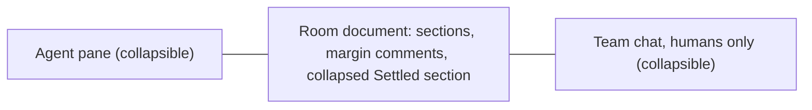
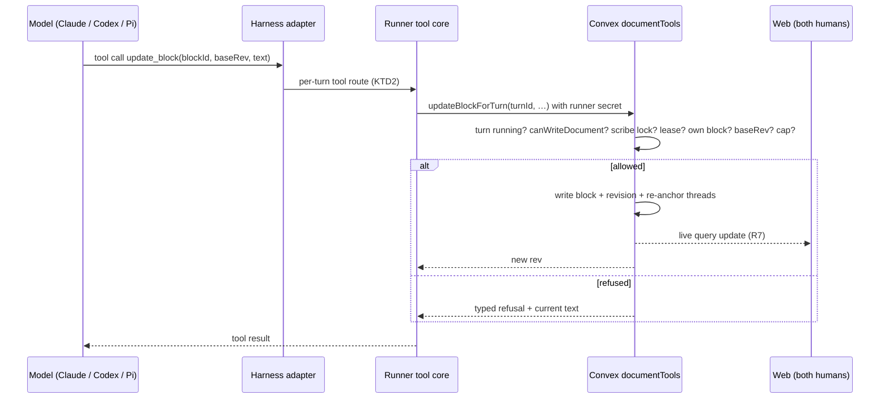
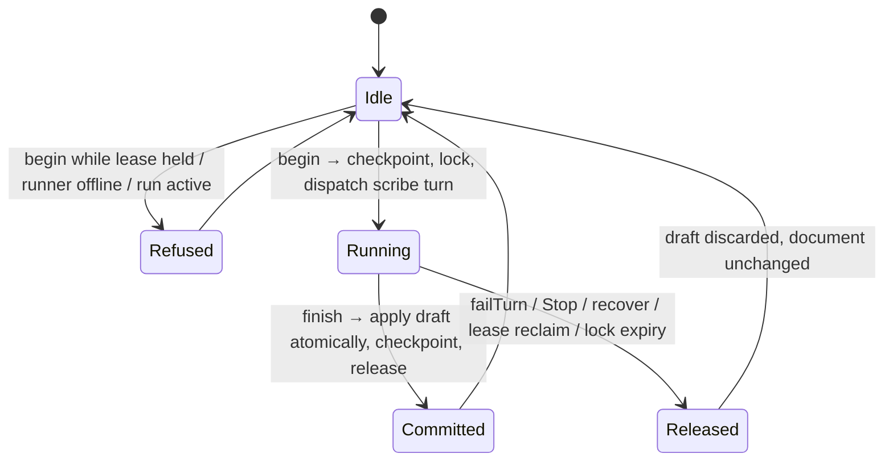
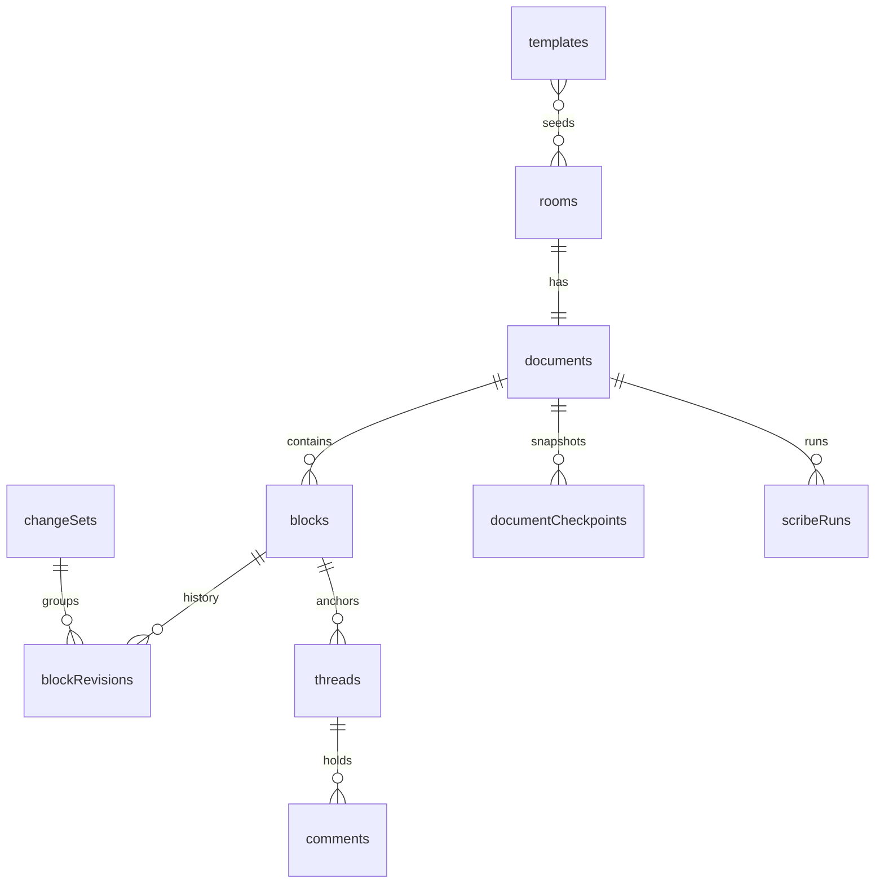

# Room Document - Plan

## Goal Capsule

- **Objective:** Everyone in an Atelier room works from one current, shared record of the session: Robert, a teammate and every model. They read it, write in it and discuss it in place, and nothing written there is ever lost.
- **Means:** per-turn document tools for Claude, Codex and Pi, with every rule enforced in Convex, and a document-first laptop room (KTD1, KTD4).
- **Product authority:** Robert (room owner). The Product Contract below governs behavior. The phone app is out of scope except that rooms it creates get the default template (R3).
- **Execution profile:** one pull request on a new branch cut from `feat/shared-rooms`, which it builds on. It merges after that branch. Target repo: Atelier, paths relative to its root.
- **Stop conditions:** stop and ask Robert if the U0 probe shows Codex or Pi cannot take per-turn document tools without approvals nobody can answer (KTD1); if any change would let a review or a follow-up write to the document, or let team chat reach it; or if implementation needs any exe.dev feature beyond the documented ones.
- **Who finishes:** the implementing agent builds and verifies through the Verification Contract, including the live three-harness check, and opens the PR. Robert merges.

---

## Product Contract

### Summary

Each room on the laptop web app gets a shared document that starts from a template and fills most of the screen. The agent pane and team chat open as collapsible side panels. Models keep the document current on their own. They edit only their own writing and leave margin comments on everyone else's, while humans can edit anything. A human can call in a scribe to reorganize and combine the document. Every change is attributed and kept in revision history in the database, and comment threads stay until a human settles them.

### Problem Frame

A room session produces three kinds of useful material: what has happened so far, each model's ideas and notes, and questions the humans want to come back to. Today all of it lands in chat. Chat is a scrolling stream, so the current picture of the session exists nowhere. A model's idea from an hour ago is buried, and a question Robert meant to return to has scrolled away.

The shared-rooms work adds a second human and a private team chat, which makes this worse. Two people and several models are now producing material across two streams, and nobody holds the combined picture. Robert wants the collaboration a shared Google Doc or Notion page gives a team, with models taking part as teammates rather than as a tool someone has to drive.

Two earlier lessons shape the answer. Robert rejected the mandatory crux and decision forms in independent review as bureaucracy (`docs/v0-spec.md`), so the document must not bring back a required process. He also rejected approving each agent edit, because it would interrupt the flow of work.

### Actors

- A1. Robert: room owner. He creates rooms, writes templates and has every human permission.
- A2. Teammate: a second human in a shared room. They have the same document permissions as Robert, except writing templates.
- A3. Model participant: Claude, Codex or Pi working in the room. It reads the whole document, writes and maintains its own contributions, and comments on others'.
- A4. Scribe: a model participant that a human calls in for one cleanup run. During that run it can reorganize and rewrite anyone's text.

### Key Decisions

- **Models update the document directly and automatically.** No per-edit approval. Models add to the document when something meaningful happens rather than waiting to be asked. Governs R8. (session-settled: user-directed — chosen over per-edit approval and over updating only when asked: approval would be tedious and break the flow of work, and Robert should not have to remember to ask.)
- **Ownership works like teammates in a shared doc.** Models edit only what they wrote and comment on everything else. Governs R9, R10. (session-settled: user-directed — chosen over letting models rewrite other models' text: each contributor's writing must be preserved.)
- **Humans can edit anything.** Governs R11, R33. (session-settled: user-approved — chosen over limiting humans to their own text, or to their own plus model text: humans lead the room and history keeps every edit recoverable.)
- **Consolidation is a separate, manually invoked scribe, not automatic.** The scribe may rewrite anyone's contributions, but only after a full version is saved. Governs R16–R20, R27, R35, R36. (session-settled: user-directed — chosen over a scribe that only writes a separate overview and leaves the originals untouched: history makes in-place cleanup safe.)
- **Revision history lives in the app's database, not in git.** Governs R21–R23. (session-settled: user-directed — Robert ruled out git for this.)
- **Comments have one closed state, Settled.** Settled threads collapse into a section that can be expanded, like T3 Code's settled threads, and a human can reopen them. Governs R13, R14. (session-settled: user-directed — chosen over a separate Archived state: the difference between the two was not useful.)
- **The document comes first in the layout.** Governs R5. (session-settled: user-approved — chosen over three fixed columns and over a document tab beside the agent pane, after comparing rough sketches: three permanent columns are cramped on a laptop.)
- **The handbook stays separate from the document.** The handbook holds standing instructions for how to work in the room. The document is the living record of the session. Governs R25. (session-settled: user-approved — chosen over merging the handbook into the document or replacing it: automatic model updates and scribe runs must not touch standing instructions.)
- **Templates are Robert's.** Atelier ships one default template, and Robert writes the rest. Governs R2–R4, R29, R39. (session-settled: user-approved — chosen over a built-in template library.)
- **Authorship is tracked per block, not per character.** A block is a paragraph, list item or heading. This keeps "edit your own, comment on others" simple to apply. Governs R9, R11.
- **Rooms can be created in the laptop app.** Governs R3, R39. (session-settled: user-directed — chosen over choosing a template on a room's empty document, and over a template picker on the phone: Robert wanted the template chosen as part of creating the room.)
- **Starting the scribe is refused while someone is editing.** Governs R35. (session-settled: user-approved — chosen over waiting automatically or taking over the edit: nobody loses typing.)
- **Review follow-ups always get their own session.** Governs R40. (session-settled: user-approved — chosen over making an agent's ordinary session read-only after a follow-up, and over accepting the risk: solo continuity matters less than keeping review content out of a document a teammate may later read.)
- **No required process.** The document has no mandatory fields, forms or decision steps. It follows the rejection of the crux and decision forms. Governs R1.

### Requirements

**Document and templates**

- R1. Every room on the laptop web app has exactly one shared document. It has no required fields or forms.
- R2. A new room's document starts from a template. Atelier's default template has three sections: What's happened, Ideas & notes, and Open questions.
- R3. Robert can create and edit templates, and choose one when he creates a room in the laptop app. Rooms created without a choice, including rooms created on the phone, use the default template.
- R39. Robert can create a room in the laptop app with the same details the phone asks for (name, project folder and the online runner) plus a template.
- R4. Robert can save a room's current section structure as a new template. Only the headings and any guidance text are saved, not the room's content.
- R5. On a laptop, the document takes most of the room screen. The agent pane and the humans-only team chat open as collapsible side panels beside it.
- R29. Headings and guidance text that a template seeds into a room are attributed to the template's author, Robert, and follow the same rules as his other blocks.

**Writing and ownership**

- R6. Every block shows who wrote it. Authors are Robert, the teammate, a named model participant or the scribe.
- R7. Both humans see each other's and the models' changes to the document live.
- R8. Model participants add and update their own contributions without being asked, whenever something in the session is worth keeping: a finding, an idea, a change of direction or an open question.
- R9. A model participant can edit and delete only blocks it wrote.
- R10. A model participant can comment on any block it did not write, by selecting text and attaching a comment to that passage.
- R11. Humans can edit any block directly, including model-written and scribe-maintained blocks and each other's notes. The edited block keeps its author, and the edit is recorded under the human's name (R21). A model sees which of its blocks a human has edited since its last write and does not revert those edits. If it disagrees, it comments.
- R12. Two people cannot edit the same block at the same moment. While one person edits a block, others see that it is being edited.
- R31. A person's edit lock on a block lapses after about two minutes without activity, and the other person can then edit that block.
- R32. Each model turn has a cap on how many blocks and comments it can write. A refused write tells the model why.
- R33. A model cannot delete a block that a human has edited. It comments instead.

**Comments**

- R13. A comment is a thread anchored to a selected passage. Humans and models can reply in it, and every comment and reply shows its author.
- R14. Only a human can settle a thread. A settled thread moves into a collapsed Settled section that can be expanded, and a human can reopen it. Models can reply but cannot settle or reopen.
- R15. A model replies in a thread only when a human @mentions it. Otherwise a comment is a note and starts no model turn. A model may start new comment threads on its own while it updates the document (R8).
- R34. A mention of a model that is busy waits until the model is free. It never answers that model's open question card or joins its running turn, and the reply always lands in the thread.

**Scribe**

- R16. Either human can call in a scribe and choose which model participant acts as scribe for that run.
- R35. Starting the scribe is refused while anyone is editing a block, and the refusal names who is editing.
- R17. Before the scribe changes anything, Atelier saves a complete, restorable version of the document (R21).
- R18. During its run, the scribe can reorganize, rewrite, merge and remove any block, including human-written ones.
- R19. A block the scribe writes or combines is attributed to the scribe and credits the authors of the blocks it drew from. Their original text stays in history. Between scribe runs, only humans edit scribe blocks. Every model, including the one that acted as scribe, comments on them instead (R9, R10).
- R20. Comment threads survive a scribe run. A thread whose passage still exists in some form stays attached to it. A thread whose passage was removed stays open and links to the original passage in history.
- R27. While a scribe run is in progress, the document is read-only for humans and other models and shows that the scribe is working. A failed or stopped run leaves the document as it was before the run.
- R36. Comments and replies keep working during a scribe run. Threads started during the run re-attach when it finishes, under the same rules as R20.

**Revision history**

- R21. Every change to the document is recorded with its author and time: edits, additions, deletions, scribe runs and restores. Revision history is stored in the app's database.
- R22. Humans can browse earlier versions of the document and see what changed and who changed it.
- R37. A version is one change set: one model turn's writes, one person's edit of a block, one scribe run, one restore or the template seeding.
- R23. Only a human can restore an earlier version. A restore saves the current state as a version first, so nothing is lost.
- R38. A restore returns block text only. Comment threads are not rolled back; they re-attach to the restored text under the same rules as R20.

**Agent context and privacy**

- R24. Model participants can read the whole current document, including comment threads and settled threads, when they work in the room. Independent-review turns do not receive the document, so reviews stay blind.
- R25. The room handbook stays separate from the document. Model updates and scribe runs never change it.
- R26. Anything in the document, including comments between the two humans, is visible to agents. Team chat stays invisible to agents, and models never write team chat content into the document.
- R28. Model turns that are part of an independent review, or that follow up a review or its decision, never add to, edit or comment on the document. The scribe never runs as one of these turns. Reviews and their follow-ups stay visible to Robert only, as in the shared-rooms plan. Follow-up turns may read the document.
- R40. Once a room has a document, every review follow-up runs on its own session, even when Robert is alone in the room, so an agent's ordinary session never holds review content it could later write into the document.
- R30. The teammate join notice also says that the room document is shared with the agents and kept permanently.

### Layout

Illustrates R5 and R14.

### Key Flows

- F1. Model keeps the document current
  - **Trigger:** A model finishes work in which something worth keeping happened.
  - **Actors:** A3
  - **Steps:** The model reads the current document. It adds a block or updates one of its own blocks in the relevant section. It may start a comment thread on someone else's block. The change appears live for both humans and is recorded in history.
  - **Covered by:** R6–R10, R15, R21, R24
- F2. Human asks a model about its note
  - **Trigger:** Robert selects a passage of Codex's note and comments, mentioning @Claude.
  - **Actors:** A1, A3
  - **Steps:** The thread is anchored to the passage. Claude is asked to respond and replies in the thread. Codex does not reply, because it was not mentioned. Robert later settles the thread, and it collapses into Settled.
  - **Covered by:** R13–R15
- F3. Scribe cleanup
  - **Trigger:** The document has become cluttered, and the teammate calls in the scribe and chooses Claude.
  - **Actors:** A2, A4
  - **Steps:** Atelier saves a full version, and the document becomes read-only to everyone else until the run ends. The scribe merges overlapping notes into combined blocks attributed to the scribe and crediting the original authors. It reorganizes sections. Open threads stay attached or link back to their removed passages. The run appears in history as one attributed change set.
  - **Covered by:** R16–R21, R27
- F4. Recover something the scribe removed
  - **Trigger:** Robert notices that an idea he wanted is gone after a scribe run.
  - **Actors:** A1
  - **Steps:** Robert opens history, finds the version saved before the scribe run and reads the original passage. He copies it back or restores the whole version. A restore first saves the current state.
  - **Covered by:** R21–R23

### Acceptance Examples

- AE1. Covers R9, R10. Given a block written by Codex, when Claude tries to edit it, then the edit is refused, and Claude can attach a comment to it instead.
- AE2. Covers R11. Given a block written by Claude, when the teammate fixes a sentence in it, then the block still shows Claude as author, and history shows the teammate's edit. When Claude next updates that block, the teammate's fix is still there.
- AE3. Covers R15. Given a human comment on a model's block that mentions no one, then no model turn starts. If the comment @mentions Pi, then only Pi responds.
- AE4. Covers R14. Given an open thread, when a model tries to settle it, then the action is refused. When Robert settles it, it collapses into Settled, and the teammate can expand and reopen it.
- AE5. Covers R17, R20. Given a scribe run that deletes a passage with an open comment thread, then a version from before the run exists, and the thread stays open with a link to the original passage in that version.
- AE6. Covers R23. Given Robert restores yesterday's version, then today's state is saved as a version first, and history shows the restore as Robert's change.
- AE7. Covers R26. Given Robert and the teammate discuss something in team chat, when a model next updates the document, then nothing from team chat appears in it.
- AE8. Covers R24, R28. Given a room with a teammate, when Robert runs an independent review and then sends a follow-up to Claude, then no reviewer's prompt includes the document, and the document is unchanged after both.
- AE9. Covers R27. Given a scribe run in progress, when the teammate tries to edit a block or Codex finishes a turn with an update, then both are refused with a notice that the scribe is working. If the run fails, the document matches the version saved before it.

### Scope Boundaries

Deferred for later:

- Any phone or iPad view of the document, including a read-only view.
- An automatic or scheduled scribe, or a permanent scribe role.
- Simultaneous typing by two people in the same block (R12 rules it out for now).
- A built-in template library beyond the default.
- Private, human-only comments inside the document. Private talk belongs in team chat.
- A separate Archived comment state.
- Letting the teammate write templates.
- Exposing the document through the step 5 MCP tool set beyond what this feature needs.

Outside this product's identity:

- Mandatory crux or decision entry, or any required form in the document.
- Per-edit approval of model changes.

### Dependencies / Assumptions

- The build depends on the laptop web app, room membership and team chat from the shared-rooms work: `docs/plans/2026-11-06-1419-feat-shared-rooms-plan.md` on branch `feat/shared-rooms`. `apps/web` exists only on that branch. The teammate's actions here follow that plan's equal-driving rule (its R2), and template authoring follows its owner-only setup rule (its R3).
- The handbook is a plain string on each room (`packages/backend/convex/schema.ts`). On `feat/shared-rooms` every ordinary turn's room context includes it (`packages/backend/convex/lib/prompt.ts`), and review prompts include it separately (`packages/backend/convex/rituals.ts`). R25 assumes only that the handbook remains a separate text.
- No document, comment, annotation or revision model exists in the backend on either branch. This is net-new data.
- App data lives in Convex (`docs/v0-spec.md`, "Data"), which satisfies the database requirement in R21.
- Rooms that existed before this feature get the default template the first time their document is opened or a model turn is claimed in them.
- A model can read the document only when a turn runs, so models update it during their own turns. They do not update it continuously in the background.

### Sources / Research

- `docs/v0-spec.md`: room data model, handbook, the append-only ledger, and the owner's rejection of mandatory crux and decision entry.
- `docs/plans/2026-11-06-1419-feat-shared-rooms-plan.md` (branch `feat/shared-rooms`): the two-pane layout this plan replaces with a document-first layout, team chat invisible to agents (its R6), and the room context block (its R30).
- `packages/backend/convex/schema.ts`, `packages/backend/convex/rituals.ts`: the current handbook field and its single use in prompts.
- T3 Code's collapsible Settled section for threads, the reference Robert gave for settled comment threads.

---

## Planning Contract

**Product Contract preservation:** changed R3, which now chooses the template in a laptop create-room flow (Robert's choice, KTD15), and corrected the handbook and seeding notes in Dependencies. Added R30–R39, the behaviors confirmed in the planning synthesis, and R40, Robert's answer to a privacy gap found in plan review. R40 changes the shared-rooms behavior where solo follow-ups continued the ordinary session. The old Outstanding Questions are resolved into the KTDs below. No other scope change.

Code base: everything builds on branch `feat/shared-rooms` (worktree `atelier-shared-rooms`), which adds the laptop web app, membership, team chat and the room context block. File paths below are relative to that tree.

### Key Technical Decisions

- KTD1. **Models write through per-turn document tools, not an end-of-turn text block or a shell CLI.** A refused write (someone else's block, a held lock, a stale base, the scribe working, a cap) has to reach the model while it can still comment or tell the user (R11, R12, R27, R32). A text block parsed after the turn would drop such writes silently and force the whole document into every prompt. A shell CLI fails on all three harnesses: Pi has no shell, Codex's sandbox has no network, and Claude denies unapproved Bash. The harnesses accept per-turn tools; only our adapters refuse them today (`runner/src/adapters/codex.ts`, `runner/src/adapters/pi.ts` throw on `mcpServers`; `runner/src/adapters/claude.ts` denies unapproved tools). U0 proves each route first. If Codex or Pi cannot take the tools without an approval nobody can answer, stop and ask Robert rather than fall back silently.
- KTD2. **One runner-hosted tool core, exposed per harness.** The core implements the KTD3 tools by calling the KTD4 Convex functions. Default transport: a streamable-HTTP MCP endpoint in the runner, bound to `127.0.0.1` on an OS-assigned ephemeral port. Ports 3000–9999 are excluded because exe.dev forwards them to anyone with VM access (https://exe.dev/docs/proxy.md). Each turn gets a random bearer that maps to its `turnId`, stops working when the turn ends, and travels in config headers or the environment, never in argv or transcripts.
  - Claude: an in-process `createSdkMcpServer`, which carries no token. The Agent SDK passes every non-SDK server, headers included, to the CLI as a `--mcp-config` argument, so an HTTP entry would expose the bearer in argv. If U0 rules out the in-process server, stop and ask Robert before using the HTTP entry. `canUseTool` allows `mcp__atelier__*`.
  - Codex: `mcp_servers.atelier.*` dotted keys in `config` on both `thread/start` and `thread/resume` (LEARNINGS records that unquoted dotted keys work).
  - Pi: a second runner extension, loaded on every ordinary turn whatever the edit switch says, registers the tools; `--tools` names them.
- KTD3. **Tool surface.** `read_document`, `read_thread`, `add_block`, `update_block`, `delete_block`, `comment`. Scribe turns get `read_document` and the KTD8 draft tools instead. Models get no tool to settle, reopen, restore, template, or edit others' blocks. Refusals are typed and worded so the model can act: "not your block, comment instead", "Robert is editing this block", "the scribe is working", "stale: here is the current text", "turn cap reached".
- KTD4. **Convex enforces every rule; the runner and the model are not trusted.** Document tool calls go to runner-secret functions (`documentTools.*ForTurn`) that take a `turnId`. Convex derives the author from that turn, never from tool arguments. It refuses unless the turn is running and its command is claimed (copying the `runner.progress` guards). A `canWriteDocument(turn)` helper beside `visibleTurn` in `convex/lib/visibility.ts` refuses review turns (`ritualId`), follow-ups (`followUp`) and scribe turns using ordinary tools (R28). Updates and deletes carry `baseRev`, and a stale rev returns the current text and who changed it (R11). Deleting a block a human has edited is refused (R33). Caps are counted per turn (R32). Proposed starting values, tunable in one constant: 20 block writes and 10 comments per turn, 4,000 characters per block, 600 blocks per document.
- KTD5. **Data model: blocks as rows, history as change sets.**
  - `documents`: one per room. Holds the scribe lock (run id, expiry), the current rev and the seeding marker.
  - `blocks`: one row per block, with a fractional order key (`fractional-indexing` 4.0.0) so inserts never rewrite a shared array; kind (heading, paragraph, list item); text; author (participant, or "scribe" plus credited participants); `rev`; `humanEditedAt`; the edit lease (holder, `expiresAt`); `deletedAt`.
  - `changeSets` (kind, actor, `turnId` or `scribeRunId`, time) and append-only `blockRevisions` (block, change set, operation, text before and after). One change set per model turn, per human lease session, per scribe run, per restore, and for template seeding (R37).
  - `documentCheckpoints` (a header row) and `checkpointBlocks` (one row per live block: order key, kind, text, author), taken before a scribe run, after it commits, before a restore, and after every 200 revisions. One row per block keeps every row far below Convex's 1 MiB per-document limit, whatever the document's total size; a 600-block checkpoint is well within one transaction's 16,000-document and 16 MiB write limits.
  - `threads` (block, anchor, state open or settled, `detachedBeforeChangeSetId`) and `comments` (thread, author, body, `mentions`).
  - `templates`: owned by Robert, each a list of heading and guidance pairs. The default is a code constant.
  - `scribeRuns` (the run, its chosen participant and status) and `scribeDraftOps` (one row per draft operation), so a large draft never forms one oversized row.
- KTD6. **The document reaches the prompt when the runner claims the turn.** Prompts are frozen at dispatch today (`convex/lib/dispatch.ts`), so a document baked in there would be stale for a queued turn. `runner.claim` builds the digest at claim time, following the `editsEnabled` precedent (`convex/runner.ts`). It goes in a new `<room_document>` section added to `STRUCTURE_TAG` and passed through `neutralize` in `convex/lib/prompt.ts`, so block text cannot forge an envelope. A fresh session gets the full rendering when it fits about 24,000 characters. Otherwise it gets the outline, the participant's own blocks in full, threads on them, and its blocks a human has edited. A resumed session gets only what changed since the rev that session last saw, within the same budget; past it, the session gets the outline form. The seen rev is stored beside the session id it belongs to (`participants.documentRevSeen` next to `harnessSessionId`, and on each follow-up session entry) and written when a turn finishes, never at claim, so a failed or recovered turn never advances it. A claim that starts a different session than the stored one sends the full digest. Review turns get nothing (R24). Follow-ups get the digest and read-only tools (R28), and `runner.claim` always gives them a separate session once the room has a document (R40), replacing the solo-room branch in `lib/sessions.ts` that continued the ordinary session.
- KTD7. **People's edit leases expire.** Starting to edit takes a lease on that block. The browser renews it about every 30 seconds while the person types, and it lapses after two minutes without activity (R31). Expiry is checked inside mutations, never with `Date.now()` in queries, and a `runAt(expiresAt)` cleanup mutation clears stale leases. Models never hold leases; each model write is a compare-and-set that refuses while someone else holds the block (R12).
- KTD8. **The scribe is its own turn kind with an atomic draft.**
  - `scribe.begin` (either human, R16) refuses while any lease is held, naming the editor (R35); when the runner is offline; and while a scribe run is active. Otherwise it writes the pre-run checkpoint (R17), sets the document lock with a hard 35-minute expiry, longer than the runner's 30-minute turn deadline, and dispatches a turn marked `scribeRunId`.
  - The turn runs in a fresh session that is never saved, like a review, so scribe instructions never enter the participant's ordinary session. File edits are off, and question cards are denied so the turn cannot sit waiting. Every site that today singles out review turns by `ritualId` treats `scribeRunId` the same way: `runner.claim` resumes no session, `sessionStarted` and `finish` save none, `takesSteer` and `activeOrdinaryTurn` in `lib/dispatch.ts` exclude it so chat messages queue until the run ends, and `rooms.setEditsEnabled` sends it no settings change.
  - Draft tools take small operations: keep, replace, add, remove and move, each referencing block ids. Blocks the draft does not mention are kept, which keeps a 300-block document within one model's output. Every new block lists its `sourceBlockIds`. Convex computes credits from those ids (R19); the model's claims are not trusted.
  - `runner.finish` commits the whole draft in one mutation as one change set and takes the post-run checkpoint, but only if the run is still active; a run already released is never committed. A mutation is all-or-nothing, so a failure leaves the document unchanged (R27).
  - One `releaseScribe` helper discards the draft and clears the lock. It is called from `finish`, `failTurn`, `messages.cancel` (Stop), `recover`, `reclaimExpiredLeases`, the lock-expiry scheduled mutation, and the expiry of an unclaimed command. Each path gets a test.
- KTD9. **@mentions use a thread delivery, not the chat path.** Only a comment or reply written by a human creates deliveries (R15); comments from model tools and replies posted from a mention turn's final text never do, so models cannot chain each other. A human's comment that mentions model participants is saved first, even when the runner is offline. It then creates one queued delivery per mentioned participant, carrying the `threadId`. Unlike chat messages, which `dispatchNext` cancels while the runner is offline, thread deliveries stay queued; `runners.heartbeat`, when a runner comes back online, calls `dispatchNext` for each participant in its rooms with a waiting delivery. Removing a member cancels every queued delivery from their comments, as `members.remove` already does for their queued messages. `dispatchNext` runs a thread delivery alone, like a follow-up. It never steers it into a running turn, never batches it with chat messages, and never uses it to answer a pending question card (R34). On `finish`, Convex posts the turn's final text as that participant's reply in the thread, not as an agent-pane message. During that turn the model may also use the KTD3 tools. Unmentioned comments create no delivery (R15).
- KTD10. **Comment anchors are quote selectors re-anchored server-side.** A thread stores the W3C TextQuoteSelector of the passage (exact text plus 32 characters before and after) and a position in the block's plain text. Every block-text change re-runs a port of Hypothesis's `matchQuote` in the same mutation: quote weighted 50, prefix 20, suffix 20, position 2, with our own minimum score. A match stores updated selectors; a miss marks the thread detached and records `detachedBeforeChangeSetId`, the change set that removed the passage. Its link opens the version just before that change set, rebuilt per KTD13, so it always resolves (R20). Scribe commits re-anchor first against blocks whose `sourceBlockIds` include the thread's block. Restores re-anchor the same way (R38).
- KTD11. **Editing uses a textarea per block, with no new editor library.** The block being edited is a `Textarea` (`components/ui/textarea.tsx`) while its lease is held. Every other block renders read-only through the existing `react-markdown` setup in `components/markdown/StreamingMarkdown.tsx`. A comment starts from a text selection in the read view; the selection maps to the block's plain text for the KTD10 selector. Highlights use the CSS Custom Highlight API, supported in all major browsers since June 2025, so the rendered DOM is never rewritten. `@convex-dev/prosemirror-sync` was rejected: it does character-level co-editing, has no lock or read-only mode, and its default snapshot pruning would erase history.
- KTD12. **The ledger gets one id-only `document.changed` entry per change set,** plus `document.thread_settled`, `document.restored` and `document.scribe_started` entries. The text lives in `blockRevisions`, following the `team.ts` precedent of keeping text out of the ledger. Nothing in the document code reads `teamMessages`; a test guards that, as `lib/prompt.ts` does today.
- KTD13. **A version is rebuilt by loading its nearest earlier checkpoint and replaying, in order, every change set's revisions after that checkpoint up to and including the chosen change set.** The 200-revision checkpoint interval bounds that replay to at most 200 revisions. The history list shows change sets newest first, paginated.
- KTD14. **Restore** (human only, R23) refuses while a scribe run or any lease is active, naming the holder. It checkpoints the current state, rewrites block rows to the chosen version while keeping block ids, records one `restore` change set, and re-anchors threads (R38).
- KTD15. **Laptop room creation and template seeding.** `rooms.create` takes an optional `templateId`. It seeds the document and records the seeding change set in the same transaction, with blocks attributed to Robert (R29). A new owner-only route `/rooms/new` asks for the same name, folder and online runner the phone does, plus a template (R39). An idempotent `documents.ensure` mutation seeds the default for older rooms. It runs when the document is opened and when `runner.claim` serves a turn in a room with no document.

### High-Level Technical Design

How a model's write travels, and where each rule is checked:

Scribe run lifecycle:

Data shape:

### Assumptions

- Thread state changes (settle, reopen) are attributed and recorded in the ledger but are not part of block revision history, so restore leaves them alone (R38).
- Removing a teammate releases any lease they hold at once. Their blocks and comments keep their attribution, as their messages do today.
- The document stays a room-wide resource. There are no per-section permissions.

### Sequencing

U0 settles the transport, so U5 and U6 wait on it. U1 comes first among the build units. U2–U4 build on U1, and U7 needs U2–U6. The web units need the Convex units they call, and U11 also lands after U8 because it edits the document pane. They can be built alongside U5–U7.

### Risks

| Risk | Mitigation |
|---|---|
| Codex MCP calls through `config` raise an approval or elicitation request the runner cannot answer, or are dropped on `thread/resume`. | U0 probes both. KTD1 stop condition: ask Robert before choosing a fallback. |
| Robert's own Pi extensions (`pi-mcp-adapter`) or Claude servers clash with the injected tools. | U0 probes with his real configuration loaded, as the shared-rooms LEARNINGS probes did. |
| Models flood or under-use the document (R8). | KTD4 caps, plus a live per-harness probe in the Verification Contract that records how often an ordinary request produces a write, so the guidance text can be tuned. |
| Document text is untrusted input to every model, and a teammate can plant instructions. | Authority is enforced server-side (KTD4), so planted text cannot make a model write as someone else, reach review turns or reach team chat. This matches the existing full-reach notice. |
| A crashed runner or an idle editor leaves the document locked. | Every lock and lease has an expiry and a scheduled release (KTD7, KTD8). |

### System-Wide Impact

- **Agent context:** every ordinary, mention and follow-up turn gains a `<room_document>` section and a changed room-context line (KTD6, U4). Review prompts are untouched. Prompt-forgery tests extend to the new tag.
- **Agent tools:** the harness contract in `packages/shared/src/harness.ts` changes shape, and all three adapters change (U6). Claude's deny-by-default `canUseTool` gains one allow rule, and nothing else it permits changes.
- **Turn lifecycle:** `runner.claim`, `finish`, `failTurn`, `recover`, `reclaimExpiredLeases` and `messages.cancel` each gain document or scribe handling (U3, U4, U7). The existing queue, steer and question-card tests guard against regressions in chat delivery.
- **Auth boundaries:** runner-secret functions now accept work done on a model's behalf. Authority still comes from the turn, never from the caller (KTD4). Owner-only template and room-creation actions follow the shared-rooms owner rules.
- **Live layout:** the room screen changes from two panes to document-first (U8). The phone app's room screen is unchanged.
- **Ledger and history:** new ledger entry types carry ids only (KTD12). Block text lives only in the document tables.

### Scope Boundaries (planning)

Deferred to Follow-Up Work:

- The remaining v0 step-5 tools (`raise_hand`, `read_handbook`, `recent_decisions`) on the same endpoint.
- A read-only history tool for models.

Considered and not built:

- Character-level co-editing (`@convex-dev/prosemirror-sync`, Tiptap collaboration): R12 rules out simultaneous typing, and these tools have no lock mode. Revisit only if Robert drops R12.
- A model-side rate-limit UI: the server-side caps already bound flooding. Revisit if the live probe shows the caps are hit often in normal work.
- Full snapshots on every change: change-set revisions plus checkpoints already rebuild any version, at a fraction of the storage.

---

## Implementation Units

| U-ID | Title | Key files | Depends on |
|---|---|---|---|
| U0 | Harness tool probe | `runner/scripts/probe-room-tools.ts` (throwaway) | — |
| U1 | Document data model, templates and seeding | `convex/schema.ts`, `convex/documents.ts`, `convex/templates.ts`, `convex/rooms.ts` | — |
| U2 | Human editing, leases, history and restore | `convex/blocks.ts`, `convex/history.ts`, `convex/lib/document.ts` | U1 |
| U3 | Comment threads, anchoring and mentions | `convex/threads.ts`, `convex/lib/anchor.ts`, `convex/lib/dispatch.ts`, `convex/runner.ts` | U1, U2 |
| U4 | Runner-facing document functions and the claim digest | `convex/documentTools.ts`, `convex/lib/visibility.ts`, `convex/lib/prompt.ts`, `convex/runner.ts` | U1–U3 |
| U5 | Runner tool core and loopback endpoint | `runner/src/roomTools.ts`, `runner/src/roomToolsServer.ts`, `runner/src/turns.ts` | U0, U4 |
| U6 | Adapter wiring for Claude, Codex and Pi | `packages/shared/src/harness.ts`, `runner/src/adapters/*` | U0, U5 |
| U7 | Scribe runs | `convex/scribe.ts`, `convex/runner.ts`, `convex/messages.ts`, `runner/src/turns.ts` | U2–U6 |
| U8 | Document-first room layout and block editing | `apps/web/src/components/room/RoomView.tsx`, `apps/web/src/components/document/*` | U1, U2 |
| U9 | Comments in the web app | `apps/web/src/components/document/Thread*.tsx`, `apps/web/src/lib/selection.ts` | U3, U8 |
| U10 | History, restore and scribe controls | `apps/web/src/components/document/History*.tsx`, `ScribeControl.tsx` | U2, U7, U8 |
| U11 | Templates, laptop room creation and join notice | `apps/web/src/routes/rooms.new.tsx`, `apps/web/src/routes/templates.tsx`, `apps/web/src/routes/rooms.$roomId.tsx` | U1, U8 |

Backend paths are under `packages/backend/`.

### U0. Harness tool probe

**Goal:** prove that each harness can call per-turn Atelier tools, with Robert's real configuration loaded, before any adapter work starts (KTD1).

**Requirements:** R8, R10; KTD1, KTD2.

**Dependencies:** none.

**Files:** `runner/scripts/probe-room-tools.ts` (throwaway; delete before the PR or keep under `runner/scripts/` with a header saying it is a probe).

**Approach:**
1. Stand up a stub tool server in the runner process with one `echo` tool, on the KTD2 loopback rules.
2. Claude: attach it in-process with `createSdkMcpServer`, beside Robert's own servers, on a fresh session and on `resume`. Check that the tool is listed without tool search and that `canUseTool` sees it.
3. Codex: pass `mcp_servers.atelier.*` through `config` on `thread/start` and `thread/resume`, under both approval policies and both sandboxes the edit switch uses. Record whether an approval or elicitation request arrives.
4. Pi: register the tool from a runner extension under `--tools read,grep,find,ls,atelier_*`, with Robert's extensions loaded, across `--session` resume.
5. Write the findings into `LEARNINGS.md` under a "Room document tool probes" heading.

**Execution note:** this is a live probe on the VM with Robert's logins, in throwaway git repos under `/tmp`, like the shared-rooms capability probes. If Codex or Pi fails, stop and ask Robert (Goal Capsule stop condition).

**Test expectation:** none — a probe whose result is written to `LEARNINGS.md`.

**Verification:** `LEARNINGS.md` records, per harness, the working route, whether it survives resume, and any approval behavior.

### U1. Document data model, templates and seeding

**Goal:** every room has one document, seeded from a template, with change-set history from the first block.

**Requirements:** R1–R4, R29, R37, R39; KTD5, KTD12, KTD15.

**Dependencies:** none.

**Files:**
- Modify: `packages/backend/convex/schema.ts`, `packages/backend/convex/rooms.ts`
- Create: `packages/backend/convex/documents.ts`, `packages/backend/convex/templates.ts`, `packages/backend/convex/lib/document.ts`
- Add dependency: `fractional-indexing` in `packages/backend/package.json` (pnpm here refuses same-day releases; 4.0.0 is older)
- Test: `packages/backend/tests/document.test.ts`, `packages/backend/tests/templates.test.ts`

**Approach:**
1. Add the KTD5 tables with shared validators at the top of `schema.ts` and `by_<field>` indexes, each with a comment saying why it exists.
2. `lib/document.ts` holds the shared write path: insert or patch a block, append a revision, bump the document rev, open or extend a change set, and take a checkpoint every 200 revisions.
3. `templates.ts`: owner-only create, update, delete and list (`requireOwner` then `requireMember` where a room is involved), plus `saveFromRoom`, which copies heading and guidance blocks only (R4).
4. `rooms.create` takes an optional `templateId` and seeds in the same transaction. `documents.ensure` seeds the default idempotently. `documents.get` returns blocks in order with authors, lease holders and thread counts, for members only.

**Patterns to follow:** `convex/lib/auth.ts` (`requireOwner`, `requireMember`); `reviewSnapshots` for large rows kept apart from hot ones; `convex/lib/ledger.ts` `record` with ids only; `ensureUser` for idempotent ensure mutations.

**Test scenarios:**
- Creating a room with no template seeds three heading blocks (What's happened, Ideas & notes, Open questions) attributed to Robert, in one `template_seed` change set.
- Creating a room with a chosen template seeds that template's headings and guidance in order.
- `documents.ensure` on an older room with no document seeds the default once. A second call changes nothing.
- A teammate calling a template mutation is refused with "Only the owner can …".
- `saveFromRoom` copies headings and guidance, but no paragraph a model or person wrote.
- The 200th revision triggers a checkpoint that contains every live block.
- A non-member's `documents.get` throws. A removed member's `documents.get` throws.
- Ledger rows for seeding carry ids and no block text.

**Verification:** backend tests pass, and `documents.get` serves a seeded document for both room members.

### U2. Human editing, leases, history and restore

**Goal:** both humans can edit any block, one at a time, and can browse and restore any version.

**Requirements:** R6, R7, R11, R12, R21–R23, R31, R37, R38; KTD5, KTD7, KTD13, KTD14.

**Dependencies:** U1.

**Files:**
- Create: `packages/backend/convex/blocks.ts`, `packages/backend/convex/history.ts`
- Modify: `packages/backend/convex/lib/document.ts`, `packages/backend/convex/members.ts` (release leases on removal), `packages/backend/convex/crons.ts` if a sweep is kept
- Test: `packages/backend/tests/blocks.test.ts`, `packages/backend/tests/history.test.ts`

**Approach:**
1. `blocks.startEdit` takes a lease, refusing when another person holds an unexpired one or the scribe lock is set. `blocks.renew` extends it, and `blocks.save` writes text, sets `humanEditedAt` on blocks with another author, and closes the lease's change set. `blocks.add`, `blocks.remove` and `blocks.move` use fractional keys.
2. Schedule the KTD7 cleanup with `runAt(expiresAt)` on every take or renewal. The cleanup ignores leases that were renewed after it was scheduled.
3. `history.list` pages change sets newest first. `history.version` rebuilds a version per KTD13. `history.diff` returns a change set's revisions.
4. `history.restore` follows KTD14.

**Patterns to follow:** load the row, then `requireMember(ctx, row.roomId)` (`messages.ts` cancel); lease renewal in `runner.progress`; error sentences shown through `apps/web/src/components/room/errors.ts`.

**Test scenarios:**
- Covers AE2. The teammate edits Claude's block: the author stays Claude, `humanEditedAt` is set, and the revision is attributed to the teammate.
- While Robert holds a block's lease, the teammate's `startEdit` on it is refused, naming Robert.
- After two minutes without renewal, the teammate's `startEdit` succeeds and Robert's later `save` is refused as expired.
- Removing the teammate releases their lease at once.
- Any human edit during an active scribe lock is refused with "the scribe is working".
- Covers AE6. Restoring yesterday's version checkpoints today's state first. Block ids are kept. History shows one restore change set by Robert.
- Restore while a lease is held is refused, naming the holder. Restore during a scribe run is refused.
- `history.version` for a version 450 revisions back equals the document as it was then.
- Two edits by the same person within one lease form one change set.

**Verification:** backend tests pass. Two signed-in browsers show each other's edits live (checked in U8).

### U3. Comment threads, anchoring and mentions

**Goal:** anyone can comment on a passage, threads stay attached through edits, only humans settle, and @mentions bring a model into one thread.

**Requirements:** R10, R13–R15, R20, R34, R36; KTD9, KTD10.

**Dependencies:** U1, U2.

**Files:**
- Create: `packages/backend/convex/threads.ts`, `packages/backend/convex/lib/anchor.ts`
- Modify: `packages/backend/convex/schema.ts` (`turns.threadId`, thread deliveries), `packages/backend/convex/lib/document.ts` (re-anchor on every text change), `packages/backend/convex/lib/dispatch.ts`, `packages/backend/convex/runner.ts` (`finish` posts a thread reply), `packages/backend/convex/runners.ts` (re-dispatch on reconnect), `packages/backend/convex/members.ts` (cancel a removed member's deliveries), `packages/backend/convex/messages.ts` (no thread delivery answers a card)
- Test: `packages/backend/tests/threads.test.ts`, `packages/backend/tests/anchor.test.ts`, additions to `packages/backend/tests/queue.test.ts`

**Approach:**
1. `threads.create` (human) stores the KTD10 selector computed on the server from the block's current text and the client's offsets. `threads.reply`, `threads.settle` and `threads.reopen` (humans only for the last two).
2. `lib/anchor.ts` ports `matchQuote` and is called by the shared write path in the same mutation as every text change.
3. Mentions: parse `@Name` in human-written comments only, against the room's harness participants, store `mentions` on the comment, and queue one thread delivery per participant per KTD9, including the offline hold, the reconnect re-dispatch and cancellation on member removal.
4. `dispatchNext` treats a thread delivery as run-alone and never steerable. `runner.finish` posts `finalText` into the thread for turns that carry a `threadId`.

**Patterns to follow:** follow-up handling in `lib/dispatch.ts` (`takeWhile` exclusion); `messages.send` for membership and ledger; privacy assertions with unique tokens in `tests/isolation.test.ts`.

**Test scenarios:**
- Covers AE3. A comment that mentions no one creates no delivery. A comment that mentions @Pi creates exactly one Pi delivery, and Pi's final text lands as a reply in that thread, not in the agent pane.
- A mention of a model running another turn waits, then runs alone after it. It is never steered in.
- A mention of a model with an open question card leaves the card open and unanswered.
- A comment posted while the runner is offline is saved, and its delivery runs when the runner's next heartbeat brings it back online.
- A model comment containing "@Codex" creates no Codex delivery.
- The teammate posts an @Pi comment while the runner is offline, Robert removes the teammate, the runner returns, and no Pi turn starts.
- Covers AE4. No document tool lets a model settle or reopen (U4 exposes none). Robert settles, the thread is settled, and the teammate reopens it.
- Editing a passage's surrounding text keeps the anchor. Rewriting the passage entirely marks the thread detached, and its link opens the version just before that rewrite, which contains the original passage.
- A two-word quote that appears twice in a block anchors to the occurrence nearest the stored position.

**Verification:** backend tests pass, including the queue tests that already exist.

### U4. Runner-facing document functions and the claim digest

**Goal:** model turns can read and write the document only within KTD4's rules, and every turn starts with a current view of it.

**Requirements:** R8–R11, R24, R26, R28, R32, R33, R40; KTD3, KTD4, KTD6, KTD12.

**Dependencies:** U1–U3.

**Files:**
- Create: `packages/backend/convex/documentTools.ts`
- Modify: `packages/backend/convex/lib/visibility.ts` (`canWriteDocument`), `packages/backend/convex/lib/prompt.ts` (`<room_document>`, `neutralize`, the edit-switch line), `packages/backend/convex/runner.ts` (`claim` returns the digest and the tool mode; `finish` records the seen rev with the session), `packages/backend/convex/lib/sessions.ts`, `packages/backend/convex/schema.ts` (`participants.documentRevSeen`, the follow-up session entry's seen rev)
- Test: `packages/backend/tests/documentTools.test.ts`, additions to `packages/backend/tests/prompt.test.ts` and `packages/backend/tests/isolation.test.ts`

**Approach:**
1. Each `*ForTurn` function checks the runner secret, loads the turn and its claimed command, then applies the KTD4 checks in a fixed order and returns typed refusals.
2. `claim` returns `documentMode`: `none` for reviews, `read` for follow-ups, `write` for ordinary and mention turns, and `scribe` for scribe turns. It appends the KTD6 digest, except for reviews.
3. The room context line becomes "File edits: on/off. Room document: you may add and update your own blocks and comment on others." File edits never gate document tools.

**Patterns to follow:** runner guards in `runner.progress` and `runner.finish`; `visibleTurn` as the single visibility rule; `tests/prompt.test.ts` for envelope-forgery tests.

**Test scenarios:**
- Covers AE1. `updateBlockForTurn` on Codex's block from Claude's turn is refused with "not your block". `commentForTurn` on it succeeds.
- Covers AE8. Every write function called with a review turn's id, then a follow-up turn's id, is refused, and the document is byte-identical afterwards. A review turn's claim has no `<room_document>`. A follow-up's claim has the digest and `documentMode: read`.
- An update with a stale `baseRev` is refused and returns the current text and its editor.
- Deleting a block the teammate edited is refused even with a fresh `baseRev` (R33).
- The 21st block write in one turn is refused with the cap message.
- A block whose text contains `</room_document>` cannot close the envelope in the digest.
- Covers AE7. A unique phrase posted in team chat never appears in any digest, tool result or claim payload.
- A digest for a 300-block fixture stays under the budget, and includes every block of the claiming participant.
- A resumed session's digest holds only blocks changed since that session's seen rev. An ordinary turn after a shared-room follow-up gets the delta from the ordinary session's own rev. A turn after a failed claimed turn gets the same delta as if that turn never ran. A resumed turn right after a scribe commit falls back to the outline form.
- A write from a turn that is no longer running is refused.
- Covers R40. In a solo room with a document, a follow-up claims a separate session, never the participant's ordinary one. After a review and follow-up in a solo room, then an ordinary turn, then a teammate joining, the review's unique token appears in no block, thread reply or history version.

**Verification:** backend tests pass, and the existing isolation and queue tests still pass.

### U5. Runner tool core and loopback endpoint

**Goal:** the runner exposes the KTD3 tools for each running turn and forwards them to U4, safely.

**Requirements:** R8, R10, R32; KTD2, KTD3.

**Dependencies:** U0, U4.

**Files:**
- Create: `runner/src/roomTools.ts` (tool definitions and Convex calls), `runner/src/roomToolsServer.ts` (loopback MCP endpoint and token table)
- Modify: `runner/src/turns.ts` (issue a token at start, revoke it in every exit path), `runner/package.json` (test script)
- Test: `runner/src/roomTools.test.ts`, `runner/src/roomToolsServer.test.ts`

**Approach:**
1. One tool core used by every transport. Results and refusals are plain text the model can act on.
2. The server binds `127.0.0.1` with port `0` and asserts that the chosen port is outside 3000–9999. It checks the bearer on every request, maps it to a `turnId`, and rejects tokens from finished turns.
3. Tokens are revoked in `turns.ts`'s finish, fail, cancel and crash paths.

**Patterns to follow:** `fakeConvex` and `fakeHarness` in `runner/src/turns.test.ts`; `node:test` as the runner's test runner.

**Test scenarios:**
- A request with no token, a token from a finished turn, or another turn's token is rejected.
- A refusal from Convex comes back to the caller as tool text, not as a crash.
- Revoking happens on finish, fail, cancel and a thrown adapter error.
- The bound address is `127.0.0.1` on a port outside 3000–9999.
- The token never appears in recorded turn items or logged argv.

**Verification:** runner tests pass.

### U6. Adapter wiring for Claude, Codex and Pi

**Goal:** each harness receives the document tools on ordinary, mention, follow-up (read-only) and scribe turns, and none on review turns.

**Requirements:** R8, R24, R28; KTD1, KTD2.

**Dependencies:** U0, U5.

**Files:**
- Modify: `packages/shared/src/harness.ts` (`McpServerSpec` gains an HTTP form, or a transport-neutral `roomTools` field, per U0), `runner/src/adapters/claude.ts`, `runner/src/adapters/codex.ts`, `runner/src/adapters/pi.ts`, `runner/src/turns.ts`
- Create: `runner/src/adapters/pi-room-tools-extension.ts`
- Test: `runner/src/adapters/claude.test.ts`, `runner/src/adapters/codex.test.ts`, `runner/src/adapters/pi.test.ts`

**Approach:**
1. Remove the two `throw`s and replace them with the U0 route.
2. Claude: add the server and allow `mcp__atelier__*` in `canUseTool`. Review options stay `tools: []`, `mcpServers: {}`, `strictMcpConfig`.
3. Codex: add `mcp_servers.atelier.*` to `config` on start and resume. The review config keeps every MCP server disabled.
4. Pi: load the new extension on every non-review turn and add its tool names to `--tools`. Reviews keep `--no-tools --no-extensions --no-mcp`.
5. Document tool calls flow into `turnItems` through the existing tool events.

**Patterns to follow:** `pi-guard-extension.ts`; the review option builders in each adapter; LEARNINGS notes on Codex dotted keys and Pi's MCP behavior.

**Test scenarios:**
- Covers AE8. Review requests contain no Atelier tool route on any harness, asserted on the exact options, config and args.
- An ordinary Claude turn's options include the Atelier server, and `canUseTool` allows its tools and still denies other unapproved tools.
- An ordinary Codex turn's `thread/start` and `thread/resume` both carry the `mcp_servers.atelier` keys.
- An ordinary Pi turn loads the extension with edits off and with edits on.
- A document tool call shows up as a turn item with the tool name and no token.

**Verification:** adapter tests pass, and the live parity check in the Verification Contract passes on all three harnesses.

### U7. Scribe runs

**Goal:** a human can call in a scribe that rewrites the document safely and atomically.

**Requirements:** R16–R20, R27, R35, R36; KTD8, KTD10.

**Dependencies:** U2–U6.

**Files:**
- Create: `packages/backend/convex/scribe.ts`
- Modify: `packages/backend/convex/runner.ts` (`claim`, `sessionStarted`, `finish`, `failTurn`, `recover`, `reclaimExpiredLeases`), `packages/backend/convex/lib/dispatch.ts` (`takesSteer`, `activeOrdinaryTurn`), `packages/backend/convex/rooms.ts` (`setEditsEnabled`), `packages/backend/convex/messages.ts` (`cancel`), `packages/backend/convex/schema.ts` (`turns.scribeRunId`), `runner/src/turns.ts` (fresh unsaved session, edits off, cards denied), `runner/src/roomTools.ts` (draft tools)
- Test: `packages/backend/tests/scribe.test.ts`, additions to `runner/src/turns.test.ts`

**Approach:**
1. `scribe.begin` implements KTD8's refusals and setup. It puts the run's instructions in the turn prompt, and they say that unmentioned blocks are kept.
2. Draft tools validate each operation (block ids exist, sources cover what is removed) and return a report: unaccounted blocks, threads that will move, threads that will detach.
3. `finish` applies the draft in one mutation, computes credits from `sourceBlockIds`, re-anchors open threads including those started mid-run (R36), checkpoints and releases.
4. `releaseScribe` is called from every path KTD8 lists.

**Patterns to follow:** review turns in `runner/src/turns.ts` (fresh session, never saved); lease reclaim in `runner.reclaimExpiredLeases`.

**Test scenarios:**
- Covers F3 and AE5. A run that merges two blocks and deletes a passage with an open thread leaves a pre-run checkpoint. The merged block is attributed to the scribe with both authors credited. The thread stays open and links to the version before the run. History shows one change set.
- Covers AE9. During a run, the teammate's edit is refused, and a Codex `update_block` returns "the scribe is working".
- Covers R35. `scribe.begin` while the teammate holds a lease is refused, naming the teammate.
- `scribe.begin` with the runner offline, or with a run already active, is refused.
- Each release path (failTurn, Stop, recover after a runner restart, lease reclaim, lock expiry, an unclaimed command expiring) leaves the document equal to the pre-run checkpoint and the lock cleared.
- A comment posted during the run re-attaches after commit.
- Between runs, a model's `update_block` on a scribe block is refused with "comment instead", including from the participant that acted as scribe (R19).
- A draft that mentions 5 of 300 blocks keeps the other 295 unchanged.
- The scribe turn never saves a session id on the participant.
- A steer-now message to the scribe participant during a run stays queued and runs as its own turn after the run ends.
- Turning the edit switch on during a run sends the scribe turn no settings change.
- A `finish` that arrives after lock expiry released the run commits nothing.
- A 600-block document of 4,000-character blocks checkpoints, and a draft replacing all of them commits.

**Verification:** backend and runner tests pass, and one live scribe run with each harness commits correctly.

### U8. Document-first room layout and block editing

**Goal:** the room opens on the document, with the agent pane and team chat as collapsible side panels, and people can edit blocks live.

**Requirements:** R5–R7, R11, R12, R31; KTD7, KTD11.

**Dependencies:** U1, U2.

**Files:**
- Modify: `apps/web/src/components/room/RoomView.tsx`, `apps/web/src/components/room/RoomHeader.tsx`, `apps/web/src/lib/room.ts`
- Create: `apps/web/src/components/document/DocumentPane.tsx`, `apps/web/src/components/document/Block.tsx`, `apps/web/src/components/document/BlockEditor.tsx`, `apps/web/src/lib/document.ts`
- Test: `apps/web/src/components/document/document.test.tsx`, updates to `apps/web/src/components/room/room.test.tsx`

**Approach:**
1. The main column becomes `DocumentPane`. `AgentPane` and `TeamPane` become collapsible asides that reuse the existing separator and sheet logic, generalized from one pane to two. Their open state is kept in localStorage.
2. A block renders with `react-markdown` and shows its author and any lease holder. Clicking edit calls `blocks.startEdit`, swaps in a `Textarea`, renews the lease while the person types, and saves on blur or Enter; Shift+Enter inserts a newline. A refused or expired save keeps the textarea open with the draft intact, shows the server's sentence, and offers to retake the lease or copy the draft if someone else now holds the block.
3. `documents.ensure` runs once on open.
4. An add control after each block and at the end of each section creates a heading, paragraph or list item there. Each block has delete (with confirmation) and move up or down, reachable by keyboard.
5. A collapsed agent pane shows a badge for a pending question card or a running turn, and collapsed team chat shows unread messages. A room opened for the first time shows the agent pane expanded and team chat collapsed.

**Patterns to follow:** `RoomView.tsx` separator and `Sheet`; `useComposer` for keyboard handling; `src/test/backend.tsx` query mocks.

**Test scenarios:**
- The room route renders the document as the main column, with the agent pane and team chat collapsed or expanded as last left.
- A block held by Robert shows "Robert is editing" to the teammate, and its edit control is disabled.
- A refused `startEdit` shows the server's sentence.
- Saving calls `blocks.save` with the edited text, and a live update re-renders the block.
- An expired-lease refusal leaves the textarea open with the typed text and shows the sentence.
- Adding a paragraph after a block calls `blocks.add` with that position; delete asks for confirmation; move down calls `blocks.move`.
- With the agent pane collapsed, a pending question card shows a badge on its handle.
- Existing room tests still pass with the new layout.

**Verification:** web tests pass. In two browsers, one person's edit appears live in the other.

### U9. Comments in the web app

**Goal:** people select text to comment, see threads in the margin, @mention models, and settle or reopen threads.

**Requirements:** R10, R13–R15, R20, R34, R36; KTD10, KTD11.

**Dependencies:** U3, U8.

**Files:**
- Create: `apps/web/src/lib/selection.ts` (DOM selection to block plain-text offsets), `apps/web/src/components/document/ThreadMargin.tsx`, `apps/web/src/components/document/ThreadCard.tsx`, `apps/web/src/components/document/SettledSection.tsx`, `apps/web/src/components/document/MentionInput.tsx`
- Test: `apps/web/src/lib/selection.test.ts`, `apps/web/src/components/document/threads.test.tsx`

**Approach:**
1. Selecting text in a read-view block shows a "Comment" button. Offsets are measured on the block's plain text, and the server builds the selector.
2. Highlights use the CSS Custom Highlight API. Detached threads show a "passage removed, view original" link to the version just before the change that removed it.
3. The settled section is collapsed by default and expandable, reusing the `ToolActivity` disclosure pattern in `TurnView.tsx`.
4. The mention input suggests the room's model participants. Each mention on a thread card shows its delivery state: waiting for the model, waiting for the runner, answering, replied or failed.

**Test scenarios:**
- Selecting text across markdown emphasis maps to the right plain-text offsets.
- Posting a comment with "@Claude" calls `threads.create` with Claude in `mentions`. Posting without a mention sends none.
- Settle moves the thread into the collapsed Settled section. Reopen moves it back.
- A detached thread shows the link to the original passage.
- A model's reply shows its author.
- A mention of a busy model shows "waiting for Claude" until its reply arrives.

**Verification:** web tests pass, and the comment flow works in a browser.

### U10. History, restore and scribe controls

**Goal:** people browse versions, restore one, and run the scribe from the room.

**Requirements:** R16, R17, R22, R23, R27, R35, R37, R38; KTD8, KTD13, KTD14.

**Dependencies:** U2, U7, U8.

**Files:**
- Create: `apps/web/src/components/document/HistoryPanel.tsx`, `apps/web/src/components/document/VersionView.tsx`, `apps/web/src/components/document/ScribeControl.tsx`
- Test: `apps/web/src/components/document/history.test.tsx`, `apps/web/src/components/document/scribe.test.tsx`

**Approach:**
1. The history panel lists change sets with actor, kind and time, paginated. Selecting one shows that version read-only, with its changes marked.
2. Restore asks for confirmation and shows any refusal sentence.
3. The scribe control picks a model participant and starts the run. While the run is active, the document shows "the scribe is working" with elapsed time and a Stop action that uses the cancel path, and edit controls are disabled. When the run ends, a notice says whether it committed (linking its history entry) or stopped or failed with the document unchanged.

**Test scenarios:**
- The history list shows a scribe run as one entry attributed to the scribe and the person who started it.
- Restore is confirmed, called once, and its refusal ("Robert is editing …") is shown.
- Starting the scribe while someone edits shows the refusal naming them.
- While a run is active, every block's edit control is disabled and the banner shows.
- Stop in the banner calls the cancel path, and the stopped notice says the document is unchanged.

**Verification:** web tests pass, and a scribe run and a restore work in a browser.

### U11. Templates, laptop room creation and join notice

**Goal:** Robert writes templates and creates rooms from the laptop, and teammates are told about the document before they join.

**Requirements:** R2–R4, R30, R39; KTD15.

**Dependencies:** U1, U8 (it adds "Save as template" to the document pane U8 creates).

**Files:**
- Create: `apps/web/src/routes/rooms.new.tsx`, `apps/web/src/routes/templates.tsx`, `apps/web/src/components/templates/TemplateEditor.tsx`
- Modify: `packages/backend/convex/lib/auth.ts` (bump `NOTICE_VERSION` to 2 so existing teammates re-accept), `apps/web/src/routes/index.tsx` (a "New room" entry for the owner), `apps/web/src/routes/rooms.$roomId.tsx` (join notice text), `apps/web/src/components/document/DocumentPane.tsx` ("Save as template" for the owner), `apps/web/src/routeTree.gen.ts` (regenerated)
- Test: `apps/web/src/routes/rooms.new.test.tsx`, `apps/web/src/routes/templates.test.tsx`, updates to `apps/web/src/routes/invite.test.tsx` or `rooms.test.tsx` for the notice

**Approach:**
1. `/rooms/new` is owner-only. It shows the name, a folder field defaulting as the phone does, the online runner (or "no runner online"), and a template select with the default preselected. It calls `rooms.create` with `templateId`.
2. `/templates` lists, creates and edits templates as heading and guidance pairs.
3. The join notice gains one line about the room document (R30).

**Patterns to follow:** `apps/mobile/src/app/index.tsx` create form fields; owner gating via `rooms.access` and `isOwner`; route tests in `routes/rooms.test.tsx`.

**Test scenarios:**
- A teammate visiting `/rooms/new` or `/templates` sees the owner-only message.
- Creating a room with a chosen template calls `rooms.create` with that template, then navigates to the new room.
- With no runner online, Create is disabled and says so.
- The join notice includes the document sentence, and a teammate who accepted version 1 must accept the new notice before entering the room.
- Saving a template with an empty heading is blocked.

**Verification:** web tests pass, and a room created on the laptop opens with its template's sections.

---

## Verification Contract

| Gate | Command or check | Proves |
|---|---|---|
| Backend | `pnpm --filter @atelier/backend test` and `pnpm --filter @atelier/backend typecheck` | U1–U4 and U7 rules, privacy and history |
| Runner | `pnpm --filter @atelier/runner test` and `pnpm --filter @atelier/runner typecheck` | U5–U7 tool core, tokens and adapter options |
| Web | `pnpm --filter @atelier/web test` and `pnpm --filter @atelier/web typecheck` | U8–U11 screens |
| Workspace | `pnpm typecheck` | Shared types across packages |
| Live parity check | On the VM with Robert's logins: for each of Claude, Codex and Pi, with edits on and off, on a fresh and a resumed session, have the model add a block, update it, delete it and comment on another author's passage | KTD1 end to end. Each write appears live, in the agent pane's tool activity and in history under that model |
| Live privacy check | Run an independent review and a follow-up in a room with a teammate | AE8: the document and its history are unchanged |
| Live scribe check | One scribe run per harness, plus one run stopped midway | AE5, AE9, R27 |
| R8 usage probe | Give each model an ordinary work request that doesn't mention the document, five times | How often models write unprompted, per harness, recorded in `LEARNINGS.md` to tune the guidance text. Not a pass/fail gate |

Live checks use a throwaway room and folder and must not disturb Robert's running runner or Expo processes (LEARNINGS).

---

## Definition of Done

- Every unit's verification holds, and every gate in the Verification Contract passes, except the R8 probe, which only has to be recorded.
- AE1–AE9 each have at least one passing automated test, and AE5, AE8 and AE9 also pass live.
- `docs/shared-rooms.md` no longer says solo follow-ups continue the ordinary session (R40).
- `docs/room-document.md` explains the document, comments, the scribe, history and templates for Robert and a teammate, in the style of `docs/shared-rooms.md`. `LEARNINGS.md` records the U0 probe results and any harness pitfalls found.
- No probe or abandoned-approach code remains in the diff, apart from a clearly marked U0 probe script if kept.
- Nothing new binds a port in 3000–9999, and no token appears in transcripts, turn items or process arguments.
