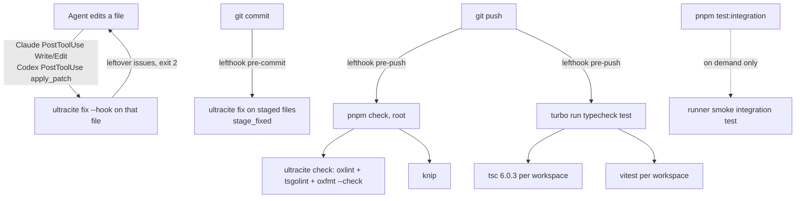

# Modern JS Tooling and Quality Gates - Plan

## Goal Capsule

- **Objective:** Every change to Atelier, whether an agent or Robert writes it, is formatted and linted when the file is saved, and nothing can be pushed with a type error, a lint error, dead code or a failing unit test.
- **Means:** Ultracite driving oxlint and oxfmt, with type-aware rules. lefthook runs the git hooks, Claude Code and Codex get post-edit hooks, every workspace tests with vitest, and Knip checks for dead code. All of it runs on TypeScript 6.0.3 (KTD1–KTD10).
- **Product authority:** Robert. The Product Contract below governs scope. rat-stack (`joelhooks/rat-stack`) is a reference, not a spec.
- **Execution profile:** one pull request on a new branch cut from `feat/shared-rooms`. It must land before room-document implementation starts (KTD8). Target repo: Atelier. Paths are relative to its root.
- **Stop conditions:** stop and ask Robert in any of these cases:
  - `oxlint-tsgolint` cannot run type-aware rules against TypeScript 6.0.3 configs.
  - Removing ESLint breaks `expo start` or the Expo Go launch flow in `LEARNINGS.md`.
  - Fixing a lint error would change runtime behavior in a way the existing tests do not cover.
  - Any tool requires an exe.dev feature beyond the documented ones.
- **Who finishes:** the implementing agent builds the work, verifies it through the Verification Contract and opens the PR. Robert merges.

---

## Product Contract

### Summary

Add one quality toolchain across the whole monorepo:

- **Lint and format:** Ultracite with oxlint (type-aware) and oxfmt, replacing the mobile app's ESLint.
- **Tests:** vitest in every workspace, with coverage reporting.
- **Dead code:** Knip.
- **Git hooks:** lefthook formats staged files on commit and runs the full check on push.
- **Agent hooks:** Claude Code and Codex fix each file an agent edits.

Existing code is reformatted once and then brought to a clean lint pass. TypeScript stays on 6.0.3, the latest 6.x release and the version Expo SDK 58 pins.

### Problem Frame

Atelier is mostly written by agents: Claude Code, Codex and Pi working in rooms, plus Robert. Today only `apps/mobile` is linted (ESLint through `expo lint`). Nothing formats code. No git hook runs. Tests are split between `node --test` in the runner and vitest in the backend and web app.

As a result, agent-written code reaches review with inconsistent style, unchecked floating promises and unused code. Problems only surface at runtime or when a human reads the diff. The project is about to grow quickly, with shared rooms, a web app and a room document. A shared gate is cheapest to add now, before more branches are in flight.

### Requirements

**Lint and format**

- R1. One command checks formatting and lint across every workspace (`apps/mobile`, `apps/web`, `packages/backend`, `packages/shared`, `runner`), and one command applies all safe fixes.
- R2. Linting includes type-aware rules, such as floating promises and misused promises, for every TypeScript file covered by a tsconfig.
- R3. ESLint and `eslint-config-expo` are removed. oxlint is the only linter.
- R4. After this work, the existing code passes the check clean under Ultracite's strict preset. A rule is disabled only where it conflicts with a Convex, Expo or TanStack Router convention, and the reason sits next to the disable in the config.

**TypeScript**

- R5. Every workspace typechecks with the same TypeScript version, 6.0.3, and no tool warns about a mismatch with Expo SDK 58's pinned version.

**Tests**

- R6. Every workspace runs unit tests with vitest through one turbo `test` task, and the runner's existing `node --test` suites are migrated without losing coverage.
- R7. Tests that need real external CLIs (pi, codex) run only through a separate integration command, never in the default test run or hooks.
- R8. `apps/mobile` gets a vitest setup for pure logic, and the plan adds seed tests for logic extracted from mobile components.
- R9. Coverage reports are produced on demand, per workspace.

**Dead code**

- R10. Knip reports unused files, exports and dependencies across all workspaces. Its check is part of the full check and passes clean after this work.

**Hooks**

- R11. On commit, staged files are formatted and safe-fixed, and the fixes are re-staged. This must take seconds, not minutes.
- R12. On push, typecheck, the full lint (including type-aware rules), Knip and unit tests all run and must pass.
- R13. When Claude Code or Codex writes or edits a file in this repo, that file is formatted and safe-fixed right away. Anything left unfixed is reported back to the agent.

**Agent guidance**

- R14. `AGENTS.md` gains a short hand-written tooling section: the commands, the hooks, and the rule never to bypass them. It does not include Ultracite's generated rules block.

### Success Criteria

- A fresh clone that runs the root install has working git hooks with no manual step.
- On the finished branch, the full check, typecheck and unit tests pass clean from the repo root.
- In a fresh agent session, an edit that leaves a file misformatted is corrected before the agent's next step.
- The Expo Go launch flow in `LEARNINGS.md` still works unchanged.

### Scope Boundaries

- CI (GitHub Actions) is out of scope. Pre-push is the gate for now.
- Exact version pinning, `devEngines` and `.nvmrc` are not added. Dependency ranges stay in their current caret and tilde style.
- No editor settings are committed. The mobile app's existing `.vscode` files stay as they are.
- tsconfig flags are not tightened beyond what the tools require.
- React Native component tests (jest-expo or React Native Testing Library) are not added. Mobile tests cover pure logic only.
- Ultracite's agent rules block is not injected into `AGENTS.md` or `CLAUDE.md`.
- Considered and not built: a PreToolUse hook that blocks `git commit --no-verify`, as rat-stack has. Robert left it out when choosing hooks. Revisit it if agents are seen bypassing hooks.
- Considered and not built: renaming existing files to satisfy a filename-case rule (KTD6). Renames would churn imports across in-flight branches for no behavior gain.

#### Deferred to Follow-Up Work

- Move to TypeScript 7 once Expo's SDK pins it (KTD1).
- Add a GitHub Actions workflow that runs the same turbo pipeline as pre-push.

### Key Decisions

- **Ultracite with oxlint and oxfmt everywhere, ESLint removed from mobile.** This loses the few RN/Expo-specific ESLint rules, because oxlint has no React Native plugin. (session-settled: user-directed — chosen over keeping ESLint for mobile or using Biome: one linter for the monorepo, matching rat-stack.) Governs R1, R3.
- **Strict preset, all existing violations fixed.** (session-settled: user-directed — chosen over baselining violations as warnings: no lint debt carried forward.) Governs R4.
- **Vitest everywhere, plus seed tests.** (session-settled: user-directed — chosen over infra-only setup or adding RN component tests.) Governs R6, R8.
- **No CI, no pinning, no editor settings, no stricter tsconfig.** (session-settled: user-directed — chosen over including them as extras.)
- **Agent hooks for Claude Code and Codex only.** (session-settled: user-directed — chosen over also adding Cursor/other hooks and a `--no-verify` blocker.) Governs R13.
- **Short hand-written tooling section in `AGENTS.md`.** (session-settled: user-directed — chosen over Ultracite's full rules block: keeps per-session agent context small.) Governs R14.

---

## Planning Contract

### Key Technical Decisions

- KTD1. **TypeScript stays on 6.0.3 in every workspace.** Expo SDK 58 pins `typescript ~6.0.3`, and `expo start` and `expo-doctor` flag anything else. TS 7.0 also ships no compiler API. Type-aware lint does not need TS 7: `oxlint-tsgolint` ships its own native binary (built on typescript-go) and never loads the installed `typescript` package. Its "TS 7+" requirement concerns tsconfig compatibility, and the repo's tsconfigs avoid the options TS 7 removes (no `baseUrl`, `node10` resolution or `es5` target). (session-settled: user-directed — chosen over TypeScript 7.0.2: prefer the most compatible current versions over the newest compiler.) Governs R5.
- KTD2. **Set up through `ultracite init` non-interactively, then hand-correct.** Use the oxlint provider, pnpm, the lefthook integration, Claude and Codex hooks, type-aware rules and the vitest framework. Leave out agent rules and editor settings. Per-workspace frameworks are react plus react-native for `apps/mobile` and react for `apps/web`. After init, apply these corrections:
  - Bump oxfmt, because init installs `^0.75.0`, which on a 0.x version means below 0.76.
  - Delete `apps/mobile/eslint.config.js` by hand, because init only removes root-level ESLint setup.
  - Keep `typescript` at `~6.0.3` wherever init or upgrade touches it.

  Generating the config keeps it upgradeable with `ultracite upgrade`, and the corrections are small. Governs R1–R3, R11, R13.
- KTD3. **Accept Ultracite's oxfmt defaults:** double quotes, 80 columns, `trailingComma: "es5"`, sorted imports, Tailwind class sorting and sorted `package.json`.
  - The code currently uses single quotes in a dense style, so nearly every line changes.
  - The reformat lands as its own commit, recorded in `.git-blame-ignore-revs` (U2). That keeps `git blame` useful and keeps the reformat separate from behavior-adjacent lint fixes (U3).
- KTD4. **Root config, workspace overrides only where needed.** The Ultracite core preset lives in root `oxlint.config.ts` and `oxfmt.config.ts`.
  - `apps/mobile` and `apps/web` get workspace oxlint configs that extend the root and add the React presets.
  - oxlint only reads the nearest config, so each workspace config repeats the root's `env`, `ignorePatterns` and `settings`.
  - `typeAware` is set in the root config only, as oxlint requires. tsgolint lints each file under the tsconfig that includes it.
- KTD5. **Files no tsconfig includes get a tsconfig, so type-aware rules cover them.**
  - `packages/backend/tests/**` sits outside `packages/backend/convex/tsconfig.json`. A small `packages/backend/tsconfig.json` will include the tests and reference the convex config.
  - Root and workspace config files (`*.config.ts`) stay syntax-linted only.
- KTD6. **Rule-disable policy (R4).** A rule is disabled or scoped only in these cases:
  - It conflicts with a framework convention that cannot change:
    - Convex default exports and `_generated` code.
    - Expo Router file names `[id].tsx` and `_layout.tsx`.
    - TanStack Router route files.
    - Existing camelCase and PascalCase file names in `apps/web`. Renaming these would churn imports for no behavior gain.
  - It duplicates TypeScript's own checks.

  Each disable carries a one-line reason in the config. A few inline disable comments are acceptable when a rule is right in general but wrong at one site, and each needs a reason.
- KTD7. **Vitest layout.** Each workspace gets its own `vitest.config.ts` and a `test` script, run through turbo so results cache per package.
  - The runner's `smoke.test.ts` becomes `smoke.integration.test.ts`. It is excluded from the default config and run by a separate `test:integration` script, which is not a turbo `test` dependency.
  - Coverage uses `@vitest/coverage-v8` at the vitest version, through a per-workspace `test:coverage` script and a root `coverage` turbo task.
  - Mobile tests must not import `react-native`, because vitest cannot parse its Flow source. Mobile seed tests target pure modules under `apps/mobile/src/lib/`.
- KTD8. **Base branch `feat/shared-rooms`, landing before room-document work.** That branch adds `apps/web` and about 15k lines over `main`, and the room-document plan (`docs/plans/2026-11-06-1730-feat-room-document-plan.md`) branches from it. Landing the reformat first means no in-flight branch has to absorb it. (session-settled: user-directed — chosen over waiting for shared-rooms to merge or branching from `main`: avoids rebasing two branches across a whole-repo reformat.)
- KTD9. **Hook split.**
  - **pre-commit:** runs `ultracite fix` on staged files only, with `stage_fixed`. This is the shape Ultracite generates.
  - **pre-push:** runs the root `check` script (Ultracite check including type-aware lint, plus Knip), then the turbo `typecheck` and `test` tasks.
  - `check` is a single root-level command, not a per-workspace turbo task. Ultracite reads the root config across all workspaces, and Knip is configured once with per-workspace entries. Running either per package would duplicate or break them.
  - lefthook installs through a root `prepare` script, with `lefthook` allowed in `pnpm-workspace.yaml` `allowBuilds`.

  (session-settled: user-approved — chosen over running everything on pre-commit or formatting only: fast commits with a full gate before code leaves the machine.) Governs R11, R12.
- KTD10. **Agent hooks are committed project files.**
  - Claude Code gets a PostToolUse hook on `Write|Edit` in root `.claude/settings.json`.
  - Codex gets a PostToolUse hook on `apply_patch` in `.codex/hooks.json`.
  - Both run `ultracite fix --hook`, which reads the edited path from the hook's stdin JSON, fixes only that file, and exits 2 with stderr when issues remain. Both agents feed that output back to the model.
  - The existing `apps/mobile/.claude/settings.json` (Expo plugin) stays as it is.

  Governs R13.

### High-Level Technical Design

Three points trigger the same toolchain. Each runs a progressively wider check.

### Assumptions

- `@vitest/coverage-v8` is published at the same version as vitest 5.1.x. Install whichever version matches the resolved vitest exactly.
- Codex runs project hooks only after the repo's `.codex/` folder is trusted in Codex. That trust step is Robert's, one time per machine, and is documented rather than automated.

---

## Implementation Units

### U1. Install the toolchain and generate configs

**Goal:** Ultracite, oxlint, oxfmt, oxlint-tsgolint, lefthook, Knip and vitest coverage are installed. The root and workspace configs exist, ESLint is gone, and TypeScript is 6.0.3 everywhere.

**Requirements:** R1, R2, R3, R5

**Dependencies:** none. Start from a new branch cut from `feat/shared-rooms` (KTD8).

**Files:**
- Create: `oxlint.config.ts`, `oxfmt.config.ts`, `apps/mobile/oxlint.config.ts`, `apps/web/oxlint.config.ts`, `packages/backend/tsconfig.json`
- Modify: `package.json`, `pnpm-workspace.yaml`, `pnpm-lock.yaml`, `turbo.json`, `apps/mobile/package.json`, `apps/web/package.json`, `packages/backend/package.json`, `packages/shared/package.json`, `runner/package.json`
- Delete: `apps/mobile/eslint.config.js`

**Approach:**
1. Run Ultracite init with the KTD2 flags, then apply the KTD2 corrections: bump oxfmt to latest 0.x and keep `typescript` at `~6.0.3`.
2. Add `"expo": { "install": { "exclude": [...] } }` to `apps/mobile/package.json` only if `expo install --check` or `expo-doctor` flags a tool this work installs.
3. Write the workspace oxlint configs (KTD4) and `packages/backend/tsconfig.json` (KTD5).
4. Add root scripts:
   - `check`: Ultracite check, then Knip, run once from the root (KTD9).
   - `fix`: Ultracite fix.
   - `test`, `coverage` and `prepare`.
5. Give each workspace `typecheck` and `test` scripts. Workspaces get no `check` script.
6. Remove the mobile `lint` script, `eslint` and `eslint-config-expo`.
7. Update the turbo tasks:
   - Add `test` and `coverage`, the latter with `coverage/**` outputs.
   - Drop `lint`.
   - Add `tsconfig.base.json` to `globalDependencies`, so a change to the shared tsconfig invalidates cached `typecheck` results.
8. Add `coverage/` to `.gitignore`.
9. Add `apps/web/src/routeTree.gen.ts` to the root oxlint and oxfmt `ignorePatterns`. It is TanStack Router output that the Vite plugin regenerates, alongside `_generated`, `.expo` and `.turbo`, which the preset already ignores.

**Execution note:** this unit is packaging and config. Prove it with install and a first `check` run (expected to fail on formatting until U2), not with unit tests.

**Patterns to follow:**
- rat-stack's `oxlint.config.ts` (`extends: [core]`, `options.typeAware`) and `oxfmt.config.ts` (spread of `ultracite/oxfmt` plus `ignorePatterns`).
- Ultracite's shared ignore list, which already covers `**/_generated`, `**/.expo` and `**/.turbo`.

**Test expectation:** none. This unit only changes tooling and configuration.

**Verification:**
- `pnpm install` succeeds with no blocked-build warning for lefthook.
- `git config core.hooksPath` or `.git/hooks` shows lefthook installed.
- `ultracite doctor` reports a healthy setup.
- tsgolint runs type-aware rules: introduce a deliberate floating promise in a scratch edit, confirm it is reported, then revert it.
- `expo start` in `apps/mobile` raises no TypeScript version warning.

### U2. Reformat the repository in one isolated commit

**Goal:** All tracked source, JSON, YAML and Markdown that oxfmt handles is reformatted to the KTD3 style, with no other change in the same commit.

**Requirements:** R1, R4

**Dependencies:** U1

**Files:**
- Modify: every formattable tracked file outside ignored paths.
- Create: `.git-blame-ignore-revs`, containing the reformat commit's SHA. It is added in a follow-up commit, because a commit cannot contain its own SHA.

**Approach:**
1. Run the formatter only. Do not apply lint fixes, so this commit stays a pure, reviewable reformat.
2. Make the reformat commit with lefthook disabled (`LEFTHOOK=0`). U1's `prepare` script has already installed the pre-commit hook, and that hook would apply lint fixes to the staged files.
3. Leave `convex/_generated/**` and `apps/web/src/routeTree.gen.ts` untouched. Both are ignored generated output.
4. Check that oxfmt's Markdown handling leaves the docs readable, especially `docs/v0-spec.md`, `LEARNINGS.md` and the plans. Ultracite sets `proseWrap: "never"`, which suits the docs' one-paragraph-per-line style. If Markdown output degrades a doc, add that path to `ignorePatterns` rather than accept damage.

**Test expectation:** none. Formatting only. The existing test suites passing after the reformat is the behavior check.

**Verification:**
- The formatter's check mode reports clean.
- Typecheck still passes, and the existing backend, web and runner tests pass unchanged.
- The commit diff has no token-level changes beyond whitespace, quotes, commas, import order and Tailwind class order.

### U3. Fix all lint errors under the strict, type-aware preset

**Goal:** The Ultracite check passes with zero errors across every workspace, following the KTD6 disable policy.

**Requirements:** R2, R4

**Dependencies:** U2

**Files:**
- Modify: source files across `runner/src/**`, `packages/backend/convex/**`, `packages/backend/tests/**`, `apps/web/src/**`, `apps/mobile/src/**`, as the lint output dictates.
- Modify: `oxlint.config.ts` and the workspace oxlint configs, for KTD6 disables only.

**Approach:**
1. Apply safe auto-fixes first, as their own commit.
2. Fix the remaining errors by hand, grouped by rule family, so a reviewer can follow each kind of change.
3. Handle floating and misused promises explicitly:
   - Await the promise where the caller should observe failure.
   - Use `void` only where fire-and-forget is the intended design, such as the runner's polling loops and the mobile `void import('expo-notifications')`, and say why in a short comment.
4. Replace non-null assertions with narrowing, or with an explicit error when the value is truly guaranteed.
5. Leave the runner's adapter control flow and the Convex transaction boundaries unchanged in shape. Where a fix would alter them, stop per the Goal Capsule.

**Execution note:** run the affected workspace's existing tests after each rule-family batch. Where a fix touches runner adapter or Convex mutation logic that the existing tests do not cover, add a characterization test before changing it.

**Patterns to follow:**
- `LEARNINGS.md` "Independent review" notes. Cancellation polling must start only after the start mutation commits, so promise fixes in `runner/src/index.ts` and `runner/src/turns.ts` must keep that order.

**Test scenarios:**
- Existing `runner/src/turns.test.ts`, `review.test.ts`, the adapter tests and every `packages/backend/tests/*.test.ts` pass unchanged after the fixes. These suites are the behavior lock.
- Characterization, added only where a promise or assertion fix touches untested runner or Convex code: the touched function's observable outcome is the same before and after the fix. For example, a rejected harness start still marks the turn failed, and nothing is left unhandled.

**Verification:**
- The full check reports zero errors and zero warnings.
- Every config disable has a reason next to it.
- The disable count is small enough that a reviewer can read each one.

### U4. Standardize on vitest, migrate the runner tests and add seed tests

**Goal:** Every workspace tests through vitest under one turbo `test` task, the CLI smoke test is integration-only, and coverage runs on demand.

**Requirements:** R6, R7, R8, R9

**Dependencies:** U3. The migrated tests must pass lint.

**Files:**
- Create: `runner/vitest.config.ts`, `packages/backend/vitest.config.ts`, `packages/shared/vitest.config.ts`, `apps/mobile/vitest.config.ts`
- Create: `apps/mobile/src/lib/notification-route.ts` and `apps/mobile/src/lib/notification-route.test.ts`
- Create: `apps/mobile/src/lib/review-participants.ts` and `apps/mobile/src/lib/review-participants.test.ts`
- Rename: `runner/src/adapters/smoke.test.ts` → `runner/src/adapters/smoke.integration.test.ts`
- Modify: `runner/src/review.test.ts`, `runner/src/turns.test.ts`, `runner/src/rotate-secret.test.ts`, `runner/src/adapters/claude.test.ts`, `runner/src/adapters/codex.test.ts`, `runner/src/adapters/pi.test.ts`
- Modify: `apps/mobile/src/components/push-routing.tsx`, `apps/mobile/src/components/reviews.tsx`
- Modify: `apps/web/vite.config.ts`, for coverage config only. Its test block already exists.
- Modify: the workspace `package.json` files, for `test`, `test:coverage` and `test:integration` scripts.

**Approach:**
1. Translate the runner tests from `node:test` and `node:assert` to vitest:
   - `mock.timers` becomes `vi.useFakeTimers` / `vi.advanceTimersByTime`.
   - `mock.fn` becomes `vi.fn`.
   - `assert.rejects` becomes `expect(...).rejects`.
   - The runner keeps executing `.ts` natively at runtime. Vitest handles the TypeScript only in tests.
2. Exclude `*.integration.test.ts` from the runner's default config and add a `test:integration` script (KTD7).
3. Move the backend's inline `vitest run tests` flags into its config file.
4. Shared exports only types plus `HARNESS_IDS`. Give it a config with `passWithNoTests` rather than padding it with a test.
5. Extract two pure functions from mobile components and call them from the components:
   - From `push-routing.tsx`: read a notification response, validate the ritual id, and return a route or nothing.
   - From `reviews.tsx`: toggle a participant's exclusion and compute the included participant ids.

   The components' behavior stays the same.

**Execution note:** migrate one runner test file at a time and confirm its test count matches the `node --test` run before deleting the old form.

**Patterns to follow:**
- `apps/web/vite.config.ts` test block (`include`, `setupFiles`) for config shape.
- `packages/backend/tests/review.test.ts` for vitest style in this repo.

**Test scenarios:**
- Migration parity: each runner test file reports the same number of tests under vitest as under `node --test`, and all pass.
- `turns.test.ts` timer-driven cases (minute-based steering and queue timeouts) pass with vitest fake timers, and the timers are reset after each test.
- The default runner `test` run does not execute the smoke test. `test:integration` executes it, and it passes on a machine with pi and codex installed.
- Notification route, happy path: a response whose data has `ritualId: "abc123"` returns the ritual route with that id.
- Notification route, edge case: a missing response, a missing or non-string `ritualId`, or an id containing characters outside `[a-z0-9]` (for example `"../x"`) returns nothing.
- Notification route, edge case: a response whose identifier equals the last handled identifier returns nothing, so a notification is never routed twice.
- Review participants: toggling an included participant excludes them, and toggling again re-includes them.
- Review participants: included ids preserve the original participant order, and excluding everyone yields an empty list, which the Start button's disabled state relies on.
- Coverage: `test:coverage` in each workspace writes a report under that workspace's `coverage/`.

**Verification:** `turbo run test` passes from the root in every workspace with no CLI dependency, and the mobile app still routes from a tapped notification in Expo Go.

### U5. Add Knip and clear its findings

**Goal:** Knip runs across all workspaces as part of the check and reports nothing.

**Requirements:** R10

**Dependencies:** U4. Test files and new lib modules must exist so Knip sees them as used.

**Files:**
- Create: `knip.json`
- Modify: source files and `package.json` files, as the findings dictate.

**Approach:**
1. Configure one `workspaces` entry per package.
2. Give the backend `typescript.config: ["convex/tsconfig.json"]`.
3. Add `runner/src/adapters/pi-cli.mjs` as a runner entry if Knip does not infer it. The Pi adapter launches it by path.
4. Rely on auto-enabled plugins (expo, expo-router, convex, vitest, lefthook, oxlint, oxfmt, turbo). Do not use `ignore` for `convex/_generated`, which Knip treats as entry files. Use `ignoreIssues` only if Knip reports issues there or in `apps/web/src/routeTree.gen.ts`.
5. Fix each finding by deleting what is unused. Where an export is used only by tests, or a dependency is used only by a CLI, add a targeted Knip exception with a reason.

**Test expectation:** none. Removal of dead code is proven by typecheck, lint and the existing tests passing.

**Verification:** Knip exits clean. Typecheck and unit tests still pass after the removals, and `expo start` and `convex dev` still start.

### U6. Wire the git hooks

**Goal:** Commits auto-format staged files, and pushes are blocked unless the full gate passes.

**Requirements:** R11, R12

**Dependencies:** U5. The full gate must already be green, or the first push blocks.

**Files:**
- Create or modify: `lefthook.yml`
- Modify: `package.json` (`prepare` script, if U1 has not already added it)

**Approach:**
1. Keep Ultracite's generated pre-commit job (KTD9).
2. Add a pre-push job that runs the root `check` script, then the turbo `typecheck` and `test` tasks (KTD9).
3. Do not add the integration tests to either hook (R7).

**Test expectation:** none. This is hook configuration, verified by exercising the hooks.

**Verification:**
- Committing a deliberately misformatted staged file results in a commit containing the formatted file.
- Pushing with a type error, a lint error or a failing unit test is rejected. Check each once, then revert.
- pre-commit on a typical small change finishes in a few seconds.

### U7. Add the Claude Code and Codex autoformat hooks

**Goal:** Files that Claude Code or Codex edit in this repo are fixed immediately, and leftover issues go back to the agent.

**Requirements:** R13

**Dependencies:** U3. The repo must be lint-clean so hook feedback reflects only the agent's own edit.

**Files:**
- Create or modify: `.claude/settings.json` (repo root)
- Create or modify: `.codex/hooks.json`

**Approach:**
1. Keep the hook configs that Ultracite generated in U1 (KTD10), and check that the command uses `pnpm exec ultracite fix --hook`.
2. Do not merge or move `apps/mobile/.claude/settings.json`.

**Test expectation:** none. This is agent configuration, verified live.

**Verification:**
- In a Claude Code session at the repo root, an Edit that writes single-quoted, misformatted code leaves the file formatted afterwards. An edit that introduces an unfixable lint error, such as an unused variable, produces hook feedback the agent sees.
- The same works in a Codex session after the `.codex/` folder is trusted.

### U8. Document the tooling for agents and humans

**Goal:** Agents and Robert know the commands, hooks and limits without reading configs.

**Requirements:** R14

**Dependencies:** U6, U7

**Files:**
- Modify: `AGENTS.md`, `LEARNINGS.md`, `apps/mobile/AGENTS.md`

**Approach:**
1. In `AGENTS.md`, add a short tooling section:
   - `pnpm check`, `pnpm fix`, `pnpm test`, `pnpm coverage`, and `pnpm --filter @atelier/runner test:integration`.
   - What the pre-commit and pre-push hooks do, and that agents must never bypass them.
   - Mobile tests must not import `react-native`.
2. In `LEARNINGS.md`, record:
   - TypeScript stays on 6.0.3 until Expo pins 7 (KTD1).
   - oxfmt must be bumped past Ultracite's pin after `ultracite init` or `upgrade`.
   - Codex project hooks need `.codex/` trusted.
   - Agent sessions should start at the repo root for hooks to apply.
3. In `apps/mobile/AGENTS.md`, replace `npx expo lint` with the repo check command, because ESLint is gone.

**Test expectation:** none. Documentation only.

**Verification:** the commands named in the docs exist and run as described.

---

## Verification Contract

| Gate | Command (repo root) | Must show |
|---|---|---|
| Format and lint | `pnpm check` | Ultracite check (oxlint with type-aware rules, oxfmt check) and Knip all clean |
| Typecheck | `pnpm typecheck` | `tsc` 6.0.3 passes in every workspace |
| Unit tests | `pnpm test` | vitest passes in every workspace with no external CLI |
| Integration | `pnpm --filter @atelier/runner test:integration` | Smoke test passes on a machine with pi and codex installed |
| Coverage | `pnpm coverage` | Per-workspace reports written under each `coverage/` |
| Hooks | commit and push exercises from U6 | pre-commit re-stages fixes, and pre-push blocks each failing gate |
| Agent hooks | live edits from U7 | Claude and Codex edits are fixed, and leftover issues are reported |
| App still runs | `LEARNINGS.md` Expo Go flow, `convex dev`, runner start | Mobile loads in Expo Go, Convex deploys and the runner connects |

---

## Definition of Done

- Every gate in the Verification Contract passes on the branch cut from `feat/shared-rooms`.
- `apps/mobile` contains no ESLint dependency, config or script. No workspace declares a TypeScript version other than `~6.0.3`.
- The reformat sits in its own commit, listed in `.git-blame-ignore-revs`. Lint fixes are in separate commits.
- Every lint-rule disable and Knip exception carries a reason.
- The runner test count under vitest matches the pre-migration `node --test` count.
- No experimental or abandoned config, scripts or code from dead-end attempts remains in the diff.
- The PR is open against `feat/shared-rooms` (or `main` if shared-rooms has merged by then). Its description lists the session-settled decisions and the KTD1 TypeScript choice.

---

## System-Wide Impact

- **Atelier's own agent turns:** the runner drives Claude Code (Agent SDK) and Codex turns in a room's working directory. For the "building Atelier inside Atelier" room, that directory is this repo, so the project hooks from U7 can also fire inside room turns.
  - For ordinary turns this is intended: their edits get formatted too.
  - Independent review turns are read-only: no Write/Edit tools for Claude, and a read-only sandbox for Codex. They should never trigger a fix.
  - U7 verification includes one ordinary room turn and one review turn in the Atelier room. The ordinary turn's edit must come back formatted. The review turn must not change any file, and must not surface hook errors in the sealed answer.
  - Whether the Agent SDK loads project hooks depends on the runner's settings sources. Record what the turn shows, but do not change runner code for it in this plan.
- **Other agents' sessions:** T3, Codex and Claude Code sessions that open this repo now run `ultracite fix` after edits. A session started in a subfolder may skip files outside it (U8 documents this).
- **Contributors' first install:** `prepare` installs git hooks on `pnpm install`. Anyone pushing must have the full gate passing locally.

---

## Risks & Dependencies

| Risk | Mitigation |
|---|---|
| tsgolint rejects or mis-handles TS 6.0.3 projects | U1 verifies type-aware rules fire before any reformat. If they don't, stop per the Goal Capsule rather than silently dropping R2 |
| The reformat conflicts with work in flight on `feat/shared-rooms` or room-document | Land before room-document starts (KTD8). If shared-rooms receives more commits first, rebase this branch and re-run the formatter rather than hand-resolving format conflicts |
| Lint fixes alter runner or Convex behavior | Rule-family commits, existing suites as the behavior lock, and characterization tests before touching untested logic (U3) |
| `ultracite upgrade` later re-pins oxfmt below the installed version | Recorded in `LEARNINGS.md` (U8) |
| Pre-push becomes slow as tests grow | Turbo caches per-package results. Revisit if pushes exceed about a minute |

---

## Sources & Research

- `joelhooks/rat-stack` (HEAD `59c8a5d`, 2026-11-05): `oxlint.config.ts`, `oxfmt.config.ts`, `lefthook.yml`, `.claude/settings.json`, `package.json`. The reference shape for KTD2 and KTD4. Its only agent hook blocks `--no-verify`; it has no autoformat hook.
- Ultracite 8.1.1 package source and docs: https://www.ultracite.ai/docs/monorepos, https://www.ultracite.ai/docs/ai/hooks and https://www.ultracite.ai/docs/git-hooks (init flags, hook shapes, oxfmt pin).
- oxc docs: https://oxc.rs/docs/guide/usage/linter/type-aware.html (tsgolint, per-tsconfig programs, root-only `typeAware`) and https://oxc.rs/docs/guide/usage/formatter/config.html.
- TypeScript 7.0 announcement: https://devblogs.microsoft.com/typescript/announcing-typescript-7-0/. TS 7 ships no API, which is part of the reasoning for KTD1.
- Expo SDK 58's version pins (`typescript ~6.0.3`) and `@expo/cli` source: the CLI only checks that `typescript/package.json` resolves.
- Knip 6.44.1 source: it parses with oxc-parser and does not depend on `typescript`.
- Prior plan sharing the base branch: `docs/plans/2026-11-06-1730-feat-room-document-plan.md`.
