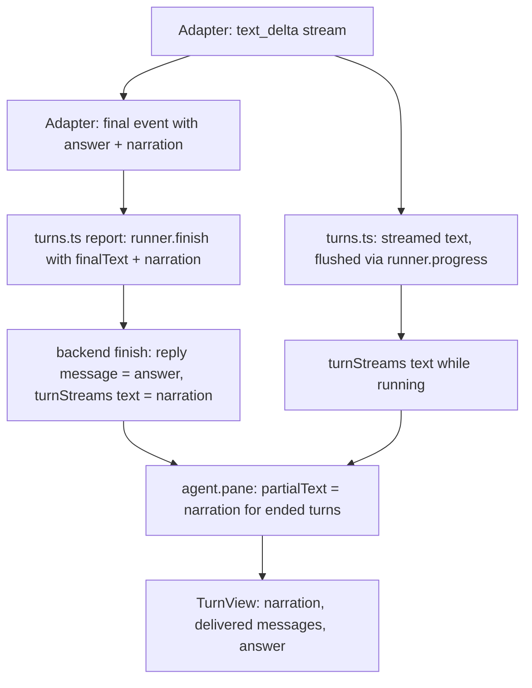
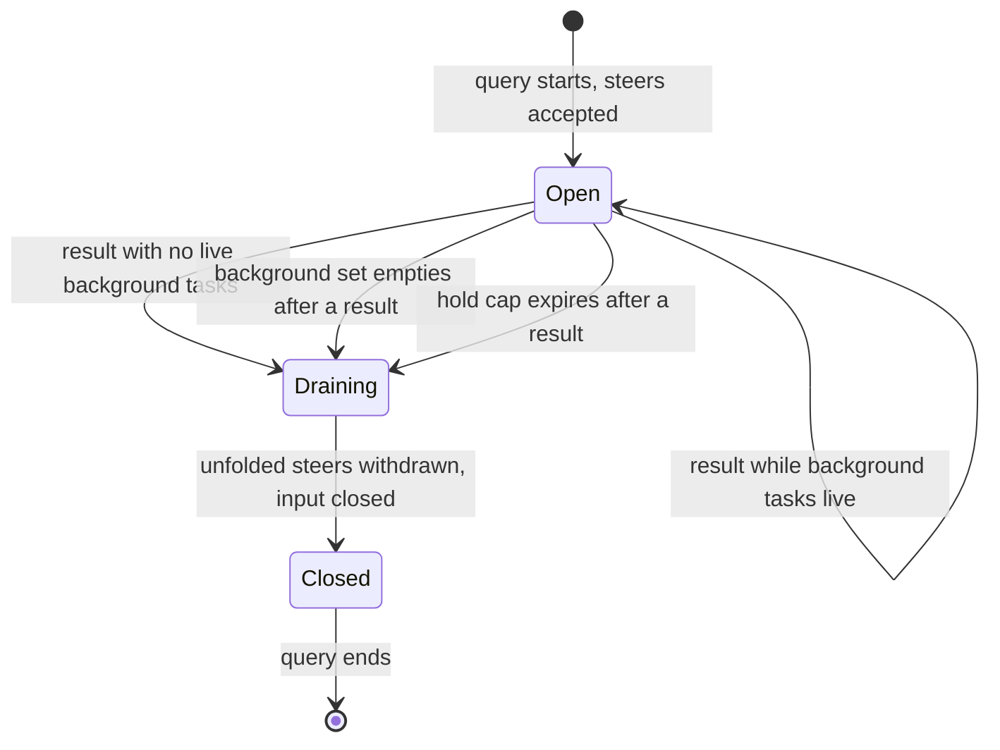

# Web E2E Findings Fixes - Plan

## Goal Capsule

- **Objective:** Robert and an invited teammate can work in a shared room on the web without the app contradicting itself. Invites work, every agent has its current room tools, each answer appears once, and steer controls appear only when steering can work. The room page fits a phone and the forms stay put while you type.
- **Means:** Fix each finding at the layer that causes it. Runner adapters report narration separately from the answer (KTD1). The backend tells the pane what can be steered (KTD3). The two broken setup steps are done on the VM (KTD10).
- **Authority:** The findings doc `docs/plans/2026-11-07-1100-web-e2e-findings.md` defines each defect and its repro. This plan's R-IDs define the fixed behavior, and the KTDs define the mechanism. `AGENTS.md` and `LEARNINGS.md` bind how work is done and verified.
- **Execution profile:** One PR from branch `docs/web-e2e-findings`, which already holds the findings doc. U1 runs on the VM first, outside the PR. U3 starts with a live probe that decides between its two designs.
- **Stop conditions:**
  - Stop and ask if `CLERK_SECRET_KEY` is still unset when U1 runs. Only Robert can supply it.
  - Stop and ask if any fix needs a schema change that breaks the mobile app's reads of `agent.pane` or `messages.timeline`.
- **Who finishes:** The executing agent opens the PR. After merge, it pushes the Convex functions, restarts the runner from `main`, and re-runs the browser checks in U10.

---

## Product Contract

### Summary

Fix all thirteen findings from the 2026-11-07 browser pass.

- Two are live setup steps: a stale runner, and a missing Clerk secret.
- Five are agent-pane behavior: doubled answers, steering, the order of steered and answered messages, and scrolling after send.
- The rest are layout, document line breaks, one Claude prompt hint, and invite checks.

Each fix is proven by a test and by repeating its browser repro.

### Problem Frame

The first end-to-end pass of the deployed web app worked through every main flow, but it found places where the app tells the user something false.

- Invites fail with a raw environment-variable name.
- Codex and Pi show "can't raise question cards" because the runner predates the code that gives them `raise_hand`.
- Answers render twice.
- **Steer now** is offered in turns that can never take a steer.
- The room page scrolls sideways at phone width.

None of these lose data. They do make a shared room feel broken to a teammate on their first visit, which is the moment the product is built for. See the findings doc for each repro.

### Requirements

**Live setup**

- R1. The running runner reports current capabilities, so Codex and Pi raise cards through `raise_hand` and no "can't raise question cards" badge shows (F1).
- R2. The owner can invite a teammate from **Members**. If invites are not configured, the sheet says so in a sentence, without naming an environment variable (F2).

**Agent pane**

- R3. A finished turn shows its answer once, preceded by any narration the agent produced before it, for Claude, Codex and Pi (F3).
- R4. While a Claude turn waits on a background command, **Steer now** and **Send and steer now** either reach the agent or are not offered; they are never offered and then refused (F4).
- R5. **Send and steer now** and **Steer now** appear only when the message can go into the running turn (F5).
- R6. A message steered into a turn, or a chat message that answered a turn's card, appears inside that turn before the turn's answer (F8).
- R7. Sending a message to an agent brings the pane to the bottom so the message is in view (F10).

**Layout**

- R8. At 360 px wide, the room page has no horizontal scroll and every document header action stays reachable (F6).
- R9. The badge on a folded panel strip ("Working", "1 question", "3 unread") is fully legible and does not overlap the strip's icon (F7).
- R10. The templates and new-room forms keep their top edge fixed while their content grows or shrinks (F12).

**Document**

- R11. A line break typed with Shift+Enter in a block shows as a line break (F9).

**Agents and invites**

- R12. When a chat message answers a multi-question Claude card, Claude is told that the one message answers every question (F11).
- R13. An invite to someone already in the room (including the owner), or to an address with an unexpired pending invite, is refused with a sentence saying why. A removed member can still be re-invited (F13).

### Success Criteria

- Each finding's repro from the findings doc, re-run in the browser against the deployed app after merge, shows the fixed behavior.
- A teammate invited through **Members** receives the link, joins and sees the room. This is the shared-rooms check list item the pass could not reach.

### Scope Boundaries

- Q1 (Test Room's Claude sees an empty `/home/exedev/Projects/`) is not in this plan. It may be a Claude Code sandbox setting on the VM, not an Atelier defect.
- Flows the pass could not test (teammate locks, unread badge from a real teammate, runner-offline banner) are verified only where U10 reaches them after invites work.
- Deleting the test room, the test template and the test messages left by the pass is not in this plan.
- Considered and not built: a removal path for agents in **Members**. Nothing in the findings asked for it.
- Considered and not built: a global markdown line-break plugin. Agent output would change too. KTD5 scopes the fix to document blocks.

#### Deferred to Follow-Up Work

- Q1 investigation, as its own `ce-debug` session on the VM.

---

## Planning Contract

### Key Technical Decisions

- KTD1. **Adapters report narration with the final answer.** The `final` harness event gains the text that came before the answer. Claude's narration is every streamed assistant message except the one each `result` reports. Codex's narration is empty, because its final already joins all agent messages. Pi's narration is every assistant message before the last one. On `runner.finish` the backend replaces the turn's streamed text with that narration, so the pane shows narration plus answer with no string matching. The web's suffix strip in `TurnView.streamedText` stays, because turns finished before this change still need it. A single "answer starts here" offset was rejected: Claude's final can be several non-adjacent pieces of the stream.
- KTD2. **Claude keeps its input open while background tasks run.** The adapter tracks the live set from the SDK's `background_tasks_changed` system message. A `result` closes input and stops accepting steers only when that set is empty. Otherwise it stays open until the set goes empty after a result. A steer pushed in that window runs as Claude's next turn inside the same query, which the adapter already reports as `steered` once its `started` lifecycle shows (`runner/src/adapters/claude.ts:224`). Only non-ambient tasks count toward the live set, and the hold is capped: once a set time has passed since the first result, input closes as it does today, so a backgrounded process that never exits cannot hold the turn open until the 30-minute turn deadline. The probe sets the cap. This depends on Claude Code behavior that is unverified, so U3 opens with a live probe. If the probe shows the background task is killed by open input or the steer never runs, U3 takes the fallback instead: the adapter keeps today's close-at-first-result behavior, and the runner reports through `runner.progress` that the turn no longer takes steers. `takesSteer` reads that flag, so the controls U4 shows are hidden for the rest of the turn. (session-settled: user-approved — chosen over documenting the refusal as a known limit: the confirmed scope said to fall back to hiding the button.)
- KTD3. **The pane says what can be steered.** `agent.pane` adds `takesSteer` to each agent, computed by the existing `takesSteer(active)` (`packages/backend/convex/lib/dispatch.ts:267`). Each queued pane message adds whether it may steer: not a thread mention, not a follow-up. The composer and queue strip read these fields instead of `status === "running"`. Both fields are additive, so the mobile app's reads are unaffected.
- KTD4. **Delivered messages render inside their turn.** `buildTimeline` (`apps/web/src/lib/room.ts:80`) groups messages whose `delivery` is `steered` or `answeredCard` under the turn named by `deliveredTurnId`, when that turn is in the pane window, and keeps them standalone otherwise. `TurnView` orders a turn as tool activity, narration, delivered messages, answer, cards. No backend change is needed, because `deliveredTurnId` and `delivery` already reach the pane (`packages/backend/convex/agent.ts:217`).
- KTD5. **Block line breaks via CSS on document blocks only.** Document block paragraphs and list items render with `white-space: pre-line`, scoped by a class on `BlockText`. `StreamingMarkdown` and agent output are untouched. A remark plugin was rejected because it adds a dependency for one style rule.
- KTD6. **Invite checks run before any Clerk call.** An internal query refuses an address that belongs to an active member of the room, or that has a pending invite whose expiry has not passed. It runs inside `invites.create` before Clerk is contacted, so a refused invite never sends an email. Members are matched by iterating `roomMembers` by room, as `members.list` does, since `users` has no email index. Removed members and expired invites are allowed.
- KTD7. **Missing invite configuration gets a sentence, not a variable name.** `invites.create` checks for the Clerk key and the web URL before doing any work. If either is missing it throws "Invites aren't set up on this server yet." The variable name goes only to the Convex log.
- KTD8. **Form pages are top-aligned.** `StandalonePage` (`apps/web/src/components/ui/standalone-page.tsx`) takes an alignment option. `routes/templates.tsx` and `routes/rooms.new.tsx` use top alignment. Message pages (invite, unknown room) stay centred.
- KTD9. **Claude's card answer says how it was given.** In `askRoom` (`runner/src/adapters/claude.ts:124`), a chat answer's annotation note says it came in chat and that the one message answers every question on the card. Card answers keep "Answered by <name>".
- KTD10. **Setup fixes run on the VM; the secret comes from Robert.** The runner is restarted from `main` in `/home/exedev/Projects/atelier`, stopping only Atelier's runner process, per `LEARNINGS.md` "Start and verify". `CLERK_SECRET_KEY` is set on the Convex deployment by Robert, or by the agent from a value Robert provides in a shell, never typed into a browser.

### High-Level Technical Design

Narration flow for KTD1, from adapter to pane:

Claude adapter input lifecycle for KTD2:

### Sequencing

U1 runs first, because U10's invite check and R1 depend on it. U2 to U9 are independent of each other, except that U3 builds on U4's steerability field. U3's probe should run early, since its result decides that unit's design. U10 runs last: docs, then post-merge deploy and browser re-verification.

### Implementation Constraints

- No new code comments (Robert's global instructions). A lint disable needs a `-- reason`.
- Mobile tests cover only pure modules in `apps/mobile/src/lib/` (`AGENTS.md`). This plan changes no mobile code. Any pane field it adds must be additive.
- Backend changes reach the live app only after `npx convex dev --once` from `packages/backend` (`LEARNINGS.md`, shared rooms build pitfalls). `convex codegen` does not push.

---

## Implementation Units

| U-ID | Title                                                | Key files                                                                                                   | Depends on |
| ---- | ---------------------------------------------------- | ----------------------------------------------------------------------------------------------------------- | ---------- |
| U1   | Bring live setup current                             | VM runner process, Convex env                                                                               | none       |
| U2   | Narration with the final answer                      | `packages/shared/src/`, `runner/src/adapters/*`, `runner/src/turns.ts`, `packages/backend/convex/runner.ts` | none       |
| U3   | Steering during Claude background tasks              | `runner/src/adapters/claude.ts`                                                                             | U4         |
| U4   | Steer controls only when steerable                   | `packages/backend/convex/agent.ts`, `AgentComposer.tsx`, `QueueStrip.tsx`                                   | none       |
| U5   | Delivered messages inside their turn; scroll on send | `apps/web/src/lib/room.ts`, `TurnView.tsx`, `AgentPane.tsx`                                                 | none       |
| U6   | Layout: header wrap, strip badge, top-aligned forms  | `DocumentPane.tsx`, `SidePanel.tsx`, `standalone-page.tsx`                                                  | none       |
| U7   | Block line breaks                                    | `BlockText.tsx`, `apps/web/src/index.css`                                                                   | none       |
| U8   | Claude told a chat answer covers the card            | `runner/src/adapters/claude.ts`                                                                             | none       |
| U9   | Invite checks and setup message                      | `packages/backend/convex/invites.ts`                                                                        | none       |
| U10  | Docs, deploy and browser re-verification             | `docs/*.md`, `LEARNINGS.md`                                                                                 | U1-U9      |

### U1. Bring live setup current

- **Goal:** The live runner runs current `main`, and invites can reach Clerk.
- **Requirements:** R1, R2
- **Dependencies:** none
- **Files:** none in the repo. VM checkout `/home/exedev/Projects/atelier`, runner process, Convex deployment environment.
- **Approach:**
  1. Ask Robert to set `CLERK_SECRET_KEY` on the Convex deployment the web uses, from an interactive VM shell in `packages/backend` (KTD10). Confirm `ATELIER_WEB_URL` is the Vercel domain.
  2. On the VM, check out `main` (the checkout is on `feat/atelier-mcp-tools`) and install dependencies if the lockfile changed.
  3. Stop only Atelier's runner and restart it detached with its log at `~/.atelier/logs/runner.log`.
- **Patterns to follow:** `LEARNINGS.md` "Start and verify" (stop only Atelier processes, keep logs private).
- **Test expectation:** none, because this is operations. U10 proves it in the browser.
- **Verification:** The runner log shows a fresh registration. In E2E Room, the Codex and Pi "can't raise question cards" badges are gone, and Codex lists `raise_hand` among its tools. An invite from **Members** returns a link instead of an error.

### U2. Narration with the final answer

- **Goal:** Finished turns show narration once and the answer once (KTD1).
- **Requirements:** R3
- **Dependencies:** none
- **Files:**
  - `packages/shared/src/harness.ts` (the `final` event)
  - `runner/src/adapters/claude.ts`, `runner/src/adapters/codex.ts`, `runner/src/adapters/pi.ts`
  - `runner/src/turns.ts`
  - `packages/backend/convex/runner.ts` (`finish` args and handler), `packages/backend/convex/lib/turnActivity.ts`
  - Tests: `runner/src/adapters/claude.test.ts`, `runner/src/adapters/codex.test.ts`, `runner/src/adapters/pi.test.ts`, `runner/src/turns.test.ts`, `packages/backend/tests/turn-items.test.ts`, `apps/web/src/components/room/room.test.tsx`
- **Approach:**
  1. Add optional narration to the `final` event.
  2. Claude: track each assistant message's streamed text. At each `result`, take the message that result reports out of the narration. Keep the existing `\n\n` joins.
  3. Codex: emit empty narration. Pi: emit narration from the assistant messages before the last.
  4. `turns.ts` passes narration to `runner.finish`. `finish` writes it as the turn's stream text whenever the field is supplied, including an empty string, so Codex's empty narration clears the stream. It leaves the stream untouched only when the field is missing, which covers an older runner.
  5. Review turns keep their existing sealing. Narration is written to the same `turnStreams` row the stream already uses, so visibility rules apply unchanged.
- **Patterns to follow:** `resultEvents` and `streamEvents` in `claude.ts`; `setStreamedText` in `turnActivity.ts`; the scripted fake CLI steps in `claude.test.ts`.
- **Test scenarios:**
  - Claude, one result, text before a tool call then answer text: final is the answer, narration is the pre-tool text.
  - Claude, two results (background task), text A, tool-only messages, then B: final is `A\n\nB`, narration is empty, with no doubled separators.
  - Claude, a turn with no text before its answer: narration is empty.
  - Codex, two agent messages with no streamed separator: narration is empty and final is both messages.
  - Pi, two assistant messages: narration is the first, final is the last.
  - turns.ts: `runner:finish` carries the narration the harness emitted.
  - Backend: `finish` with narration replaces stream text. `finish` without narration keeps the streamed text. A failed turn (no final) keeps the streamed text.
  - Web: an ended turn whose `partialText` is narration renders narration then the answer, each once.
- **Verification:** The background-task repro and a two-message Codex turn each show the answer once in the browser.

### U3. Steering during Claude background tasks

- **Goal:** While Claude waits on a background command, steer controls either reach it or are hidden (KTD2).
- **Requirements:** R4
- **Dependencies:** U4 (the fallback branch extends its `takesSteer` field)
- **Files:**
  - `runner/src/adapters/claude.ts`; tests `runner/src/adapters/claude.test.ts`
  - Fallback branch only: `runner/src/turns.ts`, `packages/backend/convex/runner.ts` (`progress`), `packages/backend/convex/lib/dispatch.ts` (`takesSteer`), `packages/backend/convex/schema.ts`; tests `runner/src/turns.test.ts`, `packages/backend/tests/queue.test.ts`
  - The probe script stays under `/tmp`, not committed.
- **Execution note:** Start with a live probe on the VM, with Sonnet, in a throwaway git repo under `/tmp`.
  - Record when `background_tasks_changed` and each `result` arrive for a backgrounded `sleep 20`.
  - Record whether a `priority: 'next'` message pushed between the first result and the task finishing runs, and whether the background task survives open input.
  - Repeat with a backgrounded process that never exits (`sleep 600`) to set the hold cap.

  The probe picks branch A or branch B before any adapter code is written.

- **Approach, branch A (probe passes):**
  1. Track the live non-ambient background set from `background_tasks_changed`, replacing it on each message.
  2. On `result`, withdraw unfolded steers and close input only when the set is empty. Otherwise keep `accepting` true.
  3. Close as today when the set becomes empty after a result has been seen, or when the hold cap expires.
  4. Abort and `finally` keep their current behavior.
- **Approach, branch B (probe fails):**
  1. The adapter keeps closing at the first `result`.
  2. The adapter signals that the turn has stopped taking steers. `turns.ts` reports it through `runner.progress`, which stores it on the turn.
  3. `takesSteer` returns false for a turn carrying that flag.
- **Patterns to follow:** the existing `accepting` / `withdraw` / `settle` flow and its tests.
- **Test scenarios, branch A:**
  - Result with no background tasks: input closes at that result (existing behavior kept).
  - `background_tasks_changed` with one task, then a result: input stays open, and a steer is accepted and pushed with `priority: 'next'`.
  - Then the set empties: input closes, and an unfolded steer is withdrawn and rejected.
  - A task that never ends: input closes when the hold cap expires.
  - A task flagged ambient does not hold input open.
  - A steer pushed in the open window whose `started` lifecycle shows: resolves `steered`.
  - Abort while a background task is live: the turn ends and pending steers are rejected.
- **Test scenarios, branch B:**
  - A running turn after its first `result`: the runner reports it no longer takes steers.
  - The pane then shows `takesSteer` false for that agent.
  - A new turn starts steerable again.
- **Verification:** In the background-task repro, **Steer now** either reaches Claude and Claude acts on it (branch A), or is not offered (branch B).

### U4. Steer controls only when steerable

- **Goal:** Steer buttons appear only when a steer can go into the running turn (KTD3).
- **Requirements:** R5
- **Dependencies:** none
- **Files:**
  - `packages/backend/convex/agent.ts` (pane agent and pane message objects)
  - `apps/web/src/components/room/AgentComposer.tsx`, `apps/web/src/components/room/QueueStrip.tsx`
  - Tests: `packages/backend/tests/queue.test.ts`, `packages/backend/tests/scribe.test.ts`, `packages/backend/tests/threads.test.ts`, `apps/web/src/components/room/room.test.tsx`
- **Approach:**
  1. Add `takesSteer` to each pane agent.
  2. Add a may-steer flag to each queued pane message.
  3. The composer shows **Send and steer now** only when the target agent's `takesSteer` is true. The queue strip shows **Steer now** only when the agent takes steers and the message may steer.
- **Patterns to follow:** the `agent()` and `message()` factories in `room.test.tsx`; pane assertions in `queue.test.ts`.
- **Test scenarios:**
  - Backend: an ordinary running turn gives `takesSteer` true. A scribe turn, a thread-mention turn and a follow-up turn give false. An idle agent gives false.
  - Backend: a queued thread mention or follow-up message is marked not steerable.
  - Web: a running agent with `takesSteer` false shows only **Send**. With true it shows both buttons.
  - Web: the queue strip hides **Steer now** for a non-steerable message, and for any message when the agent's turn does not take steers.
- **Verification:** During a scribe run, the composer offers only **Send**.

### U5. Delivered messages inside their turn; scroll on send

- **Goal:** Cause comes before effect in a turn, and your sent message is in view (KTD4).
- **Requirements:** R6, R7
- **Dependencies:** none
- **Files:**
  - `apps/web/src/lib/room.ts` (`buildTimeline`, `useStickToBottom`)
  - `apps/web/src/components/room/TurnView.tsx`, `apps/web/src/components/room/AgentPane.tsx`
  - Tests: a new `apps/web/src/lib/room.test.ts` for `buildTimeline`, and `apps/web/src/components/room/room.test.tsx`
- **Approach:**
  1. `buildTimeline` attaches steered and card-answer messages to their delivered turn.
  2. `TurnView` renders them between narration and the answer, using the existing message row with its delivery note.
  3. `useStickToBottom` returns a way to re-pin to the bottom, and `AgentPane`'s `onSent` calls it.
- **Patterns to follow:** `MessageRow` and `DeliveryNote` in `AgentPane.tsx`; the pure-helper tests in `apps/web/src/lib/*.test.ts`.
- **Test scenarios:**
  - `buildTimeline`: a steered message with `deliveredTurnId` in the window becomes part of that turn and is not a standalone item.
  - `buildTimeline`: a card-answer message is grouped the same way.
  - `buildTimeline`: a steered message whose turn is outside the window stays standalone.
  - Render: in a turn with a steered message, the message appears before the turn's answer text.
  - Render: after a send while scrolled up, the scroller is pinned to the bottom (scroll metrics defined on the element, since jsdom has no layout).
- **Verification:** The steer repro shows "Steered into the running turn" above "STEERED". Sending from mid-history jumps to the new message.

### U6. Layout: header wrap, strip badge, top-aligned forms

- **Goal:** The room fits a phone, folded badges read cleanly, and forms don't jump (KTD8).
- **Requirements:** R8, R9, R10
- **Dependencies:** none
- **Files:** `apps/web/src/components/document/DocumentPane.tsx`, `apps/web/src/components/room/SidePanel.tsx`, `apps/web/src/components/ui/standalone-page.tsx`, `apps/web/src/routes/templates.tsx`, `apps/web/src/routes/rooms.new.tsx`
- **Approach:**
  1. The document header wraps its actions onto a second line at narrow widths, and the "Shared with everyone…" hint is hidden there.
  2. The folded strip's badge overrides the fixed height so its vertical text sets its length. The fix goes at the call site, not in the shared `badge.tsx`, which is copied from T3 Code.
  3. `StandalonePage` gains top alignment, used by the two form routes.
- **Test expectation:** none, because these are styling changes jsdom cannot measure. U10 verifies them in the browser at 360 px and with a folded strip.
- **Verification:** At 360 px the room page's scroll width equals its client width and **Save as template** is reachable. A folded "Working" badge doesn't overlap the icon. Adding a template section doesn't move the form's top edge.

### U7. Block line breaks

- **Goal:** Shift+Enter line breaks show in blocks (KTD5).
- **Requirements:** R11
- **Dependencies:** none
- **Files:** `apps/web/src/components/document/BlockText.tsx`, `apps/web/src/index.css`, test `apps/web/src/components/document/document.test.tsx`
- **Approach:** Add a block-scoped class that sets `pre-line` on rendered paragraphs and list items.
- **Test scenarios:**
  - A paragraph block with `"one\ntwo"` renders inside an element carrying the block line-break class. Only the class is checked, because jsdom cannot measure the visual break.
- **Verification:** In the browser, a Shift+Enter list item shows on two lines.

### U8. Claude told a chat answer covers the card

- **Goal:** Claude reads a chat answer as one answer to the whole card (KTD9).
- **Requirements:** R12
- **Dependencies:** none
- **Files:** `runner/src/adapters/claude.ts` (`askRoom`), test `runner/src/adapters/claude.test.ts`
- **Approach:** Branch the annotation note on the answer's `via`.
- **Test scenarios:**
  - A two-question card answered `via: "chat"`: each question's annotation says it was answered in chat, that the one message answers every question, and who sent it.
  - A card answered `via: "card"`: the annotation stays "Answered by <name>".
- **Verification:** Repeating the two-question chat-answer repro, Claude no longer reports the copied answer as a possible bug.

### U9. Invite checks and setup message

- **Goal:** Invites refuse duplicates and explain a missing setup in plain words (KTD6, KTD7).
- **Requirements:** R2, R13
- **Dependencies:** none
- **Files:** `packages/backend/convex/invites.ts`, test `packages/backend/tests/membership.test.ts`
- **Approach:**
  1. Move the configuration check to the start of `create`.
  2. Fold the member and pending-invite check into the existing internal room query, or add a sibling one, and run it before any Clerk call.
  3. Refusals throw sentences the web's `errorText` already shows.
- **Patterns to follow:** `members.list` for iterating members and pending invites; `mockClerk` and `rejectionOf` in `membership.test.ts`.
- **Test scenarios:**
  - Inviting the owner's own address: refused "already in this room", and Clerk is not called.
  - Inviting an active member: refused the same way.
  - Inviting an address with an unexpired pending invite: refused "already has a pending invite".
  - Inviting an address whose pending invite has expired: succeeds.
  - Re-inviting a removed member: succeeds (keeps `membership.test.ts` "a removed teammate rejoins through a new invite" green).
  - Address case differs from the stored member email: still refused.
  - `CLERK_SECRET_KEY` unset: refused "Invites aren't set up on this server yet.", and Clerk is not called.
- **Verification:** **Members** shows these sentences for the owner's own address and, before U1, for the missing key.

### U10. Docs, deploy and browser re-verification

- **Goal:** Docs match the fixed behavior, the fixes are live, and each finding's repro passes.
- **Requirements:** R1-R13
- **Dependencies:** U1-U9
- **Files:** `docs/shared-rooms.md` (steering, card chat answers, invites), `docs/room-document.md` (line breaks), `docs/v0-spec.md` (runner `finish` payload, invite rule), `LEARNINGS.md` (U3 probe result, the setup lessons), `docs/plans/2026-11-07-1100-web-e2e-findings.md` (mark each finding fixed or limited)
- **Approach:**
  1. Update each doc where its statement changes.
  2. After merge, push the Convex functions, restart the runner from `main`, and let Vercel deploy the web.
  3. Re-run every repro from the findings doc in Claude in Chrome. Use the iframe method from `LEARNINGS.md` for narrow widths.
  4. Invite a real second address that Robert names, and walk the join notice.
- **Test expectation:** none, because this unit is docs and live verification.
- **Verification:** Each finding is marked fixed in the findings doc, with screenshot evidence.

---

## Verification Contract

| Gate                      | Command or check                                          | Proves                                                              |
| ------------------------- | --------------------------------------------------------- | ------------------------------------------------------------------- |
| Lint, format, unused code | `pnpm check`                                              | Ultracite and Knip clean, including the new pane fields and helper  |
| Types                     | `pnpm typecheck`                                          | Shared `final` event change compiles across runner, backend and web |
| Unit tests                | `pnpm test`                                               | U2, U3, U4, U5, U7, U8, U9 scenarios                                |
| Coverage                  | `pnpm coverage`                                           | Coverage holds at or above 85% in touched workspaces                |
| Live probe                | Throwaway script on the VM (U3)                           | Claude Code's background-task and steer behavior                    |
| Backend live              | `npx convex dev --once` from `packages/backend` on the VM | New functions are on the dev deployment                             |
| Browser                   | Findings-doc repros in Claude in Chrome                   | R1-R13 on the deployed app                                          |

The pre-push hook runs check, typecheck and unit tests. Never bypass it.

---

## Definition of Done

- Every R-ID is met and shown by its unit's verification.
- `pnpm check`, `pnpm typecheck` and `pnpm test` pass, and no lint rule was weakened.
- The findings doc marks each finding fixed or limited. `LEARNINGS.md` holds the probe result, and stale lines in it are removed.
- Abandoned-attempt code (including any U3 design the probe ruled out) is not in the diff. The probe script stays out of the repo.
- The PR is open. After merge, the backend is pushed, the runner is restarted from `main`, and U10's browser pass is done.

---

## Deferred / Open Questions

These entries are review items left for the author. They do not block implementation.

### From 2026-11-07 review

- **Summary promises a unit test for every fix** — Product Contract, Summary (P2, coherence, confidence 75)

  An implementer reading the Summary will expect a unit test for each fix, but the live-setup and styling units state that no unit test applies, since jsdom cannot measure layout and operations have no code.

  Change: Say that each code fix is proven by a unit test where jsdom can measure it, and every fix by repeating its browser repro.

- **Missing-key invite message cannot be checked in the browser in the stated order** — U9 invite checks, with U1 live setup and U10 deploy (P2, cross-model whole-doc review, confidence 75)

  The live-setup unit provisions the Clerk key before the invite-check code is deployed, so the browser check of the "invites aren't set up" message, as the invite unit words it, either never runs or runs against the old app.

  Change: Prove the missing-key message by its unit test only, and keep the browser check to the owner's-own-address refusal.

---

## Appendix

### Sources

- Findings and repros: `docs/plans/2026-11-07-1100-web-e2e-findings.md`
- Claude steering behavior (fold on `'next'`, a post-final message runs as a second turn): `LEARNINGS.md`, "Harness capability probes (2026-11-06)", Claude section
- SDK background-task messages: `background_tasks_changed` and `task_*` in `@anthropic-ai/claude-agent-sdk` 0.3.318 `sdk.d.ts`
- Steerability rule: `takesSteer` in `packages/backend/convex/lib/dispatch.ts`
- Delivered-message link: `deliveredTurnId` and `delivery` on pane messages in `packages/backend/convex/agent.ts`
