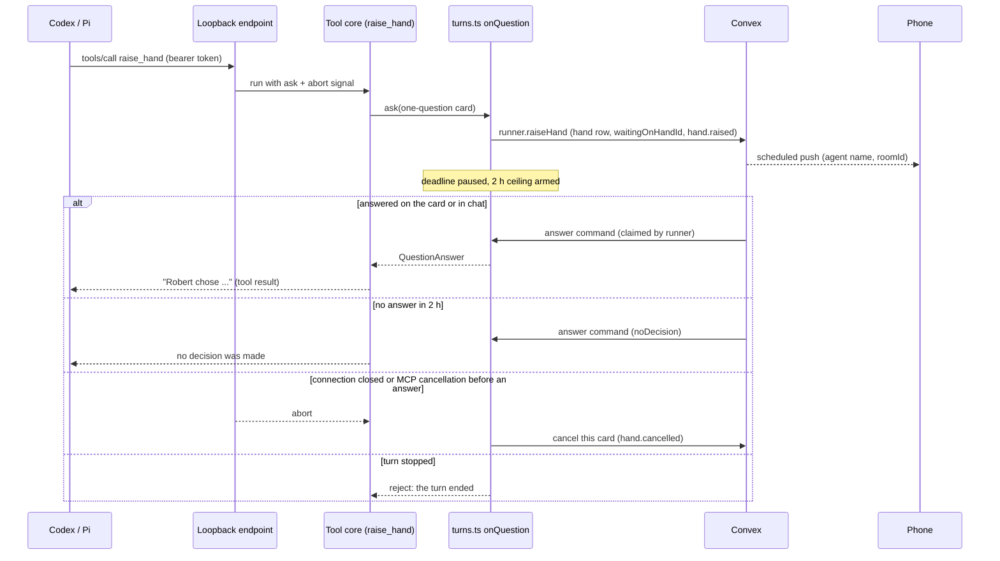

# Atelier MCP Tools - Plan

## Goal Capsule

- **Objective:** Any agent in a room, whether Claude, Codex or Pi, can stop and put a question in front of the people in the room. Robert's phone tells him it is waiting, and the agent carries on with the answer in the same turn. Agents can also look up the room's current handbook and recent decisions when they need them.
- **Means:** three tools on the existing per-turn `atelier` room tools server. `raise_hand` goes through the runner's existing question-card channel (KTD1, KTD2).
- **Product authority:** Robert (room owner). The Product Contract below governs behavior. `docs/v0-spec.md` ("Atelier MCP server (v0)", build order step 5) is the origin. Where this plan departs from it (no rationale, Claude keeps its own question tool), the spec is updated to match (U6).
- **Execution profile:** one pull request on a new branch cut from `main`. The repo's pre-commit and pre-push hooks run `pnpm check`, typecheck and unit tests, and must never be bypassed (`AGENTS.md`).
- **Stop conditions:** stop and ask Robert if U1 shows that Codex or Pi cannot hold a tool call open for at least 40 minutes, that either harness kills it in a way no config fixes (KTD3), or that a harness abandons a call without closing its connection or sending an MCP cancellation (KTD4). Also stop if any change would give an independent review a room tool, let a follow-up write to the document, or let team chat reach an agent. Stop as well if implementation needs any exe.dev feature beyond the documented ones.
- **Who finishes:** the implementing agent builds the work and verifies it through the Verification Contract, including the live three-harness check in U6, then opens the PR. Robert merges.

---

## Product Contract

### Summary

Codex and Pi get a `raise_hand` tool that opens the same question card Claude's question tool opens today. Their turn waits for the first answer, from the card or from chat, and goes on with it. Every raised card now sends a push to Robert's phone that opens the room, and the phone's room screen shows the question being asked. Every agent turn except independent reviews and scribe runs also gets `read_handbook` and `recent_decisions`. These return the current handbook and the agent-safe view of recent decisions.

### Problem Frame

Only Claude can ask the room a question today. It does so through its own `AskUserQuestion`, which the runner turns into a card (`runner/src/adapters/claude.ts`, `askRoom`). Codex and Pi ask in plain text inside their reply. Nothing marks them as waiting, nobody is notified, and the room shows a "can't raise question cards" badge for them (`apps/web/src/components/room/AgentPane.tsx`). The Codex probe in `LEARNINGS.md` saw Codex call `sleep` three times while it waited for a plain-text answer, which wasted three minutes of turn time.

Cards themselves don't push. The only push Atelier sends is "Review ready" (`packages/backend/convex/push.ts`), so a card can sit unseen for its full 2-hour limit. The v0 success criteria list "a push notification arrives when ... an agent raises its hand" (`docs/v0-spec.md`).

The handbook and the last 10 decisions are written into each prompt when the message is queued (`packages/backend/convex/lib/dispatch.ts`, `lib/prompt.ts` `contextBlock`). A long or late-starting turn has no way to see a handbook edit or a decision made since then, and nothing older than the last 10.

### Key Decisions

- **The asking turn waits for the answer.** It does not carry on and pick the answer up later. Governs R2, R3. (session-settled: user-approved — chosen over a "carry on" variant: a card would have to outlive its turn and its answer would need a new delivery path. Waiting reuses the card rules Claude already follows.)
- **Claude keeps its own question tool and does not get `raise_hand`.** Governs R9. (session-settled: user-approved — chosen over offering both: two ways to ask the same thing invite inconsistent use, and `AskUserQuestion` already supports multi-question cards.)
- **Every raised card pushes, Claude's included.** Governs R4, R5. (session-settled: user-approved — chosen over deferring push: the spec ties push to `raise_hand`, and an unseen card wastes up to 2 hours of a waiting turn.)
- **`recent_decisions` returns no rationale, although the spec mentions it.** Governs R8. (session-settled: user-approved — only review decisions carry a rationale (`packages/backend/convex/rituals.ts` `decide`), and agents never see review decisions (`lib/prompt.ts` `agentDecisions`).)

### Requirements

**Asking the room**

- R1. Outside independent reviews and scribe runs, a Codex or Pi turn can ask one question, optionally with answer choices. The question appears as a question card in the agent pane, the same kind Claude's questions produce, with free text always allowed.
- R2. The asking turn waits for the first answer, whether given on the card or in a chat message to that agent, and continues with it. The existing card rules apply unchanged. After 2 hours with no answer, the agent is told no decision was made. If the turn is stopped, the card is cancelled. Answers to cards from a follow-up turn are owner-only. Each answered question records a decision.
- R3. If the agent stops waiting before an answer arrives, the card closes as cancelled and the agent no longer shows as waiting. This happens when its tool call is cancelled or times out while the turn is still running.
- R4. Every raised card, from any harness, sends a push notification to Robert's phone. Tapping it opens the room. The notification names the agent but never contains the question. No push is sent for a card already closed by the time the push goes out.
- R5. On the phone, the room screen shows the text of the open card's question or questions for the agent being answered. Answering stays as it is today: a chat message to a waiting agent answers its card.
- R6. Once the runner reports its capabilities, the room shows Codex and Pi as able to raise cards. The "can't raise question cards" badge no longer appears for them.

**Room context on demand**

- R7. An agent can read the room's current handbook. If the handbook is empty, it is told the room has none.
- R8. An agent can read the room's latest decisions, newest last, 10 by default and up to 50 on request. It sees the view the room context block already uses: question, choice, who decided and when. That view never includes a rationale, decisions from independent reviews, or decisions from cards raised by a review or its follow-up.

**Who gets which tool**

- R9. Each turn kind gets exactly these new tools:

| Turn kind                     | `raise_hand`                 | `read_handbook` | `recent_decisions` |
| ----------------------------- | ---------------------------- | --------------- | ------------------ |
| Independent review            | no (no room tools at all)    | no              | no                 |
| Ordinary turn, Codex or Pi    | yes                          | yes             | yes                |
| Ordinary turn, Claude         | no (keeps `AskUserQuestion`) | yes             | yes                |
| Review follow-up, Codex or Pi | yes (card is owner-only)     | yes             | yes                |
| Review follow-up, Claude      | no (keeps `AskUserQuestion`) | yes             | yes                |
| Scribe run, any harness       | no                           | no              | no                 |

The document tools keep their current rules: follow-ups read only, and scribes use draft tools (`packages/backend/convex/lib/visibility.ts`).

### Acceptance Examples

- AE1. Covers R1, R2. **Given** a Codex ordinary turn, **when** Codex calls `raise_hand` with "Which database?" and options "Postgres", "SQLite", **then** the pane shows a card with those two options and Codex shows as waiting. **When** Robert picks "SQLite", **then** Codex's tool call returns that Robert chose SQLite, the turn goes on, and a decision "Which database? → SQLite" appears in the next context block.
- AE2. Covers R2. **Given** a Pi turn waiting on its card, **when** a teammate sends Pi "use SQLite" in chat, **then** the card is answered in chat, no new turn starts, and Pi's tool call returns the teammate's text.
- AE3. Covers R3. **Given** a Codex turn waiting on its card, **when** Codex's tool call is cancelled while the turn keeps running, **then** the card closes as cancelled with no decision, Codex no longer shows as waiting, and a later chat message to Codex is queued or steered as usual instead of answering a card.
- AE4. Covers R4. **Given** Robert has a registered device, **when** any agent raises a card, **then** one push arrives that names the agent, and tapping it opens that room. **Given** the card is answered within the same second, **when** the push action runs, **then** nothing is sent.
- AE5. Covers R8, R9. **Given** a room with a review decision that has a rationale and two card decisions, **when** a Codex follow-up turn calls `recent_decisions`, **then** it gets the two card decisions only, with no rationale.

### Scope Boundaries

- `raise_hand` asks one question per call. Multi-question cards stay Claude-only.
- The phone gets no card screen with option buttons. It shows the question text, and answering stays by chat (R5).
- Codex's under-development `features.default_mode_request_user_input` question path is not used (`LEARNINGS.md`, Codex probe).
- `post_finding` and `ask_peer` stay out of scope, as the spec says.

**Considered and not built:**

- A "carry on, answer later" mode for `raise_hand`. See Key Decisions. Revisit if waiting turns prove to block useful work.
- Push retries and a per-card push status. A lost push leaves the card visible in the web and phone apps. Revisit if pushes are seen to go missing in real use.
- Sending pushes only to the room's own owner. Today only owners can register devices (`push.register` calls `requireOwner`), and there is one owner, so every registered device is Robert's (KTD6). Revisit when a second owner account starts owning rooms.
- Removing the `canRaiseCards` capability now that every harness has it. The field is stored on `runners` rows, and a future harness may lack the capability.
- A length cap on `raise_hand` question text. Claude's cards have none, and the card UI already renders long text.

### Deferred to Follow-Up Work

- A phone card screen with option buttons (spec screen 4, "Hand").
- Hand-specific badge counts on the phone's room list.

---

## Planning Contract

### Key Technical Decisions

- KTD1. **The three tools join the existing per-turn `atelier` server and its one tool core (`runner/src/room-tools.ts`).** No second MCP server. Codex and Pi already discover the server's tool list at turn start (`mcp_servers.atelier`, and the Pi extension's `tools/list`), so new tools reach them without adapter-specific registration. Claude gets its list from `claudeRoomToolsServer`. (session-settled: user-approved — chosen over a second server: a second server would duplicate token issuing, Codex approval config and the Pi extension.)
- KTD2. **`raise_hand` runs through the runner's per-turn question channel, `onQuestion` in `runner/src/turns.ts`, not through a new Convex path.** That channel already calls `api.runner.raiseHand`, pauses the 30-minute turn deadline, sets the 2-hour card ceiling, resolves on the `answer` command and rejects when the turn ends. Chat answers (`messages.ts` `answerWaitingCard`) and closing cards when a turn stops (`lib/cards.ts` `closeOpenCards`) come with it. The tool core's `ToolContext` gains an optional `ask` callback. `roomTools.issue` takes it per token, alongside the tool set, so the endpoint hands the right turn's channel to the tool. `raise_hand` builds a one-question `QuestionCard`: its own random request id, `q1`, an empty header, options from the strings given, free text on and single choice. It then renders the `QuestionAnswer` as text for the model.
- KTD3. **Tool calls that wait for hours are made possible per harness, then proven live in U1 before the rest is built.** The Pi adapter's own 30-minute run timer (`setTimeout(abort, 30 * 60_000)` in `runner/src/adapters/pi.ts`) never pauses during a card wait, so it goes. The pausable turn deadline in `turns.ts` already aborts the harness signal after 30 minutes of working time. Codex's MCP client times tool calls out after 60 seconds by default. The Codex adapter sets `mcp_servers.atelier.tool_timeout_sec` just above the card ceiling (2 h + 5 min). The Pi extension runs in Pi's Node process, where `fetch` (undici) times out after 300 seconds without response headers. The extension sends its JSON-RPC posts with `node:http`, which has no default timeout. Claude needs neither change, because it doesn't get `raise_hand` (KTD7).
- KTD4. **A closed connection or an MCP cancellation means the agent stopped waiting.** The loopback endpoint gives each `tools/call` an `AbortSignal`. It fires if the client's connection closes before the reply is written, or if the same token sends `notifications/cancelled` naming that call's request id. Today the endpoint answers every notification with 202 and ignores it. U1 records which of the two signals each harness sends when it abandons a call. `raise_hand` passes that signal to `ask`. On abort, the runner settles the pending question, resumes the turn deadline and calls a new runner-secret mutation that cancels that one card. That mutation records `hand.cancelled` with reason "The agent stopped waiting" and moves the turn's wait to its next open card. This reuses the close-and-release logic in `lib/cards.ts`. Without it, an R3 failure leaves a card that looks open and an agent shown as waiting while it actually works, so chat to it would silently answer a dead card. A cancel that arrives after the card was answered changes nothing.
- KTD5. **The handbook and decision queries live in `packages/backend/convex/documentTools.ts` and reuse its `loadTurn` gate.** That gate checks the runner secret, a running turn with a claimed `run_turn` command, and no access for reviews. The file's header comment widens from "room document tools" to "room tools". `recent_decisions` reuses `agentDecisions` in `lib/prompt.ts` with a `limit` argument: default 10, clamped to 1–50. It formats each decision with the same line `contextBlock` uses, extracted into one shared helper, so the tool and the prompt cannot drift apart.
- KTD6. **The hand push is a scheduled action started by `runner.raiseHand`.** It is not a workflow step. The action re-reads the card and sends nothing if it is no longer `raised`. Recipients are every registered push token. Mark that as a `shortcut:` comment: only owners can register, so with more than one owner it would need the room owner's subject. The message is generic: the title "Question waiting" and a body naming the agent's display name, never the question text. `data` carries `roomId` and the asking agent's `participantId` for routing. The Expo batch send in `push.ts` is reused, once lifted out of its ritual-only result recording. Hand pushes record nothing beyond deleting `DeviceNotRegistered` tokens, so there is no schema change.
- KTD7. **Claude's in-process server lists the ordinary set minus `raise_hand`.** The runner issues ordinary and review follow-up turns the full ordinary set, `raise_hand` included. Claude's adapter builds its server from that set with `raise_hand` filtered out. The unlisted tool on Claude's token is never reachable, because the model only calls listed tools.
- KTD8. **The Codex and Pi adapters report `canRaiseCards: true`.** The capability already flows through `reportCapabilities` to `api.agent.pane` and the web badge, so R6 needs no other change.

### High-Level Technical Design

How a Codex or Pi question travels and comes back (KTD2, KTD3, KTD4, KTD6):

### Assumptions

- Codex's app-server honors `mcp_servers.atelier.tool_timeout_sec` passed in `thread/start` and `thread/resume` config, just as it honors the `url` and approval keys there (`LEARNINGS.md`, room document probes). U1 checks this.
- Pi puts no timeout of its own on extension tool execution. U1 checks this.
- Codex and Pi will call `raise_hand` when the tool description tells them to, instead of asking in plain text. U6 checks this in a live run, and if needed the description is tuned there, as the room document work did.

### Risks

| Risk                                                                          | Mitigation                                                                                                                                                                                                                                                                                                                                                                                                                                                                                  |
| ----------------------------------------------------------------------------- | ------------------------------------------------------------------------------------------------------------------------------------------------------------------------------------------------------------------------------------------------------------------------------------------------------------------------------------------------------------------------------------------------------------------------------------------------------------------------------------------- |
| A harness drops a long tool call despite the config                           | U1 proves a 40-minute wait on both harnesses before other work starts, past every limit known today (Codex's 60 s default, undici's 300 s, Pi's adapter timer at 30 min). A limit between 40 minutes and 2 hours would still close the connection, and KTD4 would then cancel the card visibly instead of leaving it open. If it fails, stop and ask Robert. The fallback, not built now, is a `raise_hand` that returns "still waiting" after a few minutes plus a `wait_for_answer` tool. |
| Codex keeps asking in plain text or calls `sleep` instead                     | The tool description says to use `raise_hand` for any question that needs a person and that the turn waits for the answer. U6 measures this.                                                                                                                                                                                                                                                                                                                                                |
| Turning edits off mid-wait interrupts a Pi turn (`runner/src/adapters/pi.ts`) | Existing behavior: the stopped turn cancels the card (R2). No change.                                                                                                                                                                                                                                                                                                                                                                                                                       |
| A late connection close cancels a card that has just been answered            | The cancel mutation acts only on a `raised` card (KTD4).                                                                                                                                                                                                                                                                                                                                                                                                                                    |

### Sources

- `docs/v0-spec.md`: "Atelier MCP server (v0)", "Ledger types", build order.
- `LEARNINGS.md`: "Harness capability probes" (Codex questions, Pi extension) and "Room document tool probes" (per-harness server wiring, Codex approval keys, port range).
- `docs/plans/2026-11-06-1730-feat-room-document-plan.md`: how the room tools server was planned and probed.
- `packages/backend/tests/hands.test.ts`: the card rules R2 inherits.

---

## Implementation Units

### U1. Live probe: tool calls that wait

- **Goal:** Prove that Codex and Pi can each hold an `atelier` tool call open for 40 minutes and still use its result, and find out how each signals that it abandoned a call.
- **Requirements:** R1, R2, R3 (feasibility, KTD3)
- **Dependencies:** none
- **Files:** none in the repo. Use a throwaway probe script and repo under `/tmp`, as the earlier probes did. Results go into `LEARNINGS.md` in U6.
- **Approach:**
  1. Serve a stub `wait` tool from a loopback endpoint shaped like `room-tools-server.ts` that replies after 40 minutes. That is beyond Codex's 60-second default, undici's 300-second header timeout and the 30-minute turn deadline. Run the probe Pi without the adapter's 30-minute timer.
  2. Codex: run with `mcp_servers.atelier.tool_timeout_sec` set and the existing `url`, bearer and approval keys, on `thread/start` and again on `thread/resume`. Confirm the model receives the result. Interrupt a second call mid-wait and record whether the HTTP connection closes or a `notifications/cancelled` arrives.
  3. Pi: load an extension that posts with `node:http`, using `--tools` with the `atelier_*` pattern. Confirm the result arrives after 40 minutes. Abort a run mid-wait and record whether the connection closes.
  4. Also ask each model a question that needs a person, with the stub tool described as `raise_hand`, and record whether it calls the tool or asks in plain text.
- **Execution note:** Run this first; the long waits can run in the background while U2 and U5 proceed. If either harness fails step 2 or 3, or abandons a call with neither signal, stop and ask Robert (Goal Capsule, stop conditions).
- **Test expectation:** none -- a live feasibility probe whose results are recorded in `LEARNINGS.md`.
- **Verification:** both harnesses return the 40-minute result to the model. Each harness sends at least one of the two abandon signals KTD4 listens for, and which one is written down.

### U2. Convex: handbook and decision queries, card withdrawal, decision line helper

- **Goal:** Add the runner-secret Convex functions the new tools call, and the mutation that cancels a card whose agent stopped waiting.
- **Requirements:** R3, R7, R8
- **Dependencies:** none
- **Files:**
  - `packages/backend/convex/documentTools.ts`: two queries, the handbook for a turn and the decisions for a turn with an optional limit.
  - `packages/backend/convex/lib/prompt.ts`: `agentDecisions` takes a limit; extract the decision line helper `contextBlock` uses.
  - `packages/backend/convex/runner.ts`: a mutation that cancels one raised card for its turn.
  - `packages/backend/convex/lib/cards.ts`: export what that mutation needs from `close` and `releaseTurn`.
  - `packages/backend/tests/document-tools.test.ts` (or a new `packages/backend/tests/room-tools.test.ts` if that file reads better) and `packages/backend/tests/hands.test.ts`.
- **Approach:**
  1. Both queries go through `loadTurn(..., "read")` (KTD5) and return the usual `{ ok: false, reason, message }` refusal shape when the turn has ended.
  2. The decisions query returns preformatted lines from the shared helper. The limit is clamped to 1–50 with a default of 10.
  3. The cancel mutation checks the runner secret and that the card belongs to the turn. It is a no-op unless the card is `raised` (KTD4).
- **Patterns to follow:** `readDocumentForTurn` for the gate and refusals. `handTimedOut` for a runner mutation that closes a card.
- **Test scenarios:**
  - The handbook query on a running turn returns the room's current handbook, including an edit made after the turn was queued.
  - The handbook query on a room with an empty handbook returns empty text, which the runner turns into "no handbook".
  - The decisions query with no limit returns the latest 10 agent-visible decisions, oldest first, as lines matching the context block's format.
  - The decisions query with limit 3 returns 3. Limit 500 returns at most 50. Limit 0 returns 1.
  - The decisions query leaves out a review decision with a rationale and a decision from a follow-up's card. Covers AE5.
  - Either query on a finished or interrupted turn returns the `turn_ended` refusal. A bad runner secret throws.
  - The cancel mutation on a raised card marks it `cancelled`, records `hand.cancelled` with the reason, moves `waitingOnHandId` to the turn's next open card, or clears it when no other card is open, and records no decision. Covers AE3.
  - The cancel mutation on an answered card changes nothing, and the answer and its decision stand.
  - After a cancel, a chat message to that agent no longer answers a card. It is queued or steered as usual.
  - The context block's decision lines are byte-identical before and after the helper extraction (existing `prompt.test.ts` and `hands.test.ts` assertions keep passing).
- **Verification:** the new tests and the existing backend suite pass.

### U3. Runner: the three tools, the question channel and connection-close withdrawal

- **Goal:** Add `raise_hand`, `read_handbook` and `recent_decisions` to the tool core, give the endpoint a per-turn `ask` and an abort signal per call, and wire `turns.ts` to issue them.
- **Requirements:** R1, R2, R3, R7, R8, R9
- **Dependencies:** U1 (which abandon signals to honor, KTD4), U2
- **Files:**
  - `runner/src/room-tools.ts`: the three tool definitions, the ordinary tool set (document tools plus the three) as the default set, and `ask` plus the abort signal in `ToolContext` and `callRoomTool`.
  - `runner/src/room-tools-server.ts`: `issue` takes `ask` with the tool set. Each `tools/call` gets an `AbortSignal` that fires on a connection close before the reply, or on a `notifications/cancelled` for its request id from the same token (KTD4).
  - `runner/src/turns.ts`: issue ordinary and review follow-up turns the ordinary set with `ask` bound to that turn's `onQuestion`. `onQuestion` accepts an optional signal, and on abort it settles the question, resumes the deadline and calls the U2 cancel mutation (KTD4).
  - `runner/src/room-tools.test.ts`, `runner/src/room-tools-server.test.ts`, `runner/src/turns.test.ts`.
- **Approach:**
  1. `raise_hand` takes `question` (non-empty string) and optional `options` (non-empty strings). It builds the card as KTD2 says. If there is no `ask` in the context, it returns an error result, never a throw.
  2. Render the answer as text. Card answer: who answered, then the chosen labels and any free text. Chat answer: who answered in chat, then their words. `noDecision`: the existing `NO_DECISION_MESSAGE` text. Rejection because the turn ended: an error result saying the turn ended.
  3. The `raise_hand` description tells the model to use it whenever it needs a person's decision or information to continue. It says the turn waits for the answer for up to 2 hours, that people may answer on the card or in chat, and that the model should not ask in plain text and wait.
  4. `read_handbook` and `recent_decisions` call the U2 queries. `recent_decisions` takes an optional integer `limit`.
  5. Scribe turns keep `scribeTools` and get no `ask`. Independent reviews keep getting no route at all (R9).
- **Patterns to follow:** existing `defineTool` entries and refusal rendering in `room-tools.ts`. The `questions` map, `settle` and `pausableTimer` in `turns.ts`.
- **Test scenarios:**
  - `listTools()` for the ordinary set includes `raise_hand`, `read_handbook` and `recent_decisions` with their argument schemas. The scribe set is unchanged.
  - `raise_hand` with a question and two options calls `ask` with one question `q1`, those two options, `allowFreeText` true and `multiSelect` false. Covers AE1.
  - `raise_hand` answered on the card returns text naming the answerer and the chosen label. Answered in chat, it returns the chat text. Covers AE2.
  - `raise_hand` answered with `noDecision` returns the no-decision message. When `ask` rejects because the turn ended, it returns an error result.
  - `raise_hand` with an empty question or a non-string option returns the "arguments don't fit" error, and `ask` is not called.
  - `read_handbook` renders the handbook text, or a "this room has no handbook" line when it is empty. It renders a `turn_ended` refusal as "Not done (turn_ended): ...".
  - `recent_decisions` passes `limit` through and renders "No decisions yet" for an empty list.
  - Endpoint: a `raise_hand` call stays pending until the issued `ask` resolves, then replies with the rendered answer.
  - Endpoint: closing the client connection mid-call fires the call's abort signal. A call that completes normally does not fire it.
  - Endpoint: a `notifications/cancelled` naming a pending call's request id fires that call's abort signal and still gets 202. The same notification from a different token does not.
  - Endpoint: a revoked token still gets 401, including for `raise_hand`.
  - `turns.ts`: an ordinary turn and a follow-up turn are issued the ordinary set with an `ask`. A scribe turn is issued `scribeTools` with no `ask`. A review is issued nothing.
  - `turns.ts`: a `raise_hand` through the issued `ask` calls `runner.raiseHand` with the one-question card, pauses the deadline, and resolves when the matching `answer` command is handled.
  - `turns.ts`: aborting the signal of a pending `ask` calls the cancel mutation for that card, removes the pending question and resumes the deadline. A later `answer` command for it reports "No question is waiting".
- **Verification:** runner unit tests pass, and the fake room-tools server in `turns.test.ts` reflects the new `issue` shape.

### U4. Adapters: Codex timeout, Pi transport, Claude's list, capabilities

- **Goal:** Make each harness reach the new tools correctly and report that Codex and Pi can raise cards.
- **Requirements:** R1, R6, R9
- **Dependencies:** U1, U3
- **Files:**
  - `runner/src/adapters/codex.ts`: add `mcp_servers.atelier.tool_timeout_sec` to the room config (KTD3), set `canRaiseCards: true` and update its comment.
  - `runner/src/adapters/pi-room-tools-extension.ts`: send `rpc` posts with `node:http` instead of `fetch`, keeping the abort signal, the error messages and the token-only-in-env rule. Update the header comment ("room tools", not only "document tools").
  - `runner/src/adapters/pi.ts`: remove the adapter's own 30-minute run timer (KTD3), set `canRaiseCards: true` and update the comment.
  - `runner/src/adapters/claude.ts`: build the in-process server from the ordinary set without `raise_hand` (KTD7).
  - `runner/src/adapters/codex.test.ts`, `runner/src/adapters/pi.test.ts`, `runner/src/adapters/claude.test.ts`.
- **Approach:** the Pi extension may import Node built-ins only, as its header says. Keep its `isTextResult` and `isListedTool` checks. An aborted request must destroy the socket so the endpoint sees the close (KTD4).
- **Patterns to follow:** the existing `roomConfig` keys in `codex.ts`. The extension's existing `rpc` helper.
- **Test scenarios:**
  - The Codex room config contains `mcp_servers.atelier.tool_timeout_sec` with a value above 7200, next to the `url`, bearer and approval keys, on start and resume. Review turns still get no `atelier` keys.
  - The Codex and Pi harnesses report `canRaiseCards: true`. Update the existing assertion in `codex.test.ts` that expects `false`.
  - A Pi run with a tool call pending is not aborted by the adapter after 30 minutes (fake timers). An abort of the harness signal still stops it.
  - The Claude in-process server lists `read_handbook` and `recent_decisions` and does not list `raise_hand`. Scribe turns still list the scribe set.
  - Claude's `canUseTool` still allows `mcp__atelier__read_handbook`, and `AskUserQuestion` still becomes a card.
  - The Pi extension registers `atelier_raise_hand`, `atelier_read_handbook` and `atelier_recent_decisions` from a stub endpoint's `tools/list`, forwards a call and returns its text. An aborted call rejects and closes its connection.
- **Verification:** adapter tests pass. `pnpm --filter @atelier/runner test:integration` still passes, since it drives the real CLIs.

### U5. Push on a raised card, phone routing and question text

- **Goal:** Notify Robert's phone whenever any agent raises a card, open the room when he taps the notification, and show the question there.
- **Requirements:** R4, R5
- **Dependencies:** none (independent of U2–U4, since it hooks `runner.raiseHand`, which Claude's cards already use)
- **Files:**
  - `packages/backend/convex/runner.ts`: `raiseHand` schedules the hand push.
  - `packages/backend/convex/push.ts`: lift the Expo batch send out of the ritual result recording, then add the hand push action and its internal query (card still raised, agent display name, room id, recipients) (KTD6).
  - `apps/mobile/src/lib/notification-route.ts` and its test: return either a ritual target or a room target with the asking agent's participant id from a tapped notification.
  - `apps/mobile/src/components/push-routing.tsx`: route a room target to `/room/[id]` with that participant preselected as the composer target, the way the ritual screen already opens a room for one participant.
  - `apps/mobile/src/app/room/[id].tsx`: show the open card's question text from `api.agent.pane` `cards` next to the existing "This will answer ...'s question" line.
  - `packages/backend/tests/hands.test.ts` and `packages/backend/tests/review.test.ts`, the latter only if the ritual push refactor touches its assertions.
- **Approach:**
  1. The hand push sends nothing, without error, when the card is closed or no device is registered.
  2. Ritual push behavior and `pushStatus` recording stay exactly as they are.
  3. Room ids are validated with the same character rule ritual ids use before routing.
  4. The mobile module stays free of `react-native` and Expo imports (`AGENTS.md`).
- **Patterns to follow:** `push.send`, `push.recipients` and `sendBatch`. `notificationRitualId` and its tests.
- **Test scenarios:**
  - Raising a card schedules exactly one hand push for that card. Covers AE4.
  - The hand push query returns no recipients for a card that is already answered, cancelled or expired. Covers AE4.
  - The hand push query returns the agent's display name and room id, and every registered token. The message built from them contains the display name and not the question text.
  - Ritual push recipients and `pushStatus` outcomes are unchanged (existing `review.test.ts` assertions pass).
  - Notification routing: `{ roomId: "abc123", participantId: "p1" }` yields a room target for that participant. `{ roomId: "abc123" }` alone yields a room target with no participant. `{ ritualId: "abc123" }` still yields a ritual target. `{ roomId: "../x" }`, a numeric `roomId` and an already-handled identifier yield nothing.
- **Verification:** backend and mobile unit tests pass. In U6, a registered device receives a hand push and the tap opens the room showing the question.

### U6. Docs, learnings and the live three-harness check

- **Goal:** Bring the docs in line with the new behavior and prove it end to end on the real harnesses.
- **Requirements:** R1–R9
- **Dependencies:** U1–U5
- **Files:**
  - `docs/v0-spec.md`: the MCP tool table (built, Claude keeps `AskUserQuestion`, turn waits, no rationale), the adapter note "Codex and Pi have no question cards", and the mention of the push.
  - `docs/shared-rooms.md`: the "Only Claude raises cards" paragraph.
  - `LEARNINGS.md`: U1 probe results and anything the live check teaches.
- **Approach:**
  1. Push the functions to the Convex dev deployment first (`npx convex dev --once` from `packages/backend`; `LEARNINGS.md`, "Shared rooms build pitfalls").
  2. Run a second runner beside Robert's, and use a throwaway room under `/tmp`, as the room document live check did.
- **Test expectation:** none -- documentation, plus the live check below.
- **Verification (live check):**
  - Codex and Pi each raise a card on a fresh session and on a resumed one. One is answered on the card and one in chat. Each turn continues with the answer, and the decisions appear in the next context block. Covers AE1, AE2.
  - A Pi card is answered more than 30 minutes after its turn started, and the turn continues with the answer.
  - An unanswered Pi card is stopped from the room, and the card shows cancelled.
  - A Codex follow-up's card is not answerable by a teammate.
  - Each harness calls `read_handbook` after Robert edits the handbook and sees the edit, and calls `recent_decisions` with a limit.
  - With a registered device, a raised card sends a push that opens the room showing the question. If no device is registered, record push as skipped, as the independent review live check did (`LEARNINGS.md`, "Independent review (step 4)").
  - A scribe run and an independent review show none of the new tools.
  - Record whether Codex and Pi called `raise_hand` unprompted when they needed an answer. Tune the description if they did not.

---

## Verification Contract

| Gate                      | Command / check                                  | Proves                                                                                                   |
| ------------------------- | ------------------------------------------------ | -------------------------------------------------------------------------------------------------------- |
| Lint, format, unused code | `pnpm check`                                     | Ultracite and Knip clean, no rule weakened                                                               |
| Types                     | `pnpm typecheck`                                 | every workspace compiles, runner included (it compiles backend files)                                    |
| Unit tests                | `pnpm test`                                      | U2–U5 scenarios and existing suites (`hands.test.ts`, `prompt.test.ts`, `review.test.ts`, adapter tests) |
| Harness smoke             | `pnpm --filter @atelier/runner test:integration` | real pi and codex CLIs still start and finish turns with the new tools listed                            |
| Live probe                | U1                                               | long waits survive on Codex and Pi                                                                       |
| Live end to end           | U6 verification list                             | R1–R9 on real harnesses against the dev deployment                                                       |

---

## Definition of Done

- Every requirement R1–R9 is met, and each AE has a passing test or a recorded live-check result.
- `pnpm check`, `pnpm typecheck` and `pnpm test` pass through the hooks, with no `--no-verify`, no `LEFTHOOK=0` and no weakened lint rule.
- U1 and U6 results are recorded in `LEARNINGS.md`. `docs/v0-spec.md` and `docs/shared-rooms.md` describe the shipped behavior.
- Independent reviews still receive no room tools. Scribe tool sets are unchanged. No new code path reads team chat.
- The `shortcut:` comment on hand push recipients is present (KTD6).
- Probe scripts, abandoned approaches and debugging code are not in the diff.
- The PR is open from a branch cut from `main`, and Robert merges.
