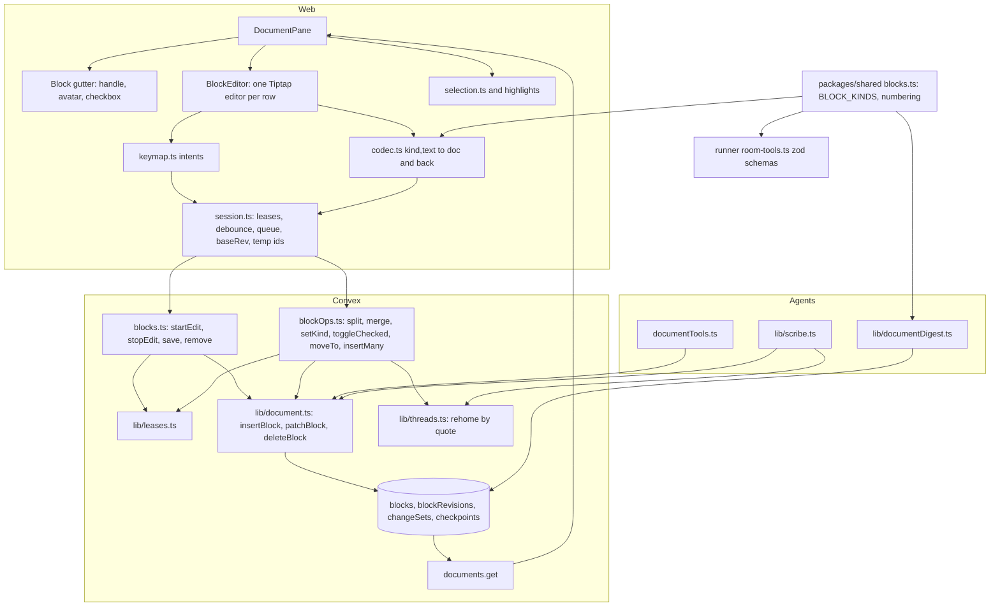
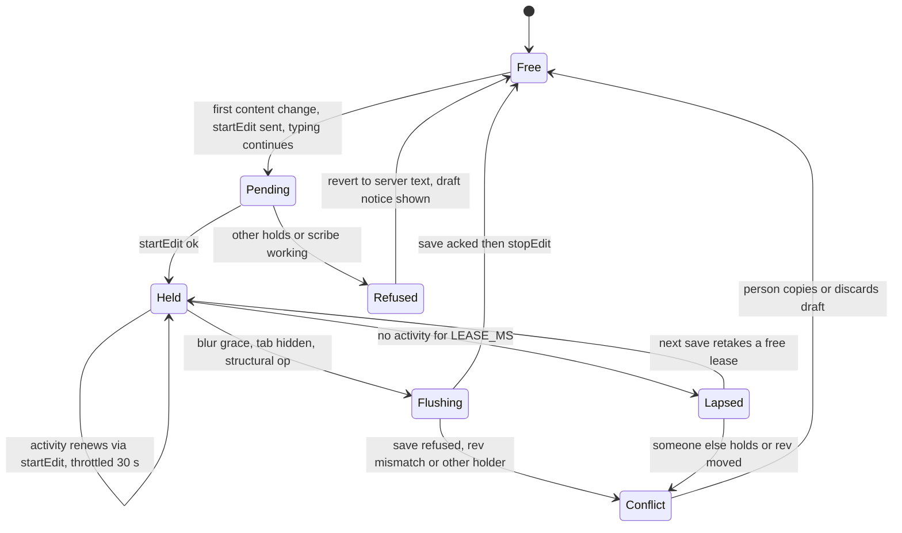
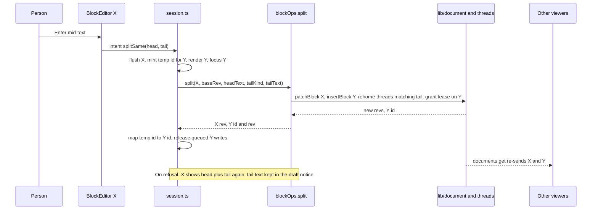

# Notion-Style Document Editor - Plan

## Goal Capsule

- **Objective:** People in a room write the shared document the way they write in Notion: click anywhere and type, press Enter for the next block, shape blocks with slash commands and markdown shortcuts, tick to-dos, drag blocks into place, and never meet an Edit button. Two people still cannot type in the same block at once, and everyone, models included, can see who is editing which block.
- **Means:** One Tiptap editor per block row over the existing blocks table, with silent per-block leases (KTD2, KTD5). `@convex-dev/prosemirror-sync` is not adopted (KD1).
- **Authority:** Product Contract R-IDs own behavior; Planning Contract KTDs own mechanism; a unit overrides neither. Where docs and code disagree, code is truth (project rule). `docs/plans/2026-11-06-1730-feat-room-document-plan.md` remains the record for everything this plan does not change.
- **Stop conditions:** Stop and report rather than improvise if (a) the browser spike in U5 shows per-block editors cannot deliver arrow-through, Enter split and Backspace merge at acceptable latency, (b) no `@tiptap/*` 3.32+ release installs under pnpm's minimum release age, or (c) the production data check in U5 finds block-level markdown inside blocks is common enough to need a migration (Assumption A5).
- **Execution profile:** One PR, Deep plan, ten dependency-ordered units. No project rule requires a split, and nothing must reach production before the rest.
- **Who finishes:** The implementing agent lands the PR through the pre-push gates and the real-browser checks in the Verification Contract and commits per unit; Robert reviews and merges.

---

## Product Contract

### Summary

Replace the Textarea-per-block editing flow with a Notion-feel surface: every block is a small rich-text editor, locks are taken silently on the first keystroke and shown as the holder's avatar, Enter and Backspace split and merge blocks atomically, and five new block kinds (to-do, numbered item, quote, code, divider) join heading, paragraph and list item. The block-rows data model, per-block authorship, model tools, comment anchors, history and the scribe all stay; they learn the new kinds and gain the atomic structural mutations and compare-and-set writes the new surface needs.

### Problem Frame

Robert asked to consider `@convex-dev/prosemirror-sync` to make multiplayer document editing better, and said what he wants is for editing to feel just like Notion. Today editing means pressing Edit, typing into a textarea, pressing Enter to save, and choosing block kinds from buttons; a block left open lapses silently, Enter creates two history entries, and comments on a split block detach. Prosemirror-sync would deliver character-level co-typing at the cost of the one-writer-per-block rule and roughly 16k lines built on block rows (per-block authorship, model compare-and-set writes, quote-anchored threads, change-set history, scribe drafts, prompt digest). The gap is the editing surface, not the sync model.

### Key Decisions

- KD1. **Notion-feel surface with silent per-block locks; no character-level co-editing.** (session-settled: user-directed — chosen over per-room prosemirror-sync co-typing, per-block prosemirror-sync documents, and "surface now, co-typing later": co-typing drops the one-writer-per-block rule that authorship, model writes, comment anchors, history, scribe and digest rest on, and the component brings no presence, no per-author identity, no server-side step validation, snapshot pruning that erases history, and a 1 MB document cap below Atelier's 2.4 MB worst case.) Governs R1, R14, R15, R16.
- KD2. **Eight block kinds in this version: heading, paragraph, list item, to-do, numbered item, quote, code, divider.** (session-settled: user-directed — chosen over keeping the three existing kinds and over the full Notion set with toggles, callouts, tables and media: the Notion basics make the surface feel like Notion at about a third more work; the full set widens schema, agent tools, digest and history far beyond that.) Governs R9, R10, R11, R12, R13, R25, R26, R27.
- KD3. **Blocks stay rows; every human write is one atomic, compare-and-set mutation on rows.** Structural edits (split, merge, convert, tick, move, multi-block paste) become server mutations that touch several rows in one change set, so history, comments and models keep working without a new sync layer. Governs R19, R22, R23.

### Actors

- A1. **Person**: a room member in the web app, editing with a mouse and keyboard, possibly from two browsers at once.
- A2. **Model participant**: writes through the existing room tools (`add_block`, `update_block`, `delete_block`, `comment`) during a turn; refused on blocks a person holds.
- A3. **Scribe**: reorganizes the whole document in a run that locks it read-only for everyone.

### Requirements

**Editing surface**

- R1. Every block renders in place as an editable rich-text surface; clicking a block puts the caret there, with no Edit button and no read-view/edit-view toggle.
- R2. Inline formatting (bold, italic, strikethrough, inline code, link) renders as formatted text and is stored as inline markdown in the block's text; untouched text round-trips byte-for-byte.
- R3. Enter, Shift+Enter, Backspace at the start of a block, and Arrow Up/Down at a block's first or last line behave per kind as the keyboard table in KTD9 states.
- R4. Typing a markdown shortcut at the start of a block (`# `, `- `, `1. `, `[] `, `> `, three backticks, `---`) or choosing a kind from the slash menu converts the block in place, keeping its id, authorship and comments, except that `---` or Divider on a non-empty block inserts a divider below and leaves the block unchanged (KTD10); the conversion is undoable.
- R5. A block can be moved to any position with a drag handle or with the keyboard; the handle is a focusable button with an accessible name and the move is announced.
- R6. Pasting several paragraphs inserts them as blocks after the current block; a paste that would exceed a cap is refused whole with the numbers.
- R7. The 4,000 character block cap is enforced in the editor at the keystroke, and the 600 block cap at every insert, each with a clear message; models share both caps.
- R8. All blocks render on load; the first paint of a 600-block document stays under the mount budget in KTD2 or the fallback mount strategy in KTD2 applies.

**Block kinds**

- R9. Kinds are `heading`, `paragraph`, `listItem`, `todo`, `numberedItem`, `quote`, `code`, `divider`; `todo` carries a `checked` flag that defaults to unchecked.
- R10. A block's stored text never contains its kind marker: no `- `, `1. `, `> `, `[ ]` or fences; `code` text is literal and never parsed as markdown; `divider` text is empty; hard line breaks are `\n`. This rule is the one source for editor, tool descriptions, digest and scribe.
- R11. Numbered items show their position in the current run of consecutive numbered items; nothing stores a number, and editor, history and digest compute it with one helper.
- R12. Clicking a to-do's checkbox toggles it without taking a lease and records a history revision; it is refused while someone else holds the block.
- R13. History version views and diffs render every kind, checked state and numbering, and mark a checked-state change as a change.

**Locks and presence**

- R14. Two people cannot edit the same block at the same moment. The lease is taken on the first content-changing input in a block, never on focus, caret movement or text selection.
- R15. While a person holds a block, others see that person's avatar or initials and "Name is editing" on the block, announced to assistive technology; models see "being edited by Name" on that block in `read_document`.
- R16. Typing proceeds while the lease request is in flight; if the lease is refused, the block reverts to server text and the typed text is offered in the draft-recovery notice with Copy my draft and Discard my draft.
- R17. The lease renews on editing activity, is released after a short grace once the block loses focus and when the tab is hidden, and a lapsed lease that nobody else took is retaken silently by the next save.
- R18. A person holds at most one lease per document; taking a new one releases the previous.
- R19. Every human write carries the block rev it was based on; a mismatch is refused with the current text, and the local text is kept as a draft.
- R20. Starting the scribe or restoring a version is refused only while someone has written under a lease; caret-only leases do not block them and are cleared when the scribe starts.
- R21. While the scribe runs, every editor is read-only; selecting text and commenting still work.

**Structural edits**

- R22. Split, merge, convert, tick, move and multi-block paste are each one mutation and one history change set, and comment threads follow the text they anchor to into whichever resulting block holds it.
- R23. Merging into a block held by someone else is refused with a hint naming them; a merge that would pass 4,000 characters is refused without truncating.

**Comments**

- R24. Selecting text inside one block, whether that block is editable or read-only for the viewer, offers Comment; highlights stay attached to the text while the editor re-renders; a selection spanning blocks offers no Comment action; a divider cannot be commented.

**Agents and scribe**

- R25. Model tools accept the new kinds and, for a model's own to-do, `checked`; their descriptions carry R10; no new tools are added and models get no move tool.
- R26. The prompt digest and `read_document` show kind, checked state and numbered position, render code verbatim and a divider as header only, and agree with each other through one shared renderer.
- R27. Scribe draft ops carry `checked`; a scribe rewrite never unticks a to-do; restoring a version brings `checked` back.

**Replacement**

- R28. The Textarea editor, the Edit, Add below, Add to section, Move up and Move down buttons, the Retake the block path and the read/edit toggle are gone with no vestigial code, and `docs/room-document.md` describes the new surface.

### Acceptance Examples

- AE1. **Covers R14, R16.** Given Ana and Ben both click the same paragraph within 100 ms and start typing, when Ana's lease lands first, then Ben's block reverts to Ana's text as it arrives, his typed characters appear in the draft-recovery notice, and Ana's avatar shows on the block.
- AE2. **Covers R22.** Given a paragraph with a comment anchored to its last sentence, when the author presses Enter before that sentence, then two blocks exist, the comment is attached to the new second block with its highlight intact, and History shows one entry.
- AE3. **Covers R20.** Given Ana's caret sits in a block she has not typed in for a minute, when Ben starts the scribe, then the run starts, Ana's lease is cleared, and her next keystroke is refused with the scribe notice and offered as a draft.
- AE4. **Covers R3, R9.** Given the caret at the start of a non-empty to-do, when Backspace is pressed once, then the block becomes a paragraph with the same text and id; a second Backspace merges it into the previous block.
- AE5. **Covers R19.** Given the same person has the document open in two browsers and edits one block in both, when the second browser's save arrives with a stale rev, then it is refused with the current text and that browser shows its text as a draft instead of overwriting.
- AE6. **Covers R6, R7.** Given a document with 598 blocks, when a person pastes five paragraphs, then nothing is inserted and the message says the paste would add 5 blocks against a 600 block limit.
- AE7. **Covers R12, R25, R27.** Given a model wrote a to-do and a person ticks it, when the model later calls `update_block` with its old rev, then it is refused as stale with `checked: true` in the current state; a scribe `draft_replace` of that to-do without `checked` leaves it ticked after commit.
- AE8. **Covers R15, R21, R24.** Given Ben holds a block, when Ana selects a phrase in it, then no lease is taken, Comment appears, and the thread anchors to the phrase; the same holds for every block during a scribe run.

### Scope Boundaries

**Considered and not built**

- `@convex-dev/prosemirror-sync` and any character-level co-editing: KD1 keeps one writer per block; the component (0.2.7, source read) only version-checks steps and never validates them against a schema, has no presence or per-author identity, prunes snapshots to first and latest, caps a document at 1 MB (Atelier allows 600 x 4,000 chars = 2.4 MB), and would force a rewrite of authorship, model writes, anchors, history, scribe and digest. Revisit only if R14 is dropped.
- Yjs-based components and BlockNote: BlockNote's markdown export is documented lossy, nests blocks, and exposes only editor-wide editability (KTD1).
- One continuous editor over all blocks: KTD2 records why.
- The full Notion block set (toggles, callouts, tables, images, embeds): KD2.
- Cross-block text selection and range delete: per-block editors make it structurally impossible, so the multi-block replace mutation, touched-block caps and `filterTransaction` lock plugin that a continuous editor would need are not built. Block-selection mode is the follow-up that covers the use case.
- Coalescing revisions per keystroke: debounced saves (KTD8) bound revision volume; revisit if checkpoint cost shows in practice.
- Viewer presence (who is looking, not editing): the lease already carries the signal that matters to models and people; evidence to change is people asking who else has the document open.
- A `beforeunload` guard and `sendBeacon` lease release: flush on hidden tab plus a one-second debounce bounds loss to under a second of typing, and lease expiry is the backstop; evidence to change is reports of lost text.
- Per-block-type validation that strips markers from model text: descriptions are the enforcement (R10); a spot check in verification decides whether that holds.
- Mobile document editing: `apps/mobile` has no document UI and references no block kinds.

#### Deferred to Follow-Up Work

- Block-selection mode: drag across blocks to select whole blocks, then move or delete them together.
- Undo and redo of split and merge across blocks (Assumption A4).
- A one-off migration splitting legacy block-level markdown into rows, if the production data check in U5 says it is needed (Assumption A5).
- `kind` on `update_block` and models ticking to-dos written by others (Assumption A3).
- Viewer presence.

---

## Planning Contract

### Key Technical Decisions

- KTD1. **Tiptap 3 headless (MIT), all `@tiptap/*` pinned to one version, over BlockNote.** BlockNote's markdown path is lossy against a markdown source of truth and it has no per-block editability. Pin 3.32.2 unless a newer release clears pnpm's minimum release age at install time (3.33.0 was published 2026-11-05); every `@tiptap/*` package has exact peer deps on `@tiptap/core` and `@tiptap/pm`, so they move together. Import ProseMirror only through `@tiptap/pm`.
- KTD2. **One Tiptap editor instance per block row.** (session-settled: user-directed — chosen over one continuous editor instance over all blocks: per block maps 1:1 to rows and leases, so no UniqueID, no `filterTransaction` lock plugin, no remote patching into a live document and no ordered multi-block save queue are needed, roughly halving the risky code; the cost is that dragging across blocks selects nothing until block-selection mode ships.) Each editor's document holds exactly one top-level node whose type is the block kind. A divider is not an editor but a focusable rule. Editors for blocks held by someone else, during a scribe run, and in history views are `editable: false` and still allow text selection. All blocks mount; U5 measures a 600-block first paint and, if it exceeds 500 ms on the dev machine, falls back to a static render of the same codec output with an editor mounted on first interaction. Governs R1, R8, R21.
- KTD3. **Kind names, storage and a shared constant.** Keep `heading`, `paragraph`, `listItem`; add `todo`, `numberedItem`, `quote`, `code`, `divider`. `checked: v.optional(v.boolean())` on `blocks` and `blockState` (no migration). `BLOCK_KINDS` and the positional numbering helper live in `packages/shared/src/blocks.ts`, consumed by Convex validators, runner zod schemas and the web; backend and web add `@atelier/shared` as a workspace dependency (runner already has it). Numbering is computed, never stored, so scribe moves and drags renumber for free (R11).
- KTD4. **One pure codec module maps (kind, text) to the editor document and back.** Parse block text through the inline path only, so a paragraph whose text begins `# x` stays a paragraph; `code` bypasses markdown; `divider` has no document. A round-trip corpus is the acceptance test (R2, R10). The implementer picks `@tiptap/markdown`'s `MarkdownManager` inline methods or a remark-based inline codec; the requirement is byte-stable round-trip for untouched text. A block is written only when a local user transaction changed it; mounting, focusing and blurring never write. Underline is excluded from the schema because it has no markdown form; link stays because stored text already contains links.
- KTD5. **Lease policy.** The client requests the lease on the first content-changing transaction, types optimistically, and on refusal reverts to server text and shows the existing draft-recovery notice. Renewal is throttled to about 30 s and happens on activity only. Release happens after a 3 s grace on blur and on `visibilitychange: hidden`, after the flush. `startEdit` releases the caller's other leases in the same document and doubles as renewal, so `renew` is deleted. `save` takes a free lease itself and refuses only when someone else holds the block, which removes the LAPSED class and the Retake button. Scribe and restore guards count only leases that have written (`leaseChangeSetId` set); `scribe.begin` clears caret-only leases. Governs R14, R17, R18, R20.
- KTD6. **Compare-and-set on human writes.** `save` and every structural mutation take `baseRev` (the block's `rev` as last acked) and throw a conflict carrying the current text and `checked` on mismatch; every mutation returns the new rev so the client can chain writes. No per-session lease ids. Governs R19.
- KTD7. **Structural mutations in `packages/backend/convex/blockOps.ts`, lease helpers in `packages/backend/convex/lib/leases.ts`.** `split`, `merge`, `setKind`, `toggleChecked`, `moveTo`, `insertMany` are built only on `insertBlock`, `patchBlock` and `deleteBlock` in `lib/document.ts`, each in one change set. `moveTo` replaces `blocks.move`, `insertMany` replaces `blocks.add`; both old mutations are deleted. The private lease helpers in `blocks.ts` (`loadForEdit`, `refuseIfHeldByOther`, `grantLease`, `personChangeSet`) move to `lib/leases.ts` so both modules share them and `blocks.ts` stays small. Every lease grant (`startEdit`, `save`'s free-lease grant, `split`'s tail grant, `insertMany`'s last-block grant) goes through one `lib/leases.ts` helper that first releases the caller's other leases in the document, which is how R18 holds. Thread re-homing generalizes `commitScribe`'s `matchQuote` re-attachment into a `lib/threads.ts` helper that both scribe and human structural ops call. Governs R22, R23.
- KTD8. **One pure per-document session module on the client, no React.** `apps/web/src/lib/editor/session.ts` owns lease state per block, debounced saves (1 s idle, flushed on blur, hidden tab and before any structural op), one serial outbound queue, `baseRev` tracking, a temp-id overlay so a split's tail renders and accepts typing before the server returns its id (the React key is the client key, stable across temp-to-real), and refusal handling. Components subscribe and stay thin. Testable with fake timers.
- KTD9. **Keyboard and kind behavior is one decision table in a pure module.** `apps/web/src/lib/editor/keymap.ts` turns (kind, caret position, key, block empty, neighbour kind) into one of a small set of intents (`splitSame`, `splitParagraph`, `insertAbove`, `insertBelow`, `hardBreak`, `newline`, `convertToParagraph`, `mergeIntoPrevious`, `removePrevious`, `removeSelf`, `focusPrevious`, `focusNext`, `none`), and the editor component executes the intent. The table is in High-Level Technical Design. Governs R3.
- KTD10. **Slash menu via `@tiptap/suggestion` with our own popup; markdown shortcuts as input rules at block start.** The popup is built from `@base-ui/react` primitives in `components/ui` (add a small popover wrapper there if none fits), anchored to the suggestion's client rect, with mousedown prevented so the editor does not blur. Input rules fire on typed input only and are undoable. `/divider` and `---` on a non-empty block insert a divider below (`insertMany`) instead of converting (R10). Governs R4.
- KTD11. **Custom drag handle plus keyboard reorder, calling `moveTo`.** A React handle using native pointer events, with Alt+Shift+Up/Down as the keyboard path and aria-live announcements. `@tiptap/extension-drag-handle-react` is not used: its peers pull in yjs and collaboration (+44 KB gzip) and it targets nodes inside one document. A block held by someone else cannot be dragged. Governs R5.
- KTD12. **The lease is the presence signal.** `documents.get` already carries `leaseHolderParticipantId`; the block gutter shows the holder's avatar or initials and "Name is editing", announced via aria-live; `read_document` prints "being edited by Name". No viewer presence. Governs R15.
- KTD13. **Comments keep the rendered-text to markdown-source projection.** Every block content element, editable or read-only, carries `data-block-text=<id>`; `apps/web/src/lib/selection.ts` (`sourceRange`, `selectionIn`, `renderedRange`) stays the mapping, not ProseMirror positions. Highlights are recomputed on editor transactions and on thread changes instead of on React render. The to-do checkbox and numbered counter contribute no text to the container. Governs R24.
- KTD14. **History grouping per person session (Assumption A1).** `changeSets` gains `lastAt` and an index by actor and document; `personChangeSet` reuses the actor's open `human_edit` change set while its `lastAt` is within 2 minutes, across blocks and structural ops, and otherwise opens a new one. `leaseChangeSetId` stays as the "has written" marker for KTD5. The history label becomes "Edits by Name" with a block count.
- KTD15. **Agent surface: no new tools, widen three, add one field.** `add_block` accepts the new kinds and optional `checked` (to-do only); `update_block` gains optional `checked` with `text` optional when `checked` is given, at least one required; `checkText` is kind-aware (divider requires empty text); `stale` returns `checked`; `patchBlock` classifies a checked change as an update; draft ops carry `checked` and `buildDraft` preserves it on replace. Models never get `move`. Governs R25, R26, R27.
- KTD16. **Tests at three seams.** Pure modules (codec, keymap, session, numbering) under vitest; backend mutations under convex-test with fake timers; a few editor-instance tests under jsdom for mount, read-only and `data-block-text`; typing, selection and drag proven in a real browser, because jsdom cannot type into contenteditable.
- KTD17. **A kind change swaps the editor's node type in place.** The editor applies a kind change as a transaction that replaces its one top-level node with the new type and the codec's content, whether the change comes from local input (applied optimistically, then `setKind`) or from `documents.get` (another person, restore, scribe), so the editor is never remounted and a kind change with identical text still reaches it. Remote kind changes follow the same not-dirty rule as remote text. Undoing a conversion is Mod+Z immediately after it, which reverts the node locally and sends `setKind` back to the previous kind; any structural mutation (split, merge, conversion) clears the affected editors' undo history, so Mod+Z can never re-insert text that now lives in another block. Governs R4.

### High-Level Technical Design

#### Components and data flow

The server rows are truth. The session module is the only optimistic layer: `DocumentPane` renders `documents.get` blocks overlaid with the session's dirty text and temp blocks, so a remote change to a block the person is not typing in flows straight into that block's editor through the codec, and a block with unsaved local text is never overwritten until its write is acked or refused.

#### Lease lifecycle

Scribe start and restore read only `Held` blocks whose lease has written (`leaseChangeSetId` set); `Pending` and caret-only states are invisible to them.

#### Split and merge

Merge is the mirror: `merge(B, baseRevB, baseRevA)` appends B's text to A, deletes B, re-homes B's threads onto A with the offset shift, and refuses when A is held by someone else or the result passes 4,000 characters. The caret lands at the join point in A.

#### Keyboard decision table (KTD9)

| Kind                          | Enter at end           | Enter mid-text           | Enter on empty block                      | Shift+Enter | Backspace at start                    |
| ----------------------------- | ---------------------- | ------------------------ | ----------------------------------------- | ----------- | ------------------------------------- |
| heading                       | new paragraph below    | split, tail is a heading | new paragraph below                       | hard break  | merge into previous                   |
| paragraph                     | new paragraph below    | split, same kind         | new paragraph below                       | hard break  | merge into previous                   |
| listItem, numberedItem, quote | new block of same kind | split, same kind         | becomes paragraph                         | hard break  | becomes paragraph                     |
| todo                          | new unchecked to-do    | split, tail unchecked    | becomes paragraph                         | hard break  | becomes paragraph                     |
| code                          | newline                | newline                  | newline; Mod+Enter adds a paragraph below | newline     | becomes paragraph, text re-serialized |
| divider                       | new paragraph below    | not applicable           | not applicable                            | none        | removes the divider (`removeSelf`)    |

Rules that apply across kinds: Enter at the start of a non-empty block inserts an empty block of the same kind above and the original keeps its id and text. Backspace at the start of the first block is `none` for a paragraph and `convertToParagraph` for any other kind. Backspace at the start of a paragraph whose previous block is a divider removes the divider instead of merging. A focused divider treats Delete like Backspace, and after it is removed focus moves to the next block with the caret at its start. A merge survivor keeps its own kind (merging into a heading stays a heading; merging into code joins the two texts with a newline). Mod+Z at the start of an editor's history is a no-op. Arrow Up on the first line and Arrow Down on the last line move focus to the neighbouring block, keeping the horizontal position where possible, and a divider in between takes focus as a rule. `setKind` and the slash menu convert in place; converting to or from `code` re-serializes the text through the codec so `*` in code becomes `\*` in a paragraph.

### Assumptions

Product-visible bets the user has not confirmed. Each is built as stated unless Robert says otherwise.

- A1. History groups a person's continuous editing into one entry: the open `human_edit` change set is reused while the last write was under 2 minutes ago, across blocks and structural ops, and the label changes from "Edit by Name" to "Edits by Name" with a block count (KTD14).
- A2. Enter-created empty blocks persist as rows and count toward 600; deleting the last remaining block leaves one empty paragraph; clicking the space below the last block appends an empty paragraph.
- A3. A model cannot tick a to-do written by someone else and comments instead; a person cannot tick a to-do another person is editing; a person's tick on a model's to-do sets `humanEditedAt`.
- A4. Undo and redo are per block editor; undoing a split or merge across blocks is deferred.
- A5. Legacy and model-written text containing block-level markdown (multiple paragraphs, nested lists, headings inside a paragraph, tables) renders as inline text with hard breaks. U5 checks production data first; a one-off split migration is planned only if such blocks are common.
- A6. Viewer presence and block-selection mode are deferred.
- A7. The blur and hidden-tab grace releases the lease after flushing; a parked caret with no typing never blocks the scribe.

### Risks

| Risk                                                                                                                                 | Mitigation                                                                                                                                                   |
| ------------------------------------------------------------------------------------------------------------------------------------ | ------------------------------------------------------------------------------------------------------------------------------------------------------------ |
| Tiptap or `@tiptap/markdown` normalizes untouched text (escaping, markers), creating spurious revisions and shifting comment anchors | KTD4 round-trip corpus including leading `# `, `- `, `1. `, escaped chars, links and empty text; write only on local user transactions; verification 9 in U5 |
| Mounting 600 editors is slow                                                                                                         | KTD2 mount budget with a measured fallback in U5                                                                                                             |
| Lease writes invalidate `documents.get` for every viewer                                                                             | Leases only on content change (KTD5), 30 s renewal throttle, 3 s blur grace; acceptable at room scale                                                        |
| Debounced saves inflate `blockRevisions` and checkpoints                                                                             | 1 s idle debounce and flush at boundaries (KTD8); coalescing is a recorded non-goal                                                                          |
| jsdom cannot drive contenteditable                                                                                                   | KTD16 seams; real-browser checks are part of done                                                                                                            |
| Convex bundling of a workspace package import from `convex/`                                                                         | `@atelier/shared` is plain TS with no runtime deps; U1 confirms `npx convex dev --once` bundles it before anything depends on it                             |
| `@tiptap/*` release refused by pnpm's minimum release age                                                                            | KTD1 pins 3.32.2; never loosen the setting                                                                                                                   |
| Human drag, tick and split bump the document rev that doubles as block rev, so models hit `stale` more often                         | Accepted; `stale` now carries `checked` and current text so the model recovers in one call                                                                   |

---

## Implementation Units

| U-ID | Title                                     | Key files                                                                                                                 | Depends on |
| ---- | ----------------------------------------- | ------------------------------------------------------------------------------------------------------------------------- | ---------- |
| U1   | Shared kinds, `checked`, numbering        | `packages/shared/src/blocks.ts`, `convex/schema.ts`, `convex/lib/document.ts`, `convex/documents.ts`, `convex/history.ts` | none       |
| U2   | Leases, CAS and history grouping          | `convex/lib/leases.ts`, `convex/blocks.ts`, `convex/scribe.ts`, `convex/history.ts`                                       | U1         |
| U3   | Structural mutations and thread re-homing | `convex/blockOps.ts`, `convex/lib/threads.ts`, `convex/lib/scribe.ts`                                                     | U2         |
| U4   | Agent surface                             | `convex/documentTools.ts`, `convex/lib/documentDigest.ts`, `convex/lib/scribe.ts`, `runner/src/room-tools.ts`             | U1         |
| U5   | Editor foundation and browser spike       | `apps/web/src/lib/editor/codec.ts`, `extensions.ts`, `components/document/BlockEditor.tsx`, `VersionView.tsx`             | U1         |
| U6   | Client session and presence               | `apps/web/src/lib/editor/session.ts`, `components/document/DocumentPane.tsx`, `Block.tsx`                                 | U2, U5     |
| U7   | Keyboard, kinds, slash menu               | `apps/web/src/lib/editor/keymap.ts`, `components/document/SlashMenu.tsx`, `BlockEditor.tsx`                               | U3, U6     |
| U8   | Reorder, paste, caps                      | `components/document/DragHandle.tsx`, `BlockEditor.tsx`, `session.ts`                                                     | U7         |
| U9   | Comments in the editor                    | `components/document/DocumentPane.tsx`, `Block.tsx`, `lib/selection.ts`                                                   | U6         |
| U10  | Removal, docs, test audit                 | `components/document/*`, `apps/web/src/lib/document.ts`, `docs/room-document.md`                                          | U7, U8, U9 |

### U1. Shared kinds, checked flag and positional numbering

**Goal:** Every layer agrees on the eight kinds and the `checked` field from one source, and history records a checked change.

**Requirements:** R9, R11, R13; KTD3, KTD15 (the `patchBlock` classification).

**Dependencies:** none.

**Files:**

- `packages/shared/src/blocks.ts` (new), `packages/shared/src/index.ts`, `packages/shared/src/blocks.test.ts` (new)
- `packages/backend/package.json`, `apps/web/package.json` (add `@atelier/shared`)
- `packages/backend/convex/schema.ts` (`blockKind` from `BLOCK_KINDS`, `checked` on `blockState` and `blocks`)
- `packages/backend/convex/lib/document.ts` (`stateOf`, `BlockPatch`, `insertBlock`, `patchBlock` op classification, `versionAt`)
- `packages/backend/convex/history.ts` (`restore` carries `checked`), `packages/backend/convex/documents.ts` (`get` returns `checked`)
- `packages/backend/tests/history.test.ts`, `packages/backend/tests/document.test.ts`

**Approach:**

1. `BLOCK_KINDS` as a readonly tuple, the `BlockKind` type, and `numberedPositions(kinds)` returning each block's number or `undefined` in `packages/shared/src/blocks.ts`; `schema.ts` builds `blockKind` from it with `v.union(...v.literal)`.
2. Add `checked` to `blockState`, `blocks`, `stateOf`, `BlockPatch`, `insertBlock`'s revision `after`, `versionAt`, `restore` and `documents.get`.
3. `patchBlock` records an `update` when `checked` changes even if text, kind and order did not, so history and `changesSince` see a toggle.
4. Run the Convex push once to confirm the shared import bundles.

**Patterns to follow:** `v.optional` additive fields like `humanEditedAt`; `...blockState.fields` reuse in `checkpointBlocks`.

**Test scenarios:**

- `numberedPositions` over `[numberedItem, numberedItem, paragraph, numberedItem]` yields `[1, 2, undefined, 1]`.
- A to-do patched from unchecked to checked records an `update` revision whose `after.checked` is true, and `history.restore` to the version before brings `checked` back to undefined.
- A version replayed through `versionAt` across a checkpoint keeps `checked` on the to-do.

**Verification:** `pnpm typecheck` passes with no hand-copied kind union left in `packages/backend`; the restore test proves `checked` survives history.

### U2. Leases, compare-and-set and history grouping

**Goal:** Silent leases are safe: one lease per person, writes are compare-and-set, lapsed leases retake silently, and scribe and restore are blocked only by people who have written.

**Requirements:** R17, R18, R19, R20; KTD5, KTD6, KTD14; Assumption A1.

**Dependencies:** U1.

**Files:**

- `packages/backend/convex/lib/leases.ts` (new: moved `loadForEdit`, `refuseIfHeldByOther`, `grantLease`, `personChangeSet`, plus `writingLeaseHolder` and `releaseOtherLeases`)
- `packages/backend/convex/blocks.ts` (`startEdit`, `stopEdit`, `save` with `baseRev`; `renew` stays until U10 removes its last caller)
- `packages/backend/convex/lib/document.ts` (`anyLeaseHolder` becomes written-lease aware or is replaced by the `leases.ts` helper)
- `packages/backend/convex/schema.ts` (`changeSets.lastAt`, index by actor and document)
- `packages/backend/convex/scribe.ts` (`begin` uses the written-lease guard and clears caret-only leases), `packages/backend/convex/history.ts` (`restore` guard, `list` label data)
- `packages/backend/tests/blocks.test.ts`, `packages/backend/tests/scribe.test.ts`, `packages/backend/tests/history.test.ts`

**Approach:**

1. Move the lease helpers out of `blocks.ts` unchanged, then change them: every grant goes through the one helper that releases the caller's other leases (KTD7), and `startEdit` keeps `leaseChangeSetId` when re-granting (it already does), so it is also the renewal call.
2. `save` takes `baseRev` (optional until U10 removes the Textarea caller, required after); it refuses with a conflict error carrying current `text`, `checked` and `rev` on mismatch, refuses when someone else holds the block, otherwise grants itself the lease and patches; it returns the new rev. Same-text saves still only renew.
3. `personChangeSet` looks up the actor's latest `human_edit` change set for the document and reuses it when `lastAt` is within 2 minutes; `openChangeSet` and `recordRevision` maintain `lastAt`.
4. Guards in `scribe.begin` and `history.restore` use `writingLeaseHolder` (lease unexpired and `leaseChangeSetId` set); `scribe.begin` clears every other live lease before locking.
5. Update `blocks.test.ts` cases that assert per-lease change sets and the LAPSED refusal. `renew` and the lapsed-lease text are deleted in U10 together with their last web caller, so every commit typechecks.

**Patterns to follow:** `vi.useFakeTimers` lease tests in `blocks.test.ts`; `refuseIfHeldByOther` messages shown by `errorText`.

**Test scenarios:**

- Two saves on different blocks within 2 minutes by one person join one change set; a save after a 3 minute gap opens another.
- A save with a stale `baseRev` is refused with the current text, and the block is unchanged.
- After 2 minutes idle, the same person's save with the right `baseRev` succeeds and re-grants the lease; if the teammate took the block meanwhile, the save is refused naming her.
- `startEdit` on block B while holding block A releases A.
- Covers AE3. `scribe.begin` succeeds while Ana holds a caret-only lease and clears it, and is refused while she holds a lease with a write under it.
- `history.restore` is refused only for a written lease.
- Removing a member still releases her leases.

**Verification:** `blocks.test.ts`, `scribe.test.ts` and `history.test.ts` pass with the scenarios above, and `pnpm typecheck` stays green.

### U3. Structural mutations and thread re-homing

**Goal:** Split, merge, convert, tick, move and multi-insert are single atomic mutations that keep comments attached.

**Requirements:** R12, R22, R23; KTD6, KTD7; Assumption A3 (`humanEditedAt` on a model's to-do).

**Dependencies:** U2.

**Files:**

- `packages/backend/convex/blockOps.ts` (new: `split`, `merge`, `setKind`, `toggleChecked`, `moveTo`, `insertMany`)
- `packages/backend/convex/lib/threads.ts` (`rehomeThreads(ctx, threads, candidates)` by `matchQuote`)
- `packages/backend/convex/lib/scribe.ts` (`commitScribe` calls `rehomeThreads`)
- `packages/backend/tests/block-ops.test.ts` (new), `packages/backend/tests/threads.test.ts`, `packages/backend/tests/scribe.test.ts`

**Approach:**

1. Each mutation loads through `lib/leases.ts`, checks `baseRev` on every touched block, takes one `personChangeSet`, and composes `insertBlock`, `patchBlock`, `deleteBlock`.
2. `split`: patch head text, insert tail with the given kind and `checked`, re-home head's threads across head and tail (a thread whose passage straddles the split point stays on the head, re-anchored to the part of its quote the head keeps), grant the lease on the tail, return both revs and the tail id. `merge`: refuse if the previous block is held by someone else or the joined text passes `BLOCK_CHARS`; patch previous with appended text (newline join for code, space-free concatenation otherwise), delete current, re-home current's threads onto previous. `setKind`: patch kind and text together; set `humanEditedAt` when not the actor's block. `toggleChecked`: no lease; refused if held by another; records an update; sets `humanEditedAt` on a model's block. `moveTo(blockId, afterBlockId | null)`: `orderBetween` the neighbours. `insertMany(afterBlockId | null, blocks[])`: refuse whole when the count would pass `DOCUMENT_BLOCKS` or any text passes `BLOCK_CHARS`; grant the lease on the last inserted block.
3. `rehomeThreads` generalizes the `sourceBlockIds` loop in `commitScribe`: for each open thread on a source block, `matchQuote` against each candidate block's text and attach to the best match or detach.

**Patterns to follow:** `blocks.add` fractional ordering with `orderBetween`; `commitScribe` thread handling; `rejectionsOf` in `tests/support.ts`.

**Test scenarios:**

- Covers AE2. Splitting a block whose comment anchors in the tail moves the thread to the tail with correct offsets, and both blocks share one change set.
- Merging B into A re-homes B's thread with the offset shift and deletes B; merging into a block the teammate holds is refused naming her; a merge over 4,000 characters is refused and both blocks are unchanged.
- `setKind` from paragraph to code stores the given text and records one revision; on a model's block it sets `humanEditedAt`.
- `toggleChecked` on a model's to-do with no lease records an update and sets `humanEditedAt`.
- A split through the middle of a commented phrase keeps the thread on the head block, attached to the head's part of the phrase.
- `toggleChecked` while another person holds the block is refused.
- `moveTo` places a block at the top and after an arbitrary block; a block held by the teammate cannot be moved.
- `insertMany` of three blocks at 598 blocks is refused whole with the count in the message; at 596 it inserts three with the lease on the last.
- A stale `baseRev` on any of the six is refused with current text.

**Verification:** `block-ops.test.ts` covers every mutation's happy path and refusals. `blocks.add` and `blocks.move` stay until U10 removes their last callers.

### U4. Agent surface: tools, digest, scribe drafts, runner schemas

**Goal:** Models and the scribe read and write the new kinds and `checked` correctly, and know which blocks people are editing.

**Requirements:** R10, R25, R26, R27; KTD3, KTD15; Assumption A3.

**Dependencies:** U1.

**Files:**

- `packages/backend/convex/documentTools.ts` (`checkText` kind-aware, `addBlockForTurn`, `updateBlockForTurn`, `stale`, `readDocumentForTurn`, `draftOp`, `draftRow`)
- `packages/backend/convex/lib/documentDigest.ts` (kind token with checked state and number, divider header only, code verbatim, one block-line renderer shared with `readDocumentForTurn`)
- `packages/backend/convex/lib/scribe.ts` (`DraftItem.checked`, `buildDraft` keep/replace/add rules, `applyPlan` passes `checked`), `packages/backend/convex/scribe.ts` (`scribeInstructions` gains three sentences)
- `packages/backend/convex/schema.ts` (`scribeDraftOps.checked`)
- `runner/src/room-tools.ts` (zod enums and `DraftOp` from `BLOCK_KINDS`, descriptions carrying R10, `renderDocument` prints checked, number and "being edited by")
- `packages/backend/tests/document-tools.test.ts`, `packages/backend/tests/scribe.test.ts`, `packages/backend/tests/prompt.test.ts`, `runner/src/room-tools.test.ts`

**Approach:**

1. `checkText(kind, text)`: divider requires empty text; every other kind keeps the non-empty rule.
2. `add_block` accepts `checked` only for `todo`; `update_block` accepts `checked` and makes `text` optional with at least one required; `ownBlock` still gates both; `stale` returns `checked`.
3. Digest and `read_document` share one line renderer that takes the view's `numberedPositions` and lease holder names.
4. `buildDraft`: `add` uses `op.checked ?? false` for a to-do; `replace` uses `op.checked ?? item.checked` and drops `checked` when the final kind is not `todo`; `keep` restores the original; `draftRow` resolves the kind as `op.kind ?? plan item kind` before `checkText`.
5. Runner: one import of `BLOCK_KINDS` replaces the five hand-copied enums; descriptions replace "Markdown text of this one block" and "A block is one heading, paragraph or list item" with the R10 rule and "one block = one paragraph or item, no block-level markdown inside a block"; `update_block` and `add_block` say to retry later in the turn or comment when refused as being edited.

**Patterns to follow:** `refuse()` results with `code` and `message`; existing `header` and `outlineLine` in `documentDigest.ts`.

**Test scenarios:**

- A model adds each of the five new kinds (divider with `""`), and `read_document` and the next digest show kind, checked state and number identically.
- `add_block` with `text: "x"` for a divider, `checked` on a paragraph, empty text for code, and `update_block` with neither field each return a clear `bad_request`.
- A model ticks its own to-do via `update_block { checked: true }` without text; rev bumps; a second call with the old rev gets `stale` whose current state includes `checked: true`.
- Covers AE7. After a person ticks a model's to-do through `toggleChecked`, the model's `update_block` with its old rev is refused as stale with `checked: true` in the current state.
- `draft_replace` on a ticked to-do without `checked` leaves it ticked after commit; a replace that changes kind to paragraph clears `checked`.
- `read_document` marks a block held by Ana as "being edited by Ana".
- Runner `room-tools.test.ts`: the `add_block` schema accepts `todo` with `checked` and rejects an unknown kind; `renderDocument` prints `todo (checked)` and `numberedItem #2`.

**Verification:** `document-tools.test.ts`, `scribe.test.ts`, `prompt.test.ts` and `room-tools.test.ts` pass; `grep` finds no literal `"heading", "paragraph", "listItem"` enum left in `runner/src`.

### U5. Editor foundation: codec, extensions, per-block editor, browser spike

**Goal:** A block renders and edits as a Tiptap editor whose document is exactly its kind and inline-markdown text, and untouched text survives mount and blur unchanged.

**Requirements:** R1, R2, R8, R9, R10, R11, R13; KTD1, KTD2, KTD3, KTD4; Assumption A5.

**Dependencies:** U1.

**Files:**

- `apps/web/package.json` (`@tiptap/core`, `@tiptap/react`, `@tiptap/pm`, `@tiptap/starter-kit` or the individual mark and node extensions, `@tiptap/markdown` if chosen, `@tiptap/suggestion`, `@tiptap/extensions` for Placeholder, one pinned version)
- `apps/web/src/lib/editor/codec.ts` (new) and `codec.test.ts` (new)
- `apps/web/src/lib/editor/extensions.ts` (new: one flat node per text kind with `content: inline*`, marks bold, italic, strike, code, link, hard break, undo/redo, placeholder; `renderHTML` emits `data-block-text`)
- `apps/web/src/components/document/BlockEditor.tsx` (rewritten: `useEditor` per block, `editable` from props, `onUpdate` serializes through the codec and calls `onChange`)
- `apps/web/src/components/document/VersionView.tsx` (renders through the same read-only path), `apps/web/src/index.css` (editor and numbered counter styles)
- `apps/web/src/components/document/document.test.tsx`, `apps/web/src/components/document/history.test.tsx`

**Approach:**

1. Codec: `toDoc(kind, text)` and `fromDoc(kind, doc)`; `code` maps raw text to a code node and back; inline-only parsing for the other kinds; `\n` inside a text kind maps to a hard break both ways.
2. One extension per kind, no list wrapper nodes, so each row is one node. A numbered item renders the number the shared numbering helper computes for it (passed as a prop), the same helper history and digest use (R11); no CSS counters. Marks use StarterKit's default shortcuts and inline input rules (Mod+B, Mod+I, `**x**`, backticks); links come from autolink and pasting a URL over a selection, with no link editing popover in this version.
3. `BlockEditor` creates the editor once per block id, never recreates it on prop changes, applies remote kind changes per KTD17 and remote text through a transaction only when the editor's serialized text differs and the block is not dirty (dirty tracking arrives in U6; here, `onChange` is a plain callback), and never calls `onChange` from mount or blur.
4. `VersionView` renders every kind and `checked` through read-only `BlockEditor` instances or the codec's static render, whichever the spike picks; `BlockText` is deleted in U10.

**Execution note:** Start with the real-browser spike and record its numbers in the PR: mount a 600-block document and time first paint against the 500 ms budget (KTD2); confirm text selection and `selectionchange` work inside an `editable: false` editor; confirm a CSS highlight Range survives a transaction in a neighbouring editor; type then blur every kind and assert `rev` and `text` unchanged. Query production data for blocks whose text contains block-level markdown before choosing the A5 path, and stop if they are common.

**Patterns to follow:** `renderAt` and `convexMock` in `apps/web/src/test`; `oxlint-disable-next-line ... -- reason` only where a fix would change behavior.

**Test scenarios:**

- Codec round-trips a corpus byte-for-byte: plain text, a line with bold, italic, strikethrough, inline code and a link in markdown syntax, text beginning `# `, `- `, `1. `, `> `, escaped `\*`, text with `\n`, empty text, and a code block with leading spaces and a `# comment` line.
- Parsing `# x **b**` as a paragraph yields paragraph text with a bold run, not a heading.
- `BlockEditor` with `editable: false` renders the text with `data-block-text` set to the block id and fires no `onChange` on mount or blur.
- A remote text prop change on a non-dirty block updates the editor's content.
- `VersionView` renders a checked to-do, a numbered run with positions 1 and 2, a code block verbatim and a divider.

**Verification:** `codec.test.ts` passes; the spike numbers are recorded; `pnpm check` accepts the new dependencies as used.

### U6. Client session: leases, debounced saves, queue, temp ids, presence

**Goal:** Typing anywhere just works: leases are taken on the first keystroke, saves debounce and chain with the right rev, refusals revert to server text with a draft notice, and holders are visible.

**Requirements:** R14, R15, R16, R17, R18, R19, R21; KTD5, KTD6, KTD8, KTD12; Assumption A7.

**Dependencies:** U2, U5.

**Files:**

- `apps/web/src/lib/editor/session.ts` (new) and `session.test.ts` (new)
- `apps/web/src/components/document/DocumentPane.tsx` (creates one session per document, overlays session state on `documents.get` blocks, `visibilitychange` and `beforeunload`-free flush)
- `apps/web/src/components/document/Block.tsx` (gutter avatar and "Name is editing" with `aria-live`; read-only when held by another or `scribeLocked`)
- `apps/web/src/components/document/BlockEditor.tsx` (reports content-changing transactions to the session; draft-recovery notice reused)
- `apps/web/src/lib/document.ts` (`RENEW_EVERY_MS` moves into the session or is deleted)

**Approach:**

1. The session holds per block: `baseRev`, dirty text, lease state, and a client key; per document: one serial queue of mutation calls and the temp-to-real id map.
2. First content change on a block: schedule `startEdit` on the queue (unless already held) and a 1 s idle `save`; activity re-arms a 30 s `startEdit` renewal; blur schedules flush then `stopEdit` after a 3 s grace that a refocus cancels; hidden tab flushes and releases.
3. Refusal of `startEdit` or `save`: mark the block conflicted with the typed text; `DocumentPane` renders the existing draft notice (Copy my draft, Discard my draft) and the editor shows server text.
4. Structural intents (U7) call `session.flush(blockId)` first and enqueue the mutation; a split registers a temp block that renders immediately and whose writes wait behind the split's ack.
5. `scribeLocked` and a foreign lease make the block's editor `editable: false`; a `startEdit` refused with the scribe message follows step 3 (server text, typed text in the draft notice, scribe notice shown) and the block then turns read-only.

**Patterns to follow:** `useNow(10_000)` for lease expiry display; `errorText` for messages; `.catch(logFailure)` for fire-and-forget releases.

**Test scenarios (fake timers, fake mutation functions):**

- A first keystroke enqueues `startEdit` then, after 1 s idle, `save` with the acked `baseRev`; a second keystroke before 1 s coalesces into one save.
- Two rapid saves on one block are sent serially and the second carries the rev returned by the first.
- Covers AE1. `startEdit` refused marks the block conflicted with the typed text, and the overlay returns server text for the editor.
- Blur schedules `stopEdit` after 3 s; refocus within 3 s cancels it; `visibilitychange: hidden` flushes a dirty block and releases.
- Typing stops for 2 minutes then resumes: the session sends `startEdit` again before the save.
- A split registers a temp key; a keystroke on the temp block queues a save that is sent with the real id after the ack.
- A conflict response keeps the local text as a draft and does not overwrite the editor.
- Component: a block with a foreign lease renders read-only with "Ben is editing" in an `aria-live` region; a scribe-locked document renders every editor read-only.

**Verification:** `session.test.ts` proves the queue, debounce, renewal and refusal paths; in two browsers, typing in the same block produces AE1's outcome.

### U7. Keyboard behavior, kind conversions, slash menu, to-do and divider

**Goal:** Enter, Backspace, arrows, markdown shortcuts and the slash menu behave per the KTD9 table and every kind looks and acts like its Notion counterpart.

**Requirements:** R3, R4, R9, R12, R22, R23; KTD9, KTD10; Assumption A2.

**Dependencies:** U3, U6.

**Files:**

- `apps/web/src/lib/editor/keymap.ts` (new) and `keymap.test.ts` (new)
- `apps/web/src/lib/editor/extensions.ts` (input rules at block start; Enter, Shift+Enter, Backspace, Arrow handlers that call `keymap` and emit intents)
- `apps/web/src/components/document/SlashMenu.tsx` (new), `apps/web/src/components/ui/popover.tsx` (new, if no existing primitive fits)
- `apps/web/src/components/document/Block.tsx` (to-do checkbox calling `toggleChecked`; divider as a focusable rule handling Enter and Backspace; empty-area click below the last block appends a paragraph)
- `apps/web/src/components/document/BlockEditor.tsx` (executes intents through the session: `split`, `merge`, `setKind`, `insertMany`, focus moves with caret placement)
- `apps/web/src/lib/document.ts` (`KIND_LABEL` for the eight kinds)

**Approach:**

1. `keymap.ts` is a pure function from (kind, key, caret at start or end, block empty, previous block kind and holder, next block exists) to an intent; the table in KTD9 is its specification and its test.
2. The editor extension maps key events to `keymap` and the component executes: `splitSame` and `splitParagraph` through `session.split` with head and tail from the codec; `mergeIntoPrevious` through `session.merge` when the previous block is free or mine, otherwise a hint naming the holder; `convertToParagraph` and slash or shortcut conversions through `session.setKind` with text re-serialized by the codec; `insertAbove`, `insertBelow` and divider insertion through `session.insertMany`; `focusPrevious` and `focusNext` move focus with the caret on the last or first line at the same horizontal offset where possible.
3. Slash menu: `@tiptap/suggestion` with `char: '/'`, items from `BLOCK_KINDS` with labels and a short description, keyboard navigation, mousedown prevented on items; choosing a kind on a non-empty block converts in place, except divider, which inserts below. Text typed after `/` filters by label; no match shows "No results" and Enter inserts nothing; Escape closes the menu and leaves the typed text. The menu never opens in a code block or a read-only editor. The popup is a listbox with `aria-activedescendant` on the highlighted option.
4. Conversions and their undo follow KTD17.
5. Caret-only movement never touches the session (R14).

**Patterns to follow:** `components/ui` primitives with `@base-ui/react` and `cva`; `Switch` for the checkbox's accessible state or a native checkbox styled with Tailwind.

**Test scenarios (`keymap.test.ts`, one per table cell that matters):**

- Enter at end of heading yields `splitParagraph`; mid-text yields `splitSame`.
- Enter at end of to-do yields `splitSame` with `checked: false`; Enter on an empty to-do yields `convertToParagraph`.
- Enter at the start of a non-empty list item yields `insertAbove` of the same kind.
- Enter in code yields `newline`; Mod+Enter in code yields `insertBelow` paragraph.
- Covers AE4. Backspace at start of a non-empty to-do yields `convertToParagraph`; on a paragraph yields `mergeIntoPrevious`; when the previous block is a divider yields `removePrevious`; when the previous block is held by another yields `none` with the holder's name.
- Arrow Up on the first line yields `focusPrevious`; Arrow Down on the last line yields `focusNext`; elsewhere `none`.
- Backspace or Delete on a focused divider yields `removeSelf`; Backspace at the start of the first block yields `none` for a paragraph and `convertToParagraph` for a heading.
- Component: after a split, Mod+Z in the head block does not bring the tail text back.
- Component: typing `[] ` at the start of a paragraph converts it to an unchecked to-do through `setKind`, and `/` opens the menu listing eight kinds.

**Verification:** `keymap.test.ts` covers the table; in the browser each kind is created by shortcut and by slash menu, Enter and Backspace follow the table, and History shows one entry per editing session.

### U8. Drag and keyboard reorder, multi-block paste, caps in the editor

**Goal:** Blocks move to any position by handle or keyboard, pasted paragraphs become blocks, and caps stop input before the server has to refuse it.

**Requirements:** R5, R6, R7; KTD11.

**Dependencies:** U7.

**Files:**

- `apps/web/src/components/document/DragHandle.tsx` (new), `apps/web/src/components/document/Block.tsx` (gutter integration, drop indicator)
- `apps/web/src/components/document/BlockEditor.tsx` (paste handler splitting on blank lines into blocks via the codec, 4,000 char guard)
- `apps/web/src/lib/editor/session.ts` (`moveTo`, `insertMany` wrappers), `apps/web/src/lib/editor/paste.ts` (new, pure: text to block list) and `paste.test.ts` (new)
- `apps/web/src/index.css` (drop indicator, handle visibility on hover and focus)

**Approach:**

1. The handle is a `button` with `aria-label="Reorder block"`; pointer drag shows an indicator between blocks and calls `moveTo(afterBlockId | null)` on drop; Alt+Shift+Up/Down calls `moveTo` with the neighbour and announces "Moved to position N of M" through the existing aria-live region; the handle is disabled with the holder's name when another person holds the block. A pointer drag auto-scrolls near the viewport edges, Escape or a drop outside the list cancels with no mutation, and after any move focus stays on the moved block's handle so the keyboard move can repeat.
2. Paste: a single-line paste is a normal edit; text with blank-line separators becomes a list of (kind, text) rows through `paste.ts`, which recognizes leading markers (`# `, `- `, `1. `, `[ ] `, `> `, fences, `---`) to pick kinds and strip markers per R10; the remainder of the current block becomes the last row; one `insertMany` call; a refusal keeps the pasted text in the draft notice.
3. Caps: the editor rejects input that would pass 4,000 characters and shows a counter from 3,800; insert affordances are disabled at 600 blocks.

**Patterns to follow:** `Block.tsx` toolbar visibility on hover and focus; Tailwind utility classes for the indicator.

**Test scenarios:**

- `paste.ts` splits a text holding, separated by blank lines, a `# Title` line, two `- ` items, a `1. ` item, a fenced code block and a `---` line into heading, two list items, a numbered item, a code block and a divider, with markers and fences stripped.
- A paste with `\n` inside one paragraph and no blank line stays one block.
- Component: a block with a foreign lease renders its handle disabled with the holder's name.
- Component: Alt+Shift+Down on the handle calls `moveTo` with the next block's id and announces the new position.
- Covers AE6. A multi-block paste refused by the server shows the pasted text in the draft notice and inserts nothing.

**Verification:** `paste.test.ts` passes; in the browser, drag and keyboard reorder place a block at the top, bottom and middle, a five-paragraph paste creates five blocks, and typing at 4,000 characters is stopped with the counter visible.

### U9. Comments inside the editor

**Goal:** Commenting works on every block, editable or not, and highlights stay on the text as editors re-render.

**Requirements:** R24; KTD13.

**Dependencies:** U6.

**Files:**

- `apps/web/src/components/document/DocumentPane.tsx` (`useBlockSelection` and `useCommentHighlights` driven by editor transactions and thread changes)
- `apps/web/src/components/document/Block.tsx` (floating Comment action on a non-collapsed selection within the block, no action for dividers)
- `apps/web/src/components/document/BlockEditor.tsx` (emits a transaction signal the pane subscribes to)
- `apps/web/src/lib/selection.ts` (only if the rendered text of a kind differs from today's projection; keep the heuristic)
- `apps/web/src/components/document/threads.test.tsx`, `apps/web/src/lib/selection.test.ts`

**Approach:**

1. Every block content element already carries `data-block-text` from U5; `selectionIn` keeps requiring the selection to lie within one container, so a cross-block selection yields no Passage and no Comment action.
2. Highlights are rebuilt when any editor emits a transaction and when the threads query changes; the draft-comment highlight persists while focus moves to the composer, as today.
3. The checkbox and numbered counter live outside the `data-block-text` element so the rendered-to-source projection sees only the text.
4. Selecting text never calls the session (R14).

**Patterns to follow:** existing `markPassages` and CSS Custom Highlight feature detection; `NewComment` with `exact` from `block.text.slice(start, end)`.

**Test scenarios:**

- Covers AE8. Selecting a phrase inside a read-only editor (foreign lease) shows the Comment action and `createThread` receives offsets into the stored markdown.
- A selection across two block containers shows no Comment action.
- `sourceRange` maps a selection inside a to-do and a numbered item to the stored text without the counter or checkbox contributing characters.
- A highlight is recomputed after a neighbouring block's transaction and still covers the commented phrase.

**Verification:** `threads.test.tsx` and `selection.test.ts` pass; in the browser, comment on a block Ben holds and on every kind during a scribe run, and highlights stay put while typing in the block above.

### U10. Removal, documentation and test audit

**Goal:** No trace of the Textarea editor flow remains, docs describe the new surface, and the test suites test real code only.

**Requirements:** R28; project rules on vestigial code, small files and valuable tests.

**Dependencies:** U7, U8, U9.

**Files:**

- Delete `apps/web/src/components/document/BlockText.tsx`; remove `AddChoices`, Move up and Move down, Edit, the read/edit toggle and the Retake path from `Block.tsx`, `BlockEditor.tsx` and `DocumentPane.tsx`
- `packages/backend/convex/blocks.ts` (delete `renew`, `add`, `move` and the lapsed-lease text now that their last callers are gone; make `save`'s `baseRev` required)
- `apps/web/src/lib/document.ts` (delete `BLOCK_KINDS` in favour of the shared import, `RENEW_EVERY_MS`, and `sectionsOf` if nothing uses it after Add to section goes)
- `apps/web/src/components/markdown/StreamingMarkdown.tsx` stays (used by `MessageRow`, `TurnView`, `ThreadCard`)
- `docs/room-document.md` (Writing in the document, Edit locks, What the models do, History and restore, Limits)
- `apps/web/src/components/document/document.test.tsx`, `history.test.tsx`, `scribe.test.tsx`, `threads.test.tsx`, `packages/backend/tests/*.test.ts`

**Approach:**

1. Remove each replaced path and let `pnpm check` (Knip) list what became unused; delete it.
2. Rewrite the docs sections from the code: click to type, shortcuts and slash menu, silent locks shown as avatars, Enter and Backspace, drag handle, to-do and divider, restore returns checked state, the scribe refusal wording for people with edits in progress, and the history label.
3. Audit tests: delete cases that only exercised the Textarea flow or restate type checks; keep one test per behavior with a specific name; confirm coverage stays at or above 85% per workspace with `pnpm coverage`.

**Patterns to follow:** docs written in the plain style of `docs/room-document.md`; code wins where they differ.

**Test expectation:** none beyond the audit; this unit removes code and updates documentation.

**Verification:** `pnpm check` is clean with no unused exports or files; `grep` for `Retake`, `Move up`, `AddChoices`, `BlockText`, `blocks.add`, `blocks.move`, `blocks.renew` finds nothing; `docs/room-document.md` matches the browser.

---

## Verification Contract

| Check                                      | Command or action                                              | Proves                                                                           |
| ------------------------------------------ | -------------------------------------------------------------- | -------------------------------------------------------------------------------- |
| Lint, format, unused code and dependencies | `pnpm check`                                                   | No vestigial code; new deps and exports used                                     |
| Types across workspaces                    | `pnpm typecheck`                                               | Shared kinds flow to Convex, runner and web with no hand copies                  |
| Unit tests                                 | `pnpm test`                                                    | Backend mutations (U1-U4), pure editor modules and component seams (U5-U9)       |
| Coverage                                   | `pnpm coverage`                                                | At least 85% per workspace; no coverage-only tests added to reach it             |
| Backend push                               | `npx convex dev --once` from `packages/backend`                | Schema with `checked` and `lastAt` deploys; the `@atelier/shared` import bundles |
| Runner refresh                             | restart the runner per `LEARNINGS.md` (Web end-to-end testing) | Agents receive the widened tool schemas and descriptions                         |

Real-browser checks on the exe.dev deployment, two browsers as two people, recorded in the PR:

1. Click into a paragraph and type: no Edit button, avatar appears for the other person within a second, no history entry until the first save, one entry for a multi-block editing session (A1).
2. AE1: both click the same block within 100 ms and type; the loser sees the draft notice.
3. Each of the eight kinds created by markdown shortcut, by slash menu, and by Enter continuation; Backspace per the table; `/divider` on a non-empty block inserts below; code block exit with Mod+Enter.
4. AE2 and merge: comments follow a split and a merge; History shows one entry each; restore brings back a ticked to-do.
5. AE3 and scribe: parked caret does not block the scribe; the scribe run renders everything read-only and comments still work; stop leaves the document unchanged.
6. Model writes: a model's `update_block` on a block a person is typing in is refused with `being_edited` and `read_document` names the person; after blur the write succeeds within the grace; a model adds each new kind and the digest shows kind, checked and number as the editor does; spot-check one prompt each with Claude, Codex and Pi that a to-do is written without a `- [ ]` marker.
7. AE5: same person in two browsers; stale save is refused and shown as a draft.
8. Drag and Alt+Shift reorder to top, middle and bottom; a block held by the other person cannot be dragged.
9. Paste five paragraphs; paste at 598 blocks is refused whole (AE6); typing stops at 4,000 characters.
10. Open and blur every kind without typing: `rev` and `text` unchanged (KTD4).
11. 600-block document first paint under the KTD2 budget, or the fallback engaged and recorded.
12. Narrow layout (390 px iframe per `LEARNINGS.md`): handle and avatar visible, slash menu usable.

---

## Definition of Done

- Every R1-R28 is observable in the browser checks above or proven by a named test; Assumptions A1-A7 are built as stated or changed by Robert's answer.
- `pnpm check`, `pnpm typecheck`, `pnpm test` and `pnpm coverage` pass from the repo root with coverage at or above 85% in `packages/backend`, `packages/shared`, `apps/web` and `runner`; hooks were never bypassed.
- The Textarea `BlockEditor`, `BlockText`, `AddChoices`, Move up and Move down, Edit, the read/edit toggle, the Retake path, `blocks.add`, `blocks.move`, `blocks.renew` and the LAPSED message are deleted, and Knip reports nothing unused.
- Abandoned spike code, fallback branches that the measured spike did not select, and experimental extensions are removed from the diff; the spike's numbers live in the PR description, not the code.
- All `@tiptap/*` packages are on one pinned version and the lockfile installs under pnpm's minimum release age without changing that setting.
- `docs/room-document.md` describes the new surface, locks, kinds, history label and limits, and matches the code.
- The runner on the VM was restarted so agents see the new tool schemas, and the Convex dev deployment carries the new schema.
- Per unit: U1-U4 each have passing backend tests named for the behavior; U5 records spike results; U6-U9 each have their pure-module tests and one component seam test; U10 leaves the test suites smaller or equal in count with no test that exercises deleted code.
- Each unit is committed as it lands, staging only the files it changed.

---

## Deferred / Open Questions

These are review items left for the author. They do not block implementation.

### From 2026-11-07 review

- **Pasting into the middle of a block can lose or duplicate the text after the caret** — U3 Structural mutations and U8 Multi-block paste (P1, whole-doc cross-model reviewer, confidence 75)

  The paste flow keeps the current block's text after the caret as the last pasted row, but the multi-insert mutation only inserts rows after a block and cannot also trim the source block. Doing that trim as a separate save breaks the promise of one atomic mutation and one history entry per paste, and a failure between the two writes loses or duplicates text.

  Change: let the multi-insert mutation take the source block's rev and split point, so in one mutation it keeps the head in the source block, inserts the pasted rows, and puts the original tail on the last row; count the result against the 600-block cap.

- **The legacy-markdown migration trigger is a judgment call ("common enough")** — Assumption A5 and the U5 production data check (P2, adversarial cross-model reviewer, confidence 75)

  The rule that stored text never contains a kind marker covers every block, but whether existing rows get migrated depends on an undefined threshold, so implementers can leave different sets of legacy rows unconverted while each believes the rule holds.

  Change: run the split migration whenever the U5 production check finds any block whose text holds block-level markdown, instead of only when such blocks are "common".

- **Cross-block history grouping adds stored state no requirement asks for** — KTD14 history grouping and Assumption A1 (P2, scope-guardian, confidence 50)

  Atomic split and merge already fix the "Enter makes two history entries" problem. Grouping a person's edits across blocks for 2 minutes adds a new change-set field, a new index and a new history label, and changes what one restore point means. Without it, a page of writing shows one history entry per block edited, which people would notice right away in History and could ask to change.

  Change: drop KTD14 and A1, keep one change set per lease plus one per structural mutation, and remove the change-set field, index and label work from U2.
